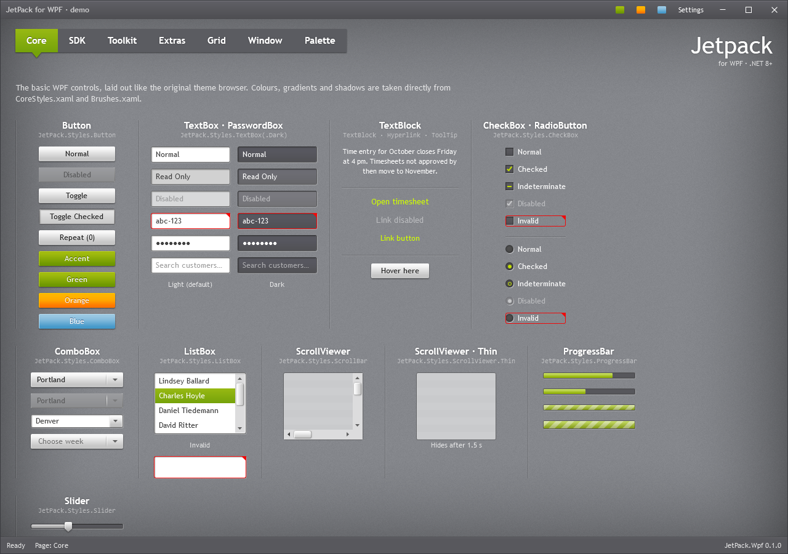

# JetPack for WPF

The JetPack theme from Microsoft's Silverlight 4 Application Themes, rebuilt as a complete controls library for WPF on .NET 8 and later. It follows the same model as MahApps.Metro: one resource dictionary gives every standard control the JetPack look, and the library adds its own controls (window, ToggleSwitch, NumericUpDown, Flyout, HamburgerMenu and more).



**Documentation: [montago.github.io/JetPackTheme](https://montago.github.io/JetPackTheme/)** covers every control, the theme and accents, typography and all resource keys (source in [docs/](docs/README.md)).

## Getting started

Install the [JetPack.Wpf](https://www.nuget.org/packages/JetPack.Wpf) package:

```bash
dotnet add package JetPack.Wpf
```

The package is published to GitHub Packages first; see
[Getting started](https://montago.github.io/JetPackTheme/getting-started.html#from-github-packages) for
adding that feed.

Then merge the dictionary in `App.xaml`:

```xml
<Application.Resources>
    <ResourceDictionary>
        <ResourceDictionary.MergedDictionaries>
            <ResourceDictionary Source="pack://application:,,,/JetPack.Wpf;component/Styles/JetPack.xaml" />
        </ResourceDictionary.MergedDictionaries>
    </ResourceDictionary>
</Application.Resources>
```

Derive your window from `JetPackWindow`:

```xml
<jp:JetPackWindow x:Class="MyApp.MainWindow"
                  xmlns="http://schemas.microsoft.com/winfx/2006/xaml/presentation"
                  xmlns:x="http://schemas.microsoft.com/winfx/2006/xaml"
                  xmlns:jp="urn:jetpack-wpf"
                  Title="My app" TitleBarMode="Dark">
    ...
</jp:JetPackWindow>
```

```csharp
public partial class MainWindow : JetPack.Wpf.Controls.JetPackWindow { ... }
```

`JetPackWindow` options:

| Property | Values |
| --- | --- |
| `TitleBarMode` | `Dark` (default), `Light`, `Texture` |
| `CornerStyle` | `Square` (default, as in the original theme) or `Rounded`. Rounded corners are drawn by the Windows 11 compositor; on Windows 10 the corners stay square. |
| `ShowVignette`, `ShowIcon`, `ShowMinButton`, `ShowMaxRestoreButton` | `bool` |
| `LeftWindowCommands`, `RightWindowCommands`, `Flyouts` | any content |
| `ResizeMode` | `CanResizeWithGrip` adds a dotted grip in the bottom-right corner and resizes only by it; `CanResize` resizes by the edges |

The window has no status bar of its own: dock a `StatusBar` at the bottom of the content, as below.

Two common layouts for the window content:

```xml
<DockPanel>
    <!-- footer -->
    <StatusBar DockPanel.Dock="Bottom">
        <StatusBarItem Content="Ready" />
        <StatusBarItem HorizontalAlignment="Right" Content="Last synced 09:42" />
    </StatusBar>
    <!-- full-width grey navigation bar right under the title bar; Tag goes to its right end -->
    <TabControl Style="{StaticResource JetPack.Styles.TabControl.Navigation}">
        <TabControl.Tag>
            <TextBlock Margin="0,0,16,0" FontSize="15" FontWeight="Bold" Text="My app" />
        </TabControl.Tag>
        <TabItem Header="Companies">...</TabItem>
        <TabItem Header="Orders">...</TabItem>
    </TabControl>
</DockPanel>
```

For the dark tab strip of the original theme browser, use `JetPack.Styles.TabControl.Strip` instead
(the demo can switch between the two under *Settings → Page navigation*). The notch slides to the
selected tab; `jp:TabControlHelper.SelectionAnimation` and `jp:TabControlHelper.ContentTransition="Fade"`
change that and add a cross-fade between pages.

## Theme and accent

```csharp
using JetPack.Wpf.Theming;

ThemeManager.ChangeAccent(JetPackAccent.Orange);            // Green (default), Orange, Blue
ThemeManager.ChangeAccent(Color.FromRgb(0x8E, 0x44, 0xAD)); // generate a full accent from one colour
ThemeManager.ShowFocusVisuals = false;                      // the original's invisible focus
ThemeManager.ControlFontSize = 11;                          // the original's control font size (default: 12)
```

Resource keys follow the MahApps scheme with a `JetPack.` prefix: `JetPack.Brushes.Accent`, `JetPack.Brushes.Accent.Selection`, `JetPack.Brushes.Control.Background`, `JetPack.Styles.Button.Accent` and so on. The *Palette* tab in the demo lists them all.

## What's included

| Group | Controls |
| --- | --- |
| Standard WPF (implicit styles) | Button, RepeatButton, ToggleButton, Hyperlink, TextBox, PasswordBox, RichTextBox, Label, CheckBox, RadioButton, ComboBox, ListBox, ListView/GridView, TreeView, ScrollBar, ScrollViewer, ProgressBar, Slider, ToolTip, GroupBox, Expander, TabControl, Calendar, DatePicker, DataGrid, GridSplitter, Separator, Menu, ContextMenu, ToolBar, StatusBar, ResizeGrip, validation errors |
| Named variants | `Button.Accent/Green/Orange/Blue/Square/Flat/Link`, `TextBox.Dark`, `TextBox.MultiLine(.Dark)`, `PasswordBox.Dark`, `TabControl.Navigation` (the full-width light link bar with the notch), `TabControl.Strip` (the dark tab strip), `Expander.Accordion`, `TextBlock.Heading1–6` |
| Own controls (`jp:`) | JetPackWindow, JetPackDialog, ToggleSwitch, NumericUpDown, SplitButton, DropDownButton, ProgressRing, Badged, Tile, Flyout, HamburgerMenu, InfoBar, RangeSlider, Rating, TimePicker, ColorPicker, AutoSuggestBox, SearchComboBox, JetPackGrid, BusyIndicator, Accordion |
| Helpers | `TextBoxHelper.Watermark`, `TextBoxHelper.ClearTextButton`, `TabControlHelper.SelectionAnimation`, `TabControlHelper.ContentTransition`, `ControlHelper.CornerRadius` and others |

## Demo

```bash
dotnet run --project src/JetPack.Wpf.Demo
```

Two sample applications show the controls together in real screen layouts (see
[Sample apps](https://montago.github.io/JetPackTheme/samples.html)):

```bash
dotnet run --project samples/JetPack.Wpf.Samples.Admin
dotnet run --project samples/JetPack.Wpf.Samples.Portal
```

The demo's `--snapshot <folder>` renders every page to PNG and exits, plus one picture per control in `<folder>/controls`
(from `Views/GalleryPage.xaml`). The images in `docs/screenshots` were made that way.

## Layout

```
src/JetPack.Wpf/
  Assets/            window texture, drawn by tools/generate_backgrounds.py
  Styles/            Brushes, Fonts, Effects, Accents/*, Controls.*.xaml, JetPack.xaml
  Themes/Generic.xaml
  Controls/          own controls
  Helpers/           attached properties and converters
  Theming/           ThemeManager and AccentGenerator
src/JetPack.Wpf.Demo/
samples/             Admin (HamburgerMenu) and Portal (navigation bar) sample apps
docs/                documentation and screenshots
tools/               generate_resource_keys.py (rebuilds docs/resource-keys.md)
design/              the HTML draft the look was approved from
```

## Releasing

Releases are published to nuget.org by `.github/workflows/release.yml` when a version tag is pushed
(`v1.2.3` publishes version 1.2.3):

```bash
git tag -a v1.2.3 -m "JetPack.Wpf 1.2.3"
git push origin v1.2.3
```

The workflow packs `JetPack.Wpf` with the tag's version, pushes it to GitHub Packages (with the
workflow's own token) and creates a GitHub release with the packages attached.

nuget.org uses [Trusted Publishing](https://learn.microsoft.com/nuget/nuget-org/trusted-publishing),
so no API key is stored. To turn it on:

1. On nuget.org, open your user menu → **Trusted Publishing** and add a policy: repository owner
   `Montago`, repository `JetPackTheme`, workflow file `release.yml`, no environment.
2. In the GitHub repository, add the secret `NUGET_USER` with your nuget.org profile name (not the
   e-mail address).

Until `NUGET_USER` exists the nuget.org steps are skipped. The workflow can be re-run for an existing
tag; packages that are already published are skipped and the release assets are replaced. Every push
and pull request is built by `.github/workflows/ci.yml`, which also uploads the package as an artifact.

## License

MIT License (see [LICENSE](LICENSE)). The look follows the JetPack theme in Microsoft's [Silverlight 4 Application Themes](https://www.microsoft.com/en-us/download/details.aspx?id=14590): colours and shadow values come from it, while all WPF styles and both background images (drawn by `tools/generate_backgrounds.py`) are made from scratch. See [NOTICE.md](NOTICE.md) for details.

## Known limitations

- TabControl only supports tabs at the top.
- The DatePicker watermark ("Select a date") comes from WPF's own resources and does not follow the app language.
- There is no built-in chart; the theme provides the `JetPack.Brushes.Chart.1–6` palette for a charting library.
