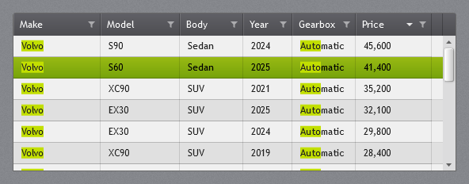

# JetPack for WPF & Web

The JetPack theme from Microsoft's Silverlight 4 Application Themes, rebuilt as a complete controls library for WPF on .NET 8 and later. It follows the same model as MahApps.Metro: one resource dictionary gives every standard control the JetPack look, and the library adds its own controls (window, ToggleSwitch, NumericUpDown, Flyout, HamburgerMenu and more), including a searchable, filterable data grid and a type-ahead combo box (see [Highlights](#highlights)).


**Documentation: [montago.github.io/JetPackTheme](https://montago.github.io/JetPackTheme/)** covers every control, the theme and accents, typography and all resource keys (source in [docs/](docs/README.md)).

## Highlights

### JetPackGrid: a free data grid for large lists



`JetPackGrid` brings the features that usually send WPF developers to a commercial grid such as
Telerik's RadGridView, in a free, MIT-licensed `DataGrid`:

- **Search across all columns.** Every word must match somewhere in the row, every hit is drawn in
  the accent colour on a grey cell, and quotes keep a phrase together: `volvo "dark blue" automatic`.
- **Filter in every column header.** Tick values from a list with row counts, or type them, with `*`
  as a wildcard, and ranges for numbers and dates: `>50000`, `2020-01-01..2020-06-30`. A column of
  dates gets a tree of years, months and days to tick.
- **Grouping** with headers that fold up, **three-state sorting** and **paging**.
- **Virtualized rows and columns**, also while grouping, so thousands of rows in tens of columns
  stay fast. Cells draw their text straight from the font, a check box column draws its JetPack
  check boxes the same way, and dragging the scroll bar shows the rows at the thumb at once.

It derives from `DataGrid`, so columns, bindings, selection and templates work as usual:

```xml
<jp:JetPackGrid ItemsSource="{Binding Cars}" SearchText="{Binding Text, ElementName=Search}"
                GroupMemberPath="Make" PageSize="100">
    <jp:JetPackGrid.Columns>
        <jp:JetPackGridColumn Header="Make" Binding="{Binding Make}" />
        <jp:JetPackGridColumn Header="Body" Binding="{Binding Body}" FilterText="estate suv" />
    </jp:JetPackGrid.Columns>
</jp:JetPackGrid>
```

It is built for searching, filtering and browsing large lists. It does not try to match everything a
commercial suite offers, such as hierarchical child grids or built-in export.
[JetPackGrid documentation](https://montago.github.io/JetPackTheme/lists.html#jetpackgrid)

### SearchComboBox: a light alternative to RadComboBox


`SearchComboBox` is a combo box you can type in, for long lists such as customers or products. It
covers what RadComboBox is most often used for, filtering and autocomplete, without a commercial
licence:

- **Typing filters the drop-down** (`Contains` or `StartsWith`, ignoring case) and completes the
  first match.
- **Virtualized drop-down**, so thousands of items stay fast.
- **The usual bindings:** `ItemsSource`, `SelectedItem`, `SelectedValue` with `SelectedValuePath`,
  `DisplayMemberPath` and `ItemTemplate`.
- **Full keyboard use:** arrow keys, PageUp/PageDown, Enter, Tab and Escape.

```xml
<jp:SearchComboBox ItemsSource="{Binding Companies}" DisplayMemberPath="Name"
                   SelectedValuePath="Id" SelectedValue="{Binding CompanyId}" />
```

[SearchComboBox documentation](https://montago.github.io/JetPackTheme/inputs.html#searchcombobox)

### Mica backdrop on Windows 11


`EnableMica="True"` lets the Windows 11 Mica material show through the JetPack ground. The window
picks up a soft tint from the desktop wallpaper, like the apps that come with Windows, and keeps its
grey texture, vignette and title bar. `GroundOpacity` sets the balance: about 0.75 keeps the classic
JetPack look, and the default of 0.5 shows more Mica.

```xml
<jp:JetPackWindow ... EnableMica="True" GroundOpacity="0.75">
```

It costs next to nothing. The compositor draws Mica from a sampled wallpaper, and the window does
not use `AllowsTransparency`. On Windows 10 and early Windows 11 the window stays opaque.
[Mica documentation](https://montago.github.io/JetPackTheme/window.html#mica-backdrop)

<sub>Telerik, RadGridView and RadComboBox are trademarks of Progress Software Corporation. JetPack for
WPF is not affiliated with or endorsed by Progress.</sub>

## Getting started

Install the [JetPack.Wpf](https://www.nuget.org/packages/JetPack.Wpf) package:

```bash
dotnet add package JetPack.Wpf
```

The package is published to GitHub Packages first; see
[Getting started](https://montago.github.io/JetPackTheme/getting-started.html#from-github-packages) for
adding that feed.

Then merge the dictionary in `App.xaml`:

```xml
<Application.Resources>
    <ResourceDictionary>
        <ResourceDictionary.MergedDictionaries>
            <ResourceDictionary Source="pack://application:,,,/JetPack.Wpf;component/Styles/JetPack.xaml" />
        </ResourceDictionary.MergedDictionaries>
    </ResourceDictionary>
</Application.Resources>
```

Derive your window from `JetPackWindow`:

```xml
<jp:JetPackWindow x:Class="MyApp.MainWindow"
                  xmlns="http://schemas.microsoft.com/winfx/2006/xaml/presentation"
                  xmlns:x="http://schemas.microsoft.com/winfx/2006/xaml"
                  xmlns:jp="urn:jetpack-wpf"
                  Title="My app" TitleBarMode="Dark">
    ...
</jp:JetPackWindow>
```

```csharp
public partial class MainWindow : JetPack.Wpf.Controls.JetPackWindow { ... }
```

`JetPackWindow` options:

| Property | Values |
| --- | --- |
| `TitleBarMode` | `Dark` (default), `Light`, `Texture` |
| `CornerStyle` | `Square` (default, as in the original theme) or `Rounded`. Rounded corners are drawn by the Windows 11 compositor; on Windows 10 the corners stay square. |
| `ShowVignette`, `ShowIcon`, `ShowMinButton`, `ShowMaxRestoreButton` | `bool` |
| `LeftWindowCommands`, `RightWindowCommands`, `Flyouts` | any content |
| `EnableMica`, `GroundOpacity` | Windows 11 Mica backdrop behind the window; `GroundOpacity` (0-1, default 0.5, about 0.75 keeps the JetPack look) sets how much of the ground covers it |
| `ResizeMode` | `CanResizeWithGrip` adds a dotted grip in the bottom-right corner and resizes only by it; `CanResize` resizes by the edges |

The window has no status bar of its own: dock a `StatusBar` at the bottom of the content, as below.

Two common layouts for the window content:

```xml
<DockPanel>
    <!-- footer -->
    <StatusBar DockPanel.Dock="Bottom">
        <StatusBarItem Content="Ready" />
        <StatusBarItem HorizontalAlignment="Right" Content="Last synced 09:42" />
    </StatusBar>
    <!-- full-width grey navigation bar right under the title bar; Tag goes to its right end -->
    <TabControl Style="{StaticResource JetPack.Styles.TabControl.Navigation}">
        <TabControl.Tag>
            <TextBlock Margin="0,0,16,0" FontSize="15" FontWeight="Bold" Text="My app" />
        </TabControl.Tag>
        <TabItem Header="Companies">...</TabItem>
        <TabItem Header="Orders">...</TabItem>
    </TabControl>
</DockPanel>
```

For the dark tab strip of the original theme browser, use `JetPack.Styles.TabControl.Strip` instead
(the demo can switch between the two under *Settings → Page navigation*). The notch slides to the
selected tab; `jp:TabControlHelper.SelectionAnimation` and `jp:TabControlHelper.ContentTransition="Fade"`
change that and add a cross-fade between pages.

## Theme and accent

```csharp
using JetPack.Wpf.Theming;

ThemeManager.ChangeAccent(JetPackAccent.Orange);            // Green (default), Orange, Blue
ThemeManager.ChangeAccent(Color.FromRgb(0x8E, 0x44, 0xAD)); // generate a full accent from one colour
ThemeManager.ShowFocusVisuals = false;                      // the original's invisible focus
ThemeManager.ControlFontSize = 11;                          // the original's control font size (default: 12)
```

Resource keys follow the MahApps scheme with a `JetPack.` prefix: `JetPack.Brushes.Accent`, `JetPack.Brushes.Accent.Selection`, `JetPack.Brushes.Control.Background`, `JetPack.Styles.Button.Accent` and so on. The *Palette* tab in the demo lists them all.

## What's included

Every name links to its section in the [documentation](https://montago.github.io/JetPackTheme/).
Merging `JetPack.xaml` styles the standard controls; the variants in brackets are named styles
(`JetPack.Styles.Button.Accent` and so on), and the last column lists the controls the library adds.

| Area | Standard WPF | Added by JetPack (`jp:`) |
| --- | --- | --- |
| **[Window and dialogs][window]** | [Window][plain-window] (named style), [ResizeGrip][resizegrip] | [JetPackWindow], [JetPackDialog], [Flyout], [Vignette], [DitheredFill][flyout] |
| **[Buttons][buttons]** | [Button] ([Accent, Green, Orange, Blue, Square, Flat, Link][button-variants]), [ToggleButton][togglebutton], [RepeatButton][togglebutton], [Hyperlink] | [SplitButton], [DropDownButton], [Tile], [Badged] |
| **[Text and input][inputs]** | [TextBox] ([Dark][textbox-dark], [MultiLine][textbox-multiline], MultiLine.Dark), [PasswordBox][passwordbox] (Dark), [RichTextBox][passwordbox], [Label], [ComboBox], [DatePicker], [validation errors][validation] | [NumericUpDown], [AutoSuggestBox], [SearchComboBox], [TimePicker], [ColorPicker] |
| **[Selection][selection]** | [CheckBox][checkbox], [RadioButton][checkbox], [Slider] | [ToggleSwitch], [RangeSlider], [Rating] |
| **[Lists and data][lists]** | [ListBox], [ListView/GridView][listview], [TreeView], [DataGrid], [Calendar], [ScrollViewer][scrollviewer] ([Thin][scrollviewer-thin]), [ScrollBar][scrollviewer] | [JetPackGrid] |
| **[Navigation and layout][navigation]** | [TabControl] ([Navigation][tabcontrol-navigation], [Strip][tabcontrol-strip]), [Expander] (Accordion), [GroupBox], [Menu], [ContextMenu][menu], [ToolBar][menu], [StatusBar], [GridSplitter], [Separator][gridsplitter], [ToolTip] | [HamburgerMenu], [Accordion] |
| **[Progress and status][status]** | [ProgressBar] | [ProgressRing], [BusyIndicator], [InfoBar] |
| **[Typography][typography]** | [TextBlock][text-styles] (Heading1–6 and more) | [JetPackIcon] |
| **[Helpers][helpers]** | | [ControlHelper] (corner radius and more), [TextBoxHelper] (watermark, clear button), [ScrollViewerHelper], [TabControlHelper] (notch animation, page transitions), [DataGridHelper] (grid settings for row templates) |

[window]: https://montago.github.io/JetPackTheme/window.html
[plain-window]: https://montago.github.io/JetPackTheme/window.html#plain-window
[resizegrip]: https://montago.github.io/JetPackTheme/window.html#resizing-and-the-grip
[jetpackwindow]: https://montago.github.io/JetPackTheme/window.html#jetpackwindow
[jetpackdialog]: https://montago.github.io/JetPackTheme/window.html#jetpackdialog
[flyout]: https://montago.github.io/JetPackTheme/window.html#flyouts
[vignette]: https://montago.github.io/JetPackTheme/window.html#vignette
[buttons]: https://montago.github.io/JetPackTheme/buttons.html
[button]: https://montago.github.io/JetPackTheme/buttons.html#button
[button-variants]: https://montago.github.io/JetPackTheme/buttons.html#variants
[togglebutton]: https://montago.github.io/JetPackTheme/buttons.html#togglebutton-and-repeatbutton
[hyperlink]: https://montago.github.io/JetPackTheme/buttons.html#hyperlink
[splitbutton]: https://montago.github.io/JetPackTheme/buttons.html#splitbutton
[dropdownbutton]: https://montago.github.io/JetPackTheme/buttons.html#dropdownbutton
[tile]: https://montago.github.io/JetPackTheme/buttons.html#tile
[badged]: https://montago.github.io/JetPackTheme/buttons.html#badged
[inputs]: https://montago.github.io/JetPackTheme/inputs.html
[textbox]: https://montago.github.io/JetPackTheme/inputs.html#textbox
[textbox-dark]: https://montago.github.io/JetPackTheme/inputs.html#dark-variant
[textbox-multiline]: https://montago.github.io/JetPackTheme/inputs.html#multi-line
[passwordbox]: https://montago.github.io/JetPackTheme/inputs.html#passwordbox-and-richtextbox
[label]: https://montago.github.io/JetPackTheme/inputs.html#label
[validation]: https://montago.github.io/JetPackTheme/inputs.html#validation
[combobox]: https://montago.github.io/JetPackTheme/inputs.html#combobox
[numericupdown]: https://montago.github.io/JetPackTheme/inputs.html#numericupdown
[autosuggestbox]: https://montago.github.io/JetPackTheme/inputs.html#autosuggestbox
[searchcombobox]: https://montago.github.io/JetPackTheme/inputs.html#searchcombobox
[datepicker]: https://montago.github.io/JetPackTheme/inputs.html#datepicker
[timepicker]: https://montago.github.io/JetPackTheme/inputs.html#timepicker
[colorpicker]: https://montago.github.io/JetPackTheme/inputs.html#colorpicker
[selection]: https://montago.github.io/JetPackTheme/selection.html
[checkbox]: https://montago.github.io/JetPackTheme/selection.html#checkbox-and-radiobutton
[toggleswitch]: https://montago.github.io/JetPackTheme/selection.html#toggleswitch
[slider]: https://montago.github.io/JetPackTheme/selection.html#slider
[rangeslider]: https://montago.github.io/JetPackTheme/selection.html#rangeslider
[rating]: https://montago.github.io/JetPackTheme/selection.html#rating
[lists]: https://montago.github.io/JetPackTheme/lists.html
[listbox]: https://montago.github.io/JetPackTheme/lists.html#listbox
[listview]: https://montago.github.io/JetPackTheme/lists.html#listview-with-gridview
[treeview]: https://montago.github.io/JetPackTheme/lists.html#treeview
[datagrid]: https://montago.github.io/JetPackTheme/lists.html#datagrid
[jetpackgrid]: https://montago.github.io/JetPackTheme/lists.html#jetpackgrid
[calendar]: https://montago.github.io/JetPackTheme/lists.html#calendar
[scrollviewer]: https://montago.github.io/JetPackTheme/lists.html#scrollviewer-and-scrollbar
[scrollviewer-thin]: https://montago.github.io/JetPackTheme/lists.html#thin-scroll-bars
[navigation]: https://montago.github.io/JetPackTheme/navigation.html
[tabcontrol]: https://montago.github.io/JetPackTheme/navigation.html#tabcontrol
[tabcontrol-navigation]: https://montago.github.io/JetPackTheme/navigation.html#navigation-bar
[tabcontrol-strip]: https://montago.github.io/JetPackTheme/navigation.html#strip
[hamburgermenu]: https://montago.github.io/JetPackTheme/navigation.html#hamburgermenu
[expander]: https://montago.github.io/JetPackTheme/navigation.html#expander
[accordion]: https://montago.github.io/JetPackTheme/navigation.html#accordion
[groupbox]: https://montago.github.io/JetPackTheme/navigation.html#groupbox
[menu]: https://montago.github.io/JetPackTheme/navigation.html#menu-contextmenu-and-toolbar
[statusbar]: https://montago.github.io/JetPackTheme/navigation.html#statusbar
[gridsplitter]: https://montago.github.io/JetPackTheme/navigation.html#gridsplitter-and-separator
[tooltip]: https://montago.github.io/JetPackTheme/navigation.html#tooltip
[status]: https://montago.github.io/JetPackTheme/status.html
[progressbar]: https://montago.github.io/JetPackTheme/status.html#progressbar
[progressring]: https://montago.github.io/JetPackTheme/status.html#progressring
[busyindicator]: https://montago.github.io/JetPackTheme/status.html#busyindicator
[infobar]: https://montago.github.io/JetPackTheme/status.html#infobar
[typography]: https://montago.github.io/JetPackTheme/typography.html
[text-styles]: https://montago.github.io/JetPackTheme/typography.html#text-styles
[jetpackicon]: https://montago.github.io/JetPackTheme/typography.html#icons
[helpers]: https://montago.github.io/JetPackTheme/helpers.html
[controlhelper]: https://montago.github.io/JetPackTheme/helpers.html#controlhelper
[textboxhelper]: https://montago.github.io/JetPackTheme/helpers.html#textboxhelper
[scrollviewerhelper]: https://montago.github.io/JetPackTheme/helpers.html#scrollviewerhelper
[tabcontrolhelper]: https://montago.github.io/JetPackTheme/helpers.html#tabcontrolhelper
[datagridhelper]: https://montago.github.io/JetPackTheme/helpers.html#datagridhelper

## Demo

```bash
dotnet run --project src/JetPack.Wpf.Demo
```

Two sample applications show the controls together in real screen layouts (see
[Sample apps](https://montago.github.io/JetPackTheme/samples.html)):

```bash
dotnet run --project samples/JetPack.Wpf.Samples.Admin
dotnet run --project samples/JetPack.Wpf.Samples.Portal
```

`src/JetPack.Web` is the same look for web sites: CSS classes named after the controls, tokens
generated from the WPF brushes, and a Razor tag helper per control with the WPF property names. It is
the [JetPack.Web](https://www.nuget.org/packages/JetPack.Web) package (`dotnet add package JetPack.Web`),
and it has the JetPackGrid too (`<jp-jetpack-grid>`, with a server mode for paging on the server).
`src/JetPack.Web.Demo` is the WPF demo as a web page, and `samples/JetPack.Web.Samples.Mvc` the admin
sample as an ASP.NET Core MVC site (see [JetPack for the web](https://montago.github.io/JetPackTheme/web.html)):

```bash
dotnet run --project src/JetPack.Web.Demo
dotnet run --project samples/JetPack.Web.Samples.Mvc
```

The demo's `--snapshot <folder>` renders every page to PNG and exits, plus one picture per control in `<folder>/controls`
(from `Views/GalleryPage.xaml`). The images in `docs/screenshots` were made that way.

## Layout

```
src/JetPack.Wpf/
  Assets/            window texture, drawn by tools/generate_backgrounds.py
  Styles/            Brushes, Fonts, Effects, Accents/*, Controls.*.xaml, JetPack.xaml
  Themes/Generic.xaml
  Controls/          own controls
  Helpers/           attached properties and converters
  Theming/           ThemeManager and AccentGenerator
src/JetPack.Wpf.Demo/
src/JetPack.Web/     the web theme (CSS, JavaScript, tag helpers)
src/JetPack.Web.Demo/  the WPF demo as a web page
samples/             Admin (HamburgerMenu) and Portal (navigation bar) sample apps, and the
                     admin sample as an ASP.NET Core MVC site
docs/                documentation and screenshots
tools/               generate_resource_keys.py (rebuilds docs/resource-keys.md),
                     generate_web_tokens.py (the web theme's CSS variables from Styles/),
                     bundle_web_css.py (the web theme's one jetpack.css)
design/              the HTML draft the look was approved from
```

## License

MIT License (see [LICENSE](LICENSE)), except the icons, which are [Material Design Icons](https://pictogrammers.com/library/mdi/) under the Apache License 2.0 (see `icons/`). The look follows the JetPack theme in Microsoft's [Silverlight 4 Application Themes](https://www.microsoft.com/en-us/download/details.aspx?id=14590): colours and shadow values come from it, while all WPF styles and both background images (drawn by `tools/generate_backgrounds.py`) are made from scratch. See [NOTICE.md](NOTICE.md) for details.

## Known limitations

- TabControl only supports tabs at the top.
- The DatePicker watermark ("Select a date") comes from WPF's own resources and does not follow the app language.
- There is no built-in chart; the theme provides the `JetPack.Brushes.Chart.1–6` palette for a charting library.
