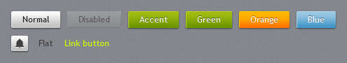
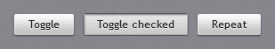
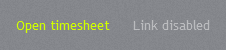
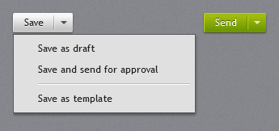
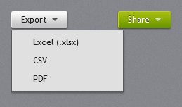
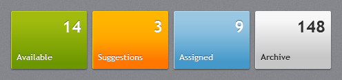
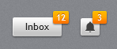

# Buttons

## Button



Every `Button` gets the JetPack chrome: a light gradient slab with a drop shadow, a white top-left
highlight and embossed dark text. Hover lightens it, pressing darkens it, and disabled buttons turn
flat grey.

```xml
<Button Content="Save" />
<Button Content="Save" IsEnabled="False" />
```

### Variants

| Style | Look |
| --- | --- |
| *(implicit)* / `JetPack.Styles.Button` | light grey, dark text |
| `JetPack.Styles.Button.Accent` | the current accent; follows `ThemeManager.ChangeAccent` |
| `JetPack.Styles.Button.Green` | the original GreenButton, always green |
| `JetPack.Styles.Button.Orange` | the original OrangeButton, always orange (good for destructive actions) |
| `JetPack.Styles.Button.Blue` | the original BlueButton, always blue |
| `JetPack.Styles.Button.Square` | 24×22 icon button, no padding |
| `JetPack.Styles.Button.Flat` | no chrome until hovered; used for tool bars |
| `JetPack.Styles.Button.Link` | looks like a hyperlink in the accent link colour |

```xml
<Button Content="Update" Style="{StaticResource JetPack.Styles.Button.Accent}" />
<Button Content="Delete" Style="{StaticResource JetPack.Styles.Button.Orange}" />
<Button Style="{StaticResource JetPack.Styles.Button.Square}" ToolTip="Notifications">
    <Path Width="12" Height="12" Stretch="Uniform" Fill="#FF404040" Data="..." />
</Button>
```

### Custom colours

The button template reads its brushes from `ControlHelper` attached properties, so a new colour is a
style with five setters:

```xml
<Style x:Key="PurpleButton" TargetType="Button" BasedOn="{StaticResource JetPack.Styles.Button}">
    <Setter Property="Foreground" Value="White" />
    <Setter Property="Background" Value="#FF7D3C98" />
    <Setter Property="jp:ControlHelper.MouseOverBackground" Value="#FF9150AD" />
    <Setter Property="jp:ControlHelper.PressedBackground" Value="#FF5E2D73" />
    <Setter Property="jp:ControlHelper.HighlightBrush" Value="#FFB07CC6" />
    <Setter Property="jp:ControlHelper.ContentEffect" Value="{x:Null}" />
</Style>
```

`ControlHelper.CornerRadius` (default 2) rounds the corners.

## ToggleButton and RepeatButton



`ToggleButton` uses the same chrome; when checked it looks pressed into the surface (light grey with an
inner shadow). `RepeatButton` looks like `Button`.

## Hyperlink



`Hyperlink` inside a `TextBlock` uses the accent link colour (bright lime for green) and underlines on
hover. Disabled links turn 45% white.

```xml
<TextBlock><Hyperlink Click="OnOpen">Open timesheet</Hyperlink></TextBlock>
```

## SplitButton



`jp:SplitButton` is a `Button` with a separate arrow part. Clicking the main part raises `Click`;
clicking the arrow opens `Menu` below the button.

```xml
<jp:SplitButton Content="Save" Click="OnSave">
    <jp:SplitButton.Menu>
        <ContextMenu>
            <MenuItem Header="Save as draft" />
            <MenuItem Header="Save and send for approval" />
        </ContextMenu>
    </jp:SplitButton.Menu>
</jp:SplitButton>
```

`JetPack.Styles.SplitButton.Accent` gives the accent colour.

## DropDownButton



`jp:DropDownButton` opens its `Menu` when clicked (it still raises `Click`). The menu is at least as
wide as the button. `JetPack.Styles.DropDownButton.Accent` gives the accent colour.

```xml
<jp:DropDownButton Content="Export">
    <jp:DropDownButton.Menu>
        <ContextMenu>
            <MenuItem Header="Excel (.xlsx)" />
            <MenuItem Header="PDF" />
        </ContextMenu>
    </jp:DropDownButton.Menu>
</jp:DropDownButton>
```

## Tile



`jp:Tile` is a 110×84 button with a large count in the top-right corner and a title bottom-left.
Content, if any, is centred.

```xml
<jp:Tile Title="Available" Count="14" Style="{StaticResource JetPack.Styles.Tile.Green}" Click="OnAvailable" />
```

| Property | Type | Description |
| --- | --- | --- |
| `Title` | `string` | Bottom-left label. |
| `Count` | `object` | Large top-right value. |

Styles: `JetPack.Styles.Tile` (light, the default), `.Accent`, `.Green`, `.Orange`, `.Blue`.

## Badged



`jp:Badged` puts a small orange count badge on the top-right corner of any element:

```xml
<jp:Badged Badge="12">
    <Button Content="Inbox" />
</jp:Badged>
```

| Property | Type | Default | Description |
| --- | --- | --- | --- |
| `Badge` | `object` | `null` | Badge content; the badge is hidden when null. |
| `BadgeBackground` | `Brush` | orange button gradient | |
