# Text and input

## TextBox

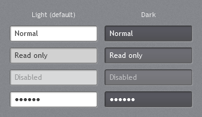

A white field with a 1px border, an inner shadow along the top and left edges and a faint highlight
along the bottom and right. Read-only fields get a light grey overlay; disabled fields fade. When the
field has keyboard focus its border turns the accent colour (see
[focus visuals](theming.md#focus-visuals)).

```xml
<TextBox Text="Contoso Corporation" />
<TextBox Text="Read only" IsReadOnly="True" />
```

### Dark variant

The original theme browser showed every input in a "White" and a "Dark Gray" version:

```xml
<TextBox Style="{StaticResource JetPack.Styles.TextBox.Dark}" Text="Normal" />
<PasswordBox Style="{StaticResource JetPack.Styles.PasswordBox.Dark}" />
```

### Multi-line

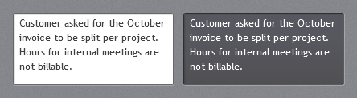

`JetPack.Styles.TextBox.MultiLine` (and `.MultiLine.Dark`) set `AcceptsReturn`, wrapping, top
alignment and a vertical scroll bar:

```xml
<TextBox Style="{StaticResource JetPack.Styles.TextBox.MultiLine.Dark}" Height="170" Text="Notes..." />
```

### Watermark and clear button

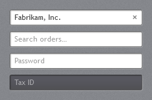

`TextBoxHelper` works on `TextBox`, `PasswordBox` and editable `ComboBox`:

```xml
<TextBox jp:TextBoxHelper.Watermark="Search orders…" jp:TextBoxHelper.ClearTextButton="True" />
<PasswordBox jp:TextBoxHelper.Watermark="Password" />
```

| Attached property | Type | Description |
| --- | --- | --- |
| `TextBoxHelper.Watermark` | `string` | Grey hint shown while the field is empty. |
| `TextBoxHelper.ClearTextButton` | `bool` | Shows a small × while the field has text; clicking it clears the field. |
| `TextBoxHelper.HasText` | `bool` (read-only) | True when the field has text; useful in your own triggers. |

The clear button runs `TextBoxHelper.ClearTextCommand`, which you can also bind to your own buttons
inside a text box template.

### Text context menu

Text boxes get a JetPack-styled cut / copy / paste / select-all menu (`JetPack.ContextMenu.Text`).

## PasswordBox and RichTextBox

`PasswordBox` matches `TextBox`, including watermark and clear button. `RichTextBox` gets the same
frame without the watermark.

## Label

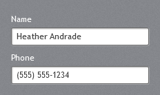

White text in the control font size, with access-key support:

```xml
<Label Content="_Name" Target="{Binding ElementName=NameBox}" />
<TextBox x:Name="NameBox" />
```

## Validation

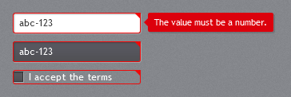

Invalid inputs get a red frame with the folded red corner from the original theme. While the input
has focus, a red call-out to its right shows the first error message. This is
`JetPack.Templates.ValidationError`, set as `Validation.ErrorTemplate` on every input style, so normal
WPF validation (`ValidatesOnDataErrors`, `INotifyDataErrorInfo`, validation rules) just works:

```xml
<TextBox Text="{Binding Phone, ValidatesOnNotifyDataErrors=True, UpdateSourceTrigger=PropertyChanged}" />
```

## ComboBox

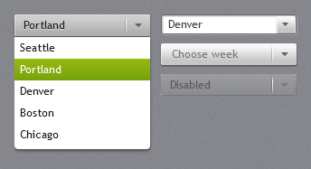

The closed combo box is one raised button with a separator and an arrow; the drop-down is white
with the accent on the selected item.

```xml
<ComboBox SelectedIndex="0">
    <ComboBoxItem Content="Seattle" />
    <ComboBoxItem Content="Portland" />
</ComboBox>
```

- `IsEditable="True"` switches to a white field with a small drop button.
- `jp:TextBoxHelper.Watermark` shows a hint while nothing is selected.
- `MaxDropDownHeight` defaults to 260.

## NumericUpDown

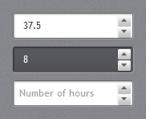

`jp:NumericUpDown` is a number field with stacked up/down buttons. The arrow keys and the mouse wheel
(while focused) step the value; Enter or leaving the field commits typed text.

```xml
<jp:NumericUpDown Value="{Binding Hours}" Minimum="0" Maximum="60" Interval="0.5" StringFormat="N1" />
<jp:NumericUpDown Value="8" Style="{StaticResource JetPack.Styles.NumericUpDown.Dark}" />
```

| Property | Type | Default | Description |
| --- | --- | --- | --- |
| `Value` | `double?` | `null` | Two-way bindable; clamped to the range; empty text sets `null`. |
| `Minimum`, `Maximum` | `double` | `MinValue`, `MaxValue` | |
| `Interval` | `double` | 1 | Step for buttons, arrow keys and wheel. |
| `StringFormat` | `string` | `G` | .NET numeric format, e.g. `N1`, `C`, `0.00`. |
| `IsReadOnly` | `bool` | `false` | Also disables the buttons. |
| `HideUpDownButtons` | `bool` | `false` | |

Event: `ValueChanged` (`RoutedPropertyChangedEventHandler<double?>`). Typed text is parsed with the
current culture; separators and other characters are ignored.

## AutoSuggestBox

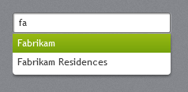

`jp:AutoSuggestBox` suggests entries from `ItemsSource` that contain the typed text (case
insensitive). Down/Up move through the suggestions, Enter or a click picks one, Escape closes the list.

```xml
<jp:AutoSuggestBox ItemsSource="{Binding CompanyNames}" Text="{Binding Company}"
                   jp:TextBoxHelper.Watermark="Search companies…" SuggestionChosen="OnChosen" />
```

| Property | Type | Default | Description |
| --- | --- | --- | --- |
| `Text` | `string` | `""` | Two-way bindable. |
| `ItemsSource` | `IEnumerable` | `null` | Items are matched on `ToString()`. |
| `MaxSuggestions` | `int` | 8 | |

Event: `SuggestionChosen`; `e.OriginalSource` is the chosen item.

## SearchComboBox

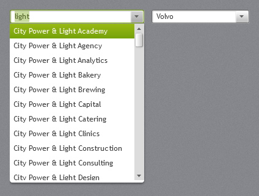

`jp:SearchComboBox` combines a combo box with type-ahead search, for long lists such as companies or
car brands. Open it and click an item, or type to filter the list and complete the word. The
drop-down is virtualized, so lists with thousands of items stay fast.

```xml
<jp:SearchComboBox ItemsSource="{Binding Companies}" DisplayMemberPath="Name"
                   SelectedValuePath="Id" SelectedValue="{Binding CompanyId}"
                   jp:TextBoxHelper.Watermark="Search companies…" />
<jp:SearchComboBox ItemsSource="{Binding CarBrands}" SelectedItem="{Binding Brand}" FilterMode="StartsWith" />
```

- Focusing the box (or typing) opens the list. With no typed text it shows every item, with the
  selected one highlighted.
- Typing filters the list (`Contains` or `StartsWith`, ignoring case) and highlights the first item
  that starts with the text. The rest of that item is filled in and selected, so the next key replaces it.
  Backspace and Delete remove text without completing it again.
- Down/Up and PageDown/PageUp move the highlight and show it in the box; Down, Alt+Down or F4 open a
  closed list.
- Enter, Tab or a click picks the highlighted item. Tab then moves on to the next control as usual.
- Escape closes the list and puts back the selected item's text.
- Leaving the box keeps the highlighted item. Text that matches nothing snaps back to the selected
  item; an empty box clears the selection.

| Property | Type | Default | Description |
| --- | --- | --- | --- |
| `ItemsSource` | `IEnumerable` | `null` | `INotifyCollectionChanged` sources are followed. |
| `SelectedItem` | `object` | `null` | Two-way bindable. |
| `SelectedValue` | `object` | `null` | Two-way bindable; the `SelectedValuePath` member of the selected item. |
| `SelectedValuePath` | `string` | `""` | Without a path, `SelectedValue` is the item itself. |
| `DisplayMemberPath` | `string` | `""` | Text shown, matched and completed (`ToString()` when empty); dotted paths work. |
| `ItemTemplate` | `DataTemplate` | `null` | Template for the drop-down items; the box still shows `DisplayMemberPath`. |
| `FilterMode` | `SearchFilterMode` | `Contains` | `Contains` or `StartsWith`. |
| `IsFilteringEnabled` | `bool` | `true` | When `false`, typing only highlights and completes; the list keeps every item. |
| `IsAutoCompleteEnabled` | `bool` | `true` | Fills in the rest of the first matching item. |
| `OpenOnFocus` | `bool` | `true` | |
| `IsDropDownOpen` | `bool` | `false` | |
| `MaxDropDownHeight` | `double` | 260 | |
| `NoMatchesText` | `string` | `No matches` | Shown in the drop-down when nothing matches. |
| `Text` | `string` | `""` | Read-only: the text in the box. |

Display texts are read once when `ItemsSource` or `DisplayMemberPath` changes (or the collection
raises `CollectionChanged`), so filtering only compares strings.

## DatePicker

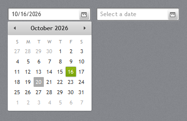

A text box with a calendar button; the drop-down uses the JetPack [`Calendar`](lists.md#calendar).
Date format, month names and the first day of the week follow the app's culture. The watermark
("Select a date") comes from WPF and is English.

```xml
<DatePicker SelectedDate="{Binding StartDate}" />
```

## TimePicker

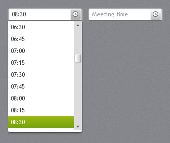

`jp:TimePicker` takes typed times (`8:30`, `8.30`, `8`) and offers a drop-down list in
`MinuteStep` steps. Times show as 24-hour `HH:mm`.

```xml
<jp:TimePicker SelectedTime="{Binding MeetingTime}" MinuteStep="30" jp:TextBoxHelper.Watermark="Meeting time" />
```

| Property | Type | Default |
| --- | --- | --- |
| `SelectedTime` | `TimeSpan?` | `null` |
| `MinuteStep` | `int` | 15 |
| `IsDropDownOpen` | `bool` | `false` |

## ColorPicker

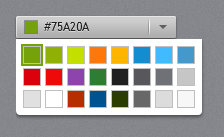

`jp:ColorPicker` looks like a combo box showing the colour and its hex value; the drop-down is a grid
of swatches.

```xml
<jp:ColorPicker SelectedColor="{Binding TagColor}" />
```

| Property | Type | Default | Description |
| --- | --- | --- | --- |
| `SelectedColor` | `Color` | `#75A20A` | Two-way bindable. |
| `Palette` | `IEnumerable` of `Color` | 24 theme colours (`ColorPicker.DefaultPalette`) | |
| `IsDropDownOpen` | `bool` | `false` | |

Combined with `ThemeManager.ChangeAccent(color)` it lets users pick their own accent (the demo does
this under *Settings*).

## Composite inputs and dark styles

`NumericUpDown`, `TimePicker` and `AutoSuggestBox` host a normal `TextBox`. Its style comes from
`jp:ControlHelper.InputStyle`, so any of them can use the dark field:

```xml
<jp:TimePicker jp:ControlHelper.InputStyle="{StaticResource JetPack.Styles.TextBox.Dark}" />
```
