# Lists and data

## ListBox

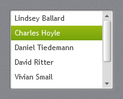

A white list with the same inset frame as text boxes. Hovered items get a light grey band; the
selected item gets the accent selection gradient with white text.

```xml
<ListBox ItemsSource="{Binding Consultants}" DisplayMemberPath="Name" Height="170" />
```

Items have `Padding="6,3"` and stretch horizontally. Virtualisation is on (`CanContentScroll`), except
while grouping.

## ListView with GridView

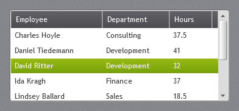

`ListView` looks like `ListBox`; with a `GridView` the column headers use the dark data grid header
gradient.

```xml
<ListView ItemsSource="{Binding Timesheets}">
    <ListView.View>
        <GridView>
            <GridViewColumn Header="Employee" DisplayMemberBinding="{Binding Employee}" Width="150" />
            <GridViewColumn Header="Hours" DisplayMemberBinding="{Binding Hours}" Width="70" />
        </GridView>
    </ListView.View>
</ListView>
```

## TreeView

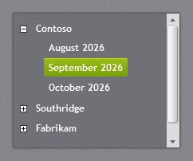

A dark panel (`#707176`) with bold white items, the white +/− expander boxes of the original and the
accent gradient with a highlight line on the selected item.

```xml
<TreeView ItemsSource="{Binding Companies}">
    <TreeView.ItemTemplate>
        <HierarchicalDataTemplate ItemsSource="{Binding Months}">
            <TextBlock Text="{Binding Name}" />
        </HierarchicalDataTemplate>
    </TreeView.ItemTemplate>
</TreeView>
```

Inside another dark panel (such as an accordion section) set `Background="Transparent"` and
`BorderThickness="0"` so the tree blends in, as the *Window* page of the demo does.

## DataGrid

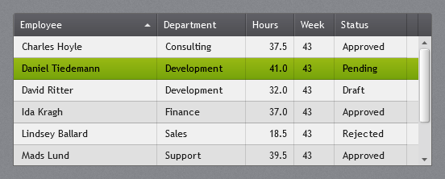

The dark gradient header with a sort arrow, a light grey body with alternating rows and faint grid
lines, a light hover band and the accent gradient on the selected row.

```xml
<DataGrid ItemsSource="{Binding Timesheets}" AutoGenerateColumns="False" IsReadOnly="True">
    <DataGrid.Columns>
        <DataGridTextColumn Header="Employee" Binding="{Binding Employee}" Width="*" />
        <DataGridTextColumn Header="Hours" Binding="{Binding Hours, StringFormat=N1}" Width="60" />
    </DataGrid.Columns>
</DataGrid>
```

Defaults set by the theme: `HeadersVisibility="Column"`, `GridLinesVisibility="All"`,
`AlternatingRowBackground` = `JetPack.Brushes.DataGrid.AlternatingRow`, row header width 14 (when
row headers are shown). With `SelectionUnit="Cell"` the selected cells get the accent instead of the
row. Behaviour (sorting, editing, adding rows) is plain WPF.

### Check boxes and edit fields in cells

`DataGridCheckBoxColumn` shows plain WPF check boxes, not the JetPack ones, and the text box and
combo box that `DataGridTextColumn` and `DataGridComboBoxColumn` open for editing are plain WPF as
well. This is on purpose: a mark in a table only has to be recognisable, and the light standard
check box sits well on the light rows. (The columns set `ElementStyle` and `EditingElementStyle`
themselves, which shuts out the implicit JetPack styles.)

For the JetPack check box in a column, give the column a style based on
`JetPack.Styles.CheckBox.OnLight`, or use a template column, where the implicit style applies:

```xml
<!-- Centred and not focusable, like WPF's own cell check box -->
<Style x:Key="GridCheckBox" TargetType="CheckBox" BasedOn="{StaticResource JetPack.Styles.CheckBox.OnLight}">
    <Setter Property="HorizontalAlignment" Value="Center" />
    <Setter Property="VerticalAlignment" Value="Center" />
    <Setter Property="Focusable" Value="False" />
</Style>

<DataGridCheckBoxColumn Header="Active" Binding="{Binding IsActive}"
                        ElementStyle="{StaticResource GridCheckBox}" EditingElementStyle="{StaticResource GridCheckBox}" />

<DataGridTemplateColumn Header="Active">
    <DataGridTemplateColumn.CellTemplate>
        <DataTemplate>
            <CheckBox IsChecked="{Binding IsActive, UpdateSourceTrigger=PropertyChanged}" HorizontalAlignment="Center" />
        </DataTemplate>
    </DataGridTemplateColumn.CellTemplate>
</DataGridTemplateColumn>
```

The same holds for `JetPackGrid`, which is a `DataGrid`.

## JetPackGrid


`jp:JetPackGrid` is a `DataGrid` for large collections (thousands of rows, tens of columns) that
people need to narrow down. It adds:

- **Search:** `SearchText` holds words that must all be found in a row, in any searchable column
  (ignoring case). Every hit is marked in the cells. Quotes keep a phrase together:
  `volvo "dark blue" automatic`.
- **Value filter per column:** the funnel in a header opens a box for values the column must
  equal. A row passes if it matches any of the values, and every filtered column must pass.
- **Three-state sorting:** clicking a header sorts ascending, then descending, then back to the
  source order. Shift+click sorts by more columns, as in DataGrid.
- **Grouping** by one member (`GroupMemberPath`), with a header row per group that folds up.
- **Paging** (`PageSize`): with more rows than that, the grid shows one page at a time and a pager
  below the rows.
- **Virtualization** of rows and columns, kept on while grouping.
- **Fast scrolling:** the cells draw their text straight from the font, and dragging the scroll bar
  thumb shows the rows at the thumb at once, grouped or not (see [Scrolling](#scrolling)).
- Read-only by default, with no new-item row and no auto-generated columns.

```xml
<TextBox x:Name="Search" jp:TextBoxHelper.Watermark="Search, e.g. volvo estate automatic" jp:TextBoxHelper.ClearTextButton="True" />

<jp:JetPackGrid ItemsSource="{Binding Cars}" SelectedItem="{Binding SelectedCar}"
                SearchText="{Binding Text, ElementName=Search}" GroupMemberPath="{Binding GroupBy}"
                Filtered="OnFiltered" SelectedItemChanged="OnSelectedCarChanged">
    <jp:JetPackGrid.Columns>
        <jp:JetPackGridColumn Header="Make" Binding="{Binding Make}" Width="100" />
        <jp:JetPackGridColumn Header="Body" Binding="{Binding Body}" Width="85" FilterText="estate suv" />
        <jp:JetPackGridColumn Header="Mileage" Binding="{Binding Mileage, StringFormat=N0}" Width="90" IsSearchable="False" />
        <DataGridCheckBoxColumn Header="Sold" Binding="{Binding IsSold}" jp:JetPackGrid.IsFilterable="False" />
    </jp:JetPackGrid.Columns>
</jp:JetPackGrid>
```

The demo's *JetPackGrid* page shows 3,000 cars in 20 columns, searched for `volvo automatic` with the
*Body* column filtered to `estate suv`:

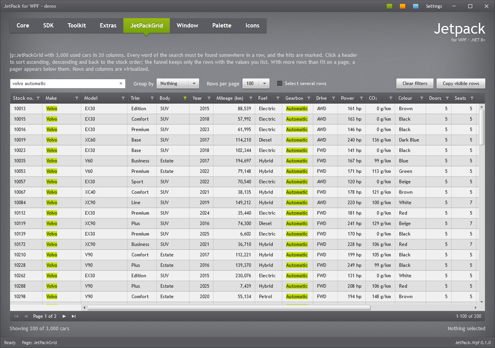

### Header filter

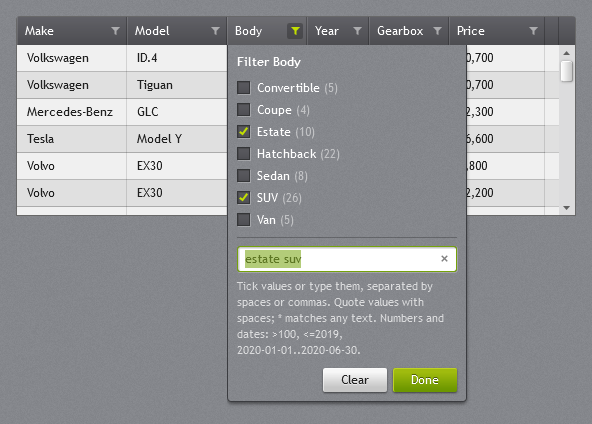

When the box opens, the grid reads the column's values from every row in the source. If there are
at most `FilterListLimit` different values (20 by default), they are listed with their row counts
so you can tick them. This suits columns such as fuel type or body type. A column with more values,
such as model or stock number, only gets the text box. The list and the text follow each other:

- Ticking a value writes it into the text.
- Typing a value ticks it.
- Typed values that are not in the list, such as `vol*`, stay in the text.

Type values separated by spaces, commas or semicolons, for example `estate, suv`. The values are
matched like this:

- A value matches when the cell's text equals it, ignoring case.
- `"land rover"`: quotes keep a value that contains spaces together.
- `vol*`, `*tron` and `*olv*`: a `*` matches any text, so these match text that starts with, ends
  with or contains the value.
- `*` alone matches any cell that is not empty.

The rows are filtered while you type. Enter, Escape or *Done* closes the box, and *Clear* empties
it. A funnel turns accent-coloured while its column has a filter. Code can set the filter through
`FilterText` on the column, which is two-way bindable.

### Groups

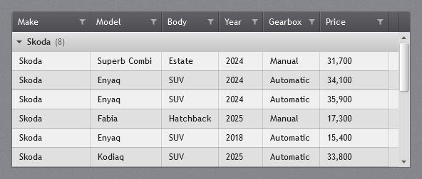

Set `GroupMemberPath` to group the rows by that member. Each group gets a header row with the
value, the group's row count and an arrow. A click on the header folds the group up to it. Folded
groups stay folded through searches, filters, sorting and paging until `GroupMemberPath` changes.
`ExpandAllGroups()` and `CollapseAllGroups()` unfold or fold every group.

The headers are rows of their own. While the grid is grouped, it gives the DataGrid a list of its
own in place of your collection, with a `GridGroupRow` in front of each group's rows. The rows
therefore virtualize and scroll row by row, as without groups, and dragging the thumb shows the
rows at the thumb (see [Scrolling](#scrolling)). While grouped:

- The groups come in the order of their first row. Within a group, the rows keep the sort.
- `Items` holds the headers between the rows, so `SelectedIndex` and `Items.IndexOf` count them.
  `ItemsSource` reads back the grid's list, although your binding still holds your collection.
  `GetVisibleItems()` returns the rows without the headers. Headers are never selected, and the
  arrow keys go past them. Folding a group deselects its rows.
- The grid sorts and filters the rows itself, not your collection's default view. A sort added to
  `Items.SortDescriptions` in code becomes the grid's sort.
- Cells can be edited, but rows cannot be added or deleted through the grid. A row whose group
  value changes moves at the next search or filter, or at `ApplyFilters()`.
- The rows alternate their background within each group.

The header is `JetPack.Styles.JetPackGrid.GroupHeader`, a `ToggleButton` whose DataContext is the
`GridGroupRow` (`Name`, `ItemCount`, `Items`, `IsExpanded`). The header row's template is
`JetPack.Templates.JetPackGrid.GroupRow` (`JetPackGrid.GroupRowTemplateKey`). Put a resource with
either key in your app to change the look. A `GroupStyle` only applies to groups that you add to
`Items.GroupDescriptions` yourself. These are WPF's own groups: they scroll by pixel, and dragging
the thumb scrolls them live.

### Paging

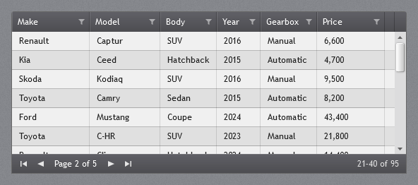

Set `PageSize` to the number of rows per page. The pager appears only when more rows than that pass
the search and the filters, so a short result shows no pager. It has buttons for the first,
previous, next and last page, the page number, and which rows the page holds (`21–40 of 95`).

```xml
<jp:JetPackGrid ItemsSource="{Binding Cars}" PageSize="100" PageIndex="{Binding CarPage}" />
```

- Sorting and grouping apply to all rows, not just the page. The pages are then cut from the
  sorted rows, and a group can continue on the next page.
- A new search, filter or sort goes back to the first page. Rows added to or removed from the source
  keep the current page.
- `FilteredItemCount`, the `Filtered` event and `GetVisibleItems()` count and return the rows of
  every page.
- A row selected on one page is deselected when another page is shown.
- Paging needs an `ItemsSource`, and a view that can filter, so `DataView` rows are not paged.

Paging shortens the list, but each scroll step costs the same as without it. The cost comes from
the rows and cells on screen, not from the number of rows in the source.

### Scrolling

Scrolling costs the same for 3,000 and 100,000 rows: what costs is the rows that come into view.
Two things keep that low:

- **Drawn text.** A `JetPackGridColumn` cell draws its text as glyph runs read straight from the font
  (`GridCellText`), with the search hits marked and an ellipsis where the text is cut. A TextBlock
  lays out every new text through WPF's line formatting, which was most of the cost of a row coming
  into view. Text with characters the font lacks (other scripts, emoji) is drawn with
  `FormattedText`, which falls back to other fonts. Align numbers with the column's `TextAlignment`:
  a column with an `ElementStyle`, and a right-to-left grid, keep the TextBlock.
  `EnableLightweightTextRendering="False"` gives every cell a TextBlock again.
- **Dragging the thumb.** Moving the rows to a far place builds every row again, which cannot keep up
  with a fast drag. While the thumb is dragged, the rows in view therefore stay where they are and
  show the texts of the rows at the thumb, with their selection. When the thumb is released, the
  grid scrolls there for real and looks exactly the same. Content that the grid cannot show for
  another row (other columns, templates) is hidden until the release. The mouse wheel, the keys and
  the scroll bar arrows scroll as usual.

A grouped grid works the same way. Its headers are rows in the list (see [Groups](#groups)), so the
preview moves the rows to where the headers leave room for them, and draws the headers over them.

Rows with details, pixel scrolling (`VirtualizingPanel.ScrollUnit="Pixel"`) and the groups of
`Items.GroupDescriptions` have rows of different heights. There, dragging the thumb scrolls the
rows live.

With the demo's 20 columns and 30,000 rows, a far jump of the thumb costs about 4 ms on the UI thread
instead of about 50 ms, and a page down about 20 ms instead of 45 ms. Grouped by make, a far jump
costs about 6 ms instead of about 100 ms, and a page down costs the same as without groups.

### Grid properties

| Property | Type | Default | Description |
| --- | --- | --- | --- |
| `SearchText` | `string` | `""` | Two-way bindable. Words separated by spaces; each must be found in the row. |
| `SearchDelay` | `TimeSpan` | 300 ms | Debounce: the rows are filtered once the search or a filter has not changed for this long, not on every key. Zero filters at once. |
| `SearchWords` | `IReadOnlyList<string>` | empty | Read-only: the words the rows are filtered by and the cells mark. |
| `FilterListLimit` | `int` | 20 | A header filter lists the values to tick when the column has at most this many different values; 0 never lists them. |
| `GroupMemberPath` | `string` | `null` | Member to group by; empty for no groups. See [Groups](#groups). |
| `IsGrouped` | `bool` | `false` | Read-only: true while `GroupMemberPath` groups the rows, and `Items` holds `GridGroupRow` headers. |
| `HighlightBrush` | `Brush` | `JetPack.Brushes.Accent.Highlight` | Background of the search hits. |
| `HighlightForeground` | `Brush` | `JetPack.Brushes.Control.Foreground` | Text colour of the search hits. |
| `EnableLightweightTextRendering` | `bool` | `true` | `JetPackGridColumn` cells draw their text (`GridCellText`) instead of using a TextBlock; see [Scrolling](#scrolling). |
| `FilteredItemCount` | `int` | 0 | Read-only: rows left after the search and filters. |
| `TotalItemCount` | `int` | 0 | Read-only: rows in the source. |
| `IsFiltered` | `bool` | `false` | Read-only: true while a search or a filter is applied. |
| `PageSize` | `int` | 0 | Rows per page; 0 shows every row. |
| `PageIndex` | `int` | 0 | Two-way bindable: the page shown, from 0. |
| `PageCount` | `int` | 1 | Read-only: number of pages; 1 when not paging. |
| `IsPaging` | `bool` | `false` | Read-only: true when there is more than one page; the pager is shown then. |
| `PageNumber` | `int` | 1 | Read-only: the page shown, from 1, for display. |
| `PageFirstRow`, `PageLastRow` | `int` | 0 | Read-only: numbers (from 1) of the first and last row on the page, among the rows that pass the filters. |

Everything else is DataGrid: `SelectedItem` (two-way), `SelectionMode` (`Single` or `Extended`),
`CanUserResizeColumns`, `FrozenColumnCount`, `IsReadOnly` and so on.

### Column settings

`jp:JetPackGridColumn` is a `DataGridTextColumn` that also marks the search hits. These settings
are properties on it, and attached properties (`jp:JetPackGrid.IsFilterable="False"`) on any other
DataGrid column:

| Property | Type | Default | Description |
| --- | --- | --- | --- |
| `IsSearchable` | `bool` | `true` | Whether the search looks in this column. |
| `IsFilterable` | `bool` | `true` | Whether the header shows the funnel. |
| `FilterText` | `string` | `""` | The values of the header filter; two-way bindable. |
| `FilterMemberPath` | `string` | `null` | Member the search and filter read instead of the binding. |
| `HasFilter` | `bool` | `false` | Read-only: true when `FilterText` holds a value. |
| `FilterOptions` | `IReadOnlyList<GridFilterOption>` | `null` | Read-only: the values in the tick list, read when the filter box opens. `null` when the column has more than `FilterListLimit` values. Each `GridFilterOption` has `Text`, `Count` and `IsChecked`. |

`JetPackGridColumn` also has `TextAlignment` (`Left` by default; `Right` for numbers). Use it rather
than an `ElementStyle`, which turns the drawn text off for the column. A cell's content is a
`GridCellText` (its `Text` is the text shown) unless the column falls back to a TextBlock.

The search and the filter compare the text the cell shows. They read the column's `Binding`,
including its `StringFormat` and `Converter`. A column without a binding (such as a
`DataGridTemplateColumn`) uses `FilterMemberPath` or `SortMemberPath`. Paths can be dotted
(`Owner.Name`), but indexers are not followed. Only `JetPackGridColumn` cells mark the hits; other
columns are still searched.

### Events and methods

| Member | Description |
| --- | --- |
| `Filtered` event | After the rows have been filtered. The `GridFilteredEventArgs` give the rows left (`e.Count`) and in all (`e.TotalCount`). |
| `SelectedItemChanged` event | When `SelectedItem` changes. Unlike `SelectionChanged`, it is not raised by combo boxes inside cells. |
| `GetVisibleItems()` | The rows left after the search and filters, in the order shown (sorted, grouped), for example to export them. With paging, the rows of every page; with groups, also the rows of folded groups, and no headers. |
| `ExpandAllGroups()`, `CollapseAllGroups()` | Unfold or fold every group. |
| `ClearFilters()` | Clears the search and every column filter. |
| `ApplyFilters()` | Filters at once instead of after `SearchDelay`, and goes back to the first page. Also re-reads values that changed in the items. |
| `ClearFilterCommand` | Routed command. With a column as parameter it clears that column's filter; without one it clears everything. Use `CommandTarget` to point a button outside the grid at it. |
| `FirstPageCommand`, `PreviousPageCommand`, `NextPageCommand`, `LastPageCommand` | Routed commands the pager uses; they can also drive a pager of your own (with `CommandTarget`). |

Notes:

- The filter works on the collection's default view, like DataGrid sorting does. Two grids bound to
  the same list therefore share their filter. Give each grid its own list or `CollectionViewSource`.
  A grouped grid filters a list of its own instead.
- A row is filtered when it is added or when the search or a filter changes. A value that changes
  later in an item does not move the row until the next change, or until you call `ApplyFilters()`.
- `DataTable` views (`BindingListCollectionView`) cannot filter by predicate, so a `DataView` is not
  filtered. Convert the rows to objects first.

## Calendar

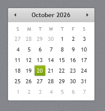

A white card with a light grey header strip, the month and arrows in it, small grey day names, today
in grey and the selected date in the accent gradient. Month and year views use the same look.

```xml
<Calendar SelectedDate="{Binding Day}" />
```

Month and day names and the first day of the week follow the app's culture. WPF formats with en-US
unless you override `FrameworkElement.LanguageProperty` at startup:

```csharp
FrameworkElement.LanguageProperty.OverrideMetadata(typeof(FrameworkElement),
    new FrameworkPropertyMetadata(XmlLanguage.GetLanguage(CultureInfo.CurrentCulture.IetfLanguageTag)));
```

## ScrollViewer and ScrollBar

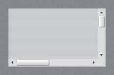

Scroll bars are 16px with a light grey track, small grey arrows and the light gradient thumb with a
white top edge from the original theme. All `ScrollViewer`s, including the ones inside text boxes and
lists, use them.

### Thin scroll bars

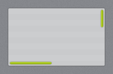

`JetPack.Styles.ScrollViewer.Thin` is a modern alternative: a slim rounded thumb in the accent
gradient with a soft shadow, no arrows and no track. The bars lie over the content instead of taking
space beside it. They are 12px wide to grab, the thumb is 5px and grows to 8px with a faint track
under the mouse. They fade in when the content scrolls or the mouse moves over the scroll viewer, and
fade out again after `ScrollViewerHelper.AutoHideDelay` (1.5 seconds) without activity. They stay while
the mouse is on a bar or a thumb is being dragged. The demo uses it for its pages.

```xml
<ScrollViewer Style="{StaticResource JetPack.Styles.ScrollViewer.Thin}"
              jp:ScrollViewerHelper.AutoHideDelay="0:0:3">
    ...
</ScrollViewer>
```

Set `jp:ScrollViewerHelper.AutoHide="False"` to keep the bars visible. To use the thin bars
everywhere, add an implicit style after the JetPack dictionary:

```xml
<Style TargetType="ScrollViewer" BasedOn="{StaticResource JetPack.Styles.ScrollViewer.Thin}" />
```

The bars cover the whole scroll viewer, padding included, so a right `Padding` of 12 keeps a free lane
for them when content runs to the edge (the demo pages use `Padding="0,22,12,0"`). The
`ScrollBar` style alone is `JetPack.Styles.ScrollBar.Thin`. The implicit style also reaches the scroll
viewers inside list and text box templates; `DataGrid` and `JetPackGrid` keep their own.
