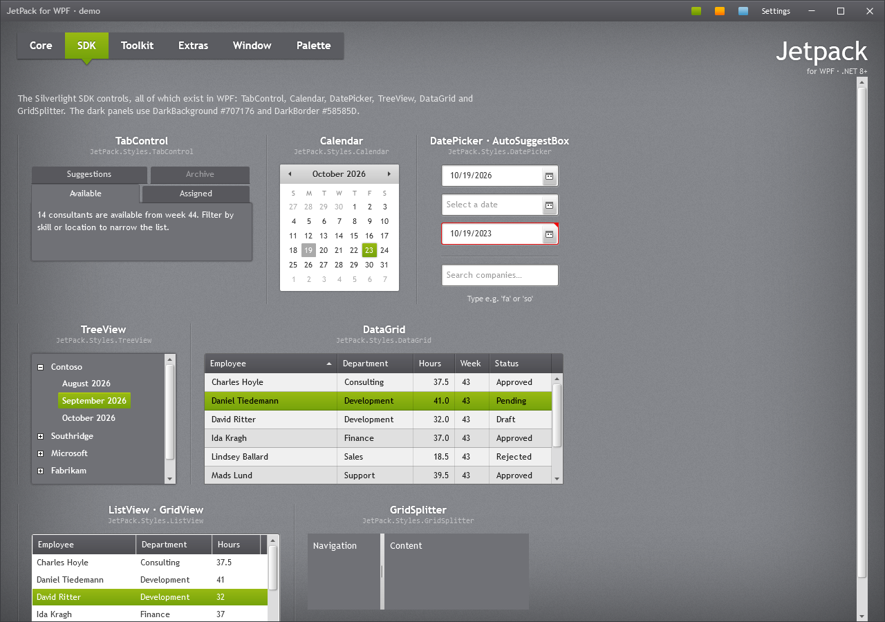

# Lists and data



## ListBox

A white list with the same inset frame as text boxes. Hovered items get a light grey band; the
selected item gets the accent selection gradient with white text.

```xml
<ListBox ItemsSource="{Binding Consultants}" DisplayMemberPath="Name" Height="170" />
```

Items have `Padding="6,3"` and stretch horizontally. Virtualisation is on (`CanContentScroll`), except
while grouping.

## ListView with GridView

`ListView` looks like `ListBox`; with a `GridView` the column headers use the dark data grid header
gradient.

```xml
<ListView ItemsSource="{Binding Timesheets}">
    <ListView.View>
        <GridView>
            <GridViewColumn Header="Employee" DisplayMemberBinding="{Binding Employee}" Width="150" />
            <GridViewColumn Header="Hours" DisplayMemberBinding="{Binding Hours}" Width="70" />
        </GridView>
    </ListView.View>
</ListView>
```

## TreeView

A dark panel (`#707176`) with bold white items, the white +/− expander boxes of the original and the
accent gradient with a highlight line on the selected item.

```xml
<TreeView ItemsSource="{Binding Companies}">
    <TreeView.ItemTemplate>
        <HierarchicalDataTemplate ItemsSource="{Binding Months}">
            <TextBlock Text="{Binding Name}" />
        </HierarchicalDataTemplate>
    </TreeView.ItemTemplate>
</TreeView>
```

Inside another dark panel (such as an accordion section) set `Background="Transparent"` and
`BorderThickness="0"` so the tree blends in, as the *Window* page of the demo does.

## DataGrid

The dark gradient header with a sort arrow, a light grey body with alternating rows and faint grid
lines, a light hover band and the accent gradient on the selected row.

```xml
<DataGrid ItemsSource="{Binding Timesheets}" AutoGenerateColumns="False" IsReadOnly="True">
    <DataGrid.Columns>
        <DataGridTextColumn Header="Employee" Binding="{Binding Employee}" Width="*" />
        <DataGridTextColumn Header="Hours" Binding="{Binding Hours, StringFormat=N1}" Width="60" />
    </DataGrid.Columns>
</DataGrid>
```

Defaults set by the theme: `HeadersVisibility="Column"`, `GridLinesVisibility="All"`,
`AlternatingRowBackground` = `JetPack.Brushes.DataGrid.AlternatingRow`, row header width 14 (when
row headers are shown). With `SelectionUnit="Cell"` the selected cells get the accent instead of the
row. Behaviour (sorting, editing, adding rows) is plain WPF.

## Calendar

A white card with a light grey header strip, the month and arrows in it, small grey day names, today
in grey and the selected date in the accent gradient. Month and year views use the same look.

```xml
<Calendar SelectedDate="{Binding Day}" />
```

Month and day names and the first day of the week follow the app's culture. WPF formats with en-US
unless you override `FrameworkElement.LanguageProperty` at startup:

```csharp
FrameworkElement.LanguageProperty.OverrideMetadata(typeof(FrameworkElement),
    new FrameworkPropertyMetadata(XmlLanguage.GetLanguage(CultureInfo.CurrentCulture.IetfLanguageTag)));
```

## ScrollViewer and ScrollBar

Scroll bars are 16px with a light grey track, small grey arrows and the light gradient thumb with a
white top edge from the original theme. All `ScrollViewer`s, including the ones inside text boxes and
lists, use them.
