# Navigation and layout

## TabControl

There are three looks.

### Panel tabs (default)

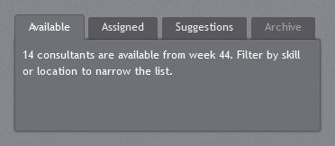

The SDK `TabControl`: dark tabs on a dark panel (`#707176`) with a soft shadow. The selected tab
merges into the panel; unselected tabs are a shade darker. Page content is white text.

```xml
<TabControl>
    <TabItem Header="Available">...</TabItem>
    <TabItem Header="Assigned">...</TabItem>
</TabControl>
```

### Navigation bar

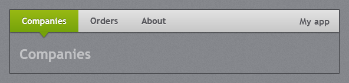

`JetPack.Styles.TabControl.Navigation` is the light link bar of the original navigation template:
a full-width grey bar with bold links, the selected link in the accent gradient with a small notch
pointing down at the page. The first link sits flush with the left edge, so put it directly under the
title bar. `Tag` is shown at the right end of the bar (branding, search, user).

```xml
<TabControl Style="{StaticResource JetPack.Styles.TabControl.Navigation}">
    <TabControl.Tag>
        <TextBlock Margin="0,0,16,0" FontSize="15" FontWeight="Bold" Text="My app" />
    </TabControl.Tag>
    <TabItem Header="Companies">...</TabItem>
    <TabItem Header="Orders">...</TabItem>
</TabControl>
```

### Strip

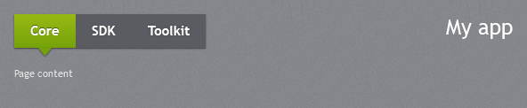

`JetPack.Styles.TabControl.Strip` is the dark tab strip from the original theme browser (Core / SDK /
Toolkit / Charts), with white links and the same accent notch. `Tag` is shown at the right, outside
the strip. The demo uses it for its pages.

```xml
<TabControl Style="{StaticResource JetPack.Styles.TabControl.Strip}" Margin="24,16,24,0">
    <TabItem Header="Core">...</TabItem>
</TabControl>
```

All three support only `TabStripPlacement="Top"`.

### Notch animation and page transitions

The notch of the navigation bar and the strip moves to the selected tab. With
`jp:TabControlHelper.SelectionAnimation` it slides along the bar and settles with a small overshoot
(`Slide`, the default), pulls up into the bar and drops down under the new tab (`Drop`), or jumps
straight there (`None`).

Pages change at once by default. `jp:TabControlHelper.ContentTransition="Fade"` cross-fades from the
old page to the new one. It works with all three TabControl styles. The notch and the fade start once
the new page has been drawn, so a heavy page does not eat their first frames; until then the old page
stays in place.

```xml
<TabControl Style="{StaticResource JetPack.Styles.TabControl.Strip}"
            jp:TabControlHelper.SelectionAnimation="Drop"
            jp:TabControlHelper.ContentTransition="Fade">
    ...
</TabControl>
```

The demo's settings flyout switches between them.

## HamburgerMenu

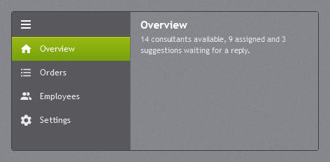

`jp:HamburgerMenu` is a `ListBox` with a dark pane on the left and a content area on the right. The
selected item gets the accent gradient. The ☰ button collapses the pane to icons.

```xml
<jp:HamburgerMenu SelectedIndex="0" Content="{Binding SelectedItem.Tag, RelativeSource={RelativeSource Self}}">
    <jp:HamburgerMenu.ContentTemplate>
        <DataTemplate>
            <ContentPresenter Content="{Binding}" />
        </DataTemplate>
    </jp:HamburgerMenu.ContentTemplate>
    <jp:HamburgerMenuItem Content="Overview" Tag="{StaticResource OverviewPage}">
        <jp:HamburgerMenuItem.Icon>
            <jp:JetPackIcon Kind="Home" />
        </jp:HamburgerMenuItem.Icon>
    </jp:HamburgerMenuItem>
</jp:HamburgerMenu>
```

| Property | Type | Default | Description |
| --- | --- | --- | --- |
| `Content` | `object` | `null` | What the content area shows; usually bound to the selected item. |
| `ContentTemplate` | `DataTemplate` | `null` | |
| `IsPaneOpen` | `bool` | `true` | Two-way bindable; false shows only icons. |
| `PaneWidth` | `double` | 170 | |
| `CompactPaneWidth` | `double` | 40 | |

`HamburgerMenuItem` adds `Icon` (any element, 18×18; a `jp:JetPackIcon` there is drawn at 18×18, where its 24×24 grid scales by 3/4 and stays sharper than at 16). With `ItemsSource`, items are wrapped in
`HamburgerMenuItem` containers automatically.

## Expander

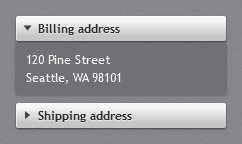

The header is a raised light bar with a bold label and an arrow that turns down when open; the body is
a dark panel with a soft shadow.

```xml
<Expander Header="Billing address" IsExpanded="True">
    <TextBlock Text="120 Pine Street&#10;Seattle, WA 98101" />
</Expander>
```

`JetPack.Styles.Expander.Accordion` is a flush variant (square header, no gap) used by `Accordion`.
Only `ExpandDirection="Down"` is styled.

## Accordion

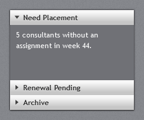

`jp:Accordion` stacks expanders in one framed panel; opening one closes the others. Given a fixed or
stretched height, the open section fills the space the closed headers leave, so those headers sit at
the bottom (as in the Toolkit Accordion). With unlimited height it simply stacks.

```xml
<jp:Accordion VerticalAlignment="Stretch">
    <Expander Header="Need Placement" IsExpanded="True">
        <TreeView Background="Transparent" BorderThickness="0" ItemsSource="{Binding Companies}" />
    </Expander>
    <Expander Header="Renewal Pending">...</Expander>
    <Expander Header="Archive">...</Expander>
</jp:Accordion>
```

Items that are not `Expander`s are wrapped in one. The layout comes from `jp:AccordionPanel`, which
you can also use as the `ItemsPanel` of your own items control.

## GroupBox

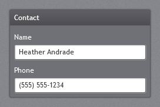

A dark panel with a dark gradient header strip and bold white header text.

```xml
<GroupBox Header="Contact">
    <StackPanel>...</StackPanel>
</GroupBox>
```

## Menu, ContextMenu and ToolBar

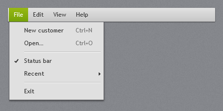

- `Menu`: a light grey bar with a drop shadow; open and hovered top-level items get the accent gradient.
- Menu drop-downs and `ContextMenu`: light grey (`#E0E0E0`) panels with a dark border and shadow, an
  icon/check column, right-aligned shortcut text and two-tone separators. Highlighted items use the
  accent gradient.
- `ToolBar`: a light grey bar with a grip and an overflow button. Buttons and toggle buttons in it are
  flat until hovered; check boxes, radio buttons, text boxes and combo boxes get tool-bar sizes.

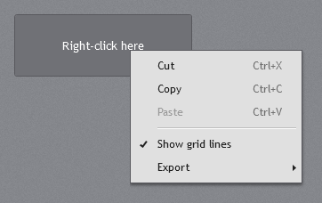

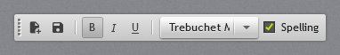

```xml
<Menu>
    <MenuItem Header="_File">
        <MenuItem Header="_New customer" InputGestureText="Ctrl+N" />
        <Separator />
        <MenuItem Header="E_xit" />
    </MenuItem>
</Menu>

<ToolBarTray>
    <ToolBar>
        <Button ToolTip="Save"><Path ... /></Button>
        <Separator />
        <ToggleButton IsChecked="True" ToolTip="Bold"><TextBlock FontWeight="Bold" Text="B" /></ToggleButton>
    </ToolBar>
</ToolBarTray>
```

## StatusBar

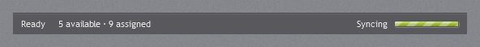

A dark grey bar with a light line along its top and small light text. Items are 16px apart and the
outer ones 10px from the edges. Dock it at the bottom of the window for the footer of the original
navigation template:

```xml
<StatusBar DockPanel.Dock="Bottom">
    <StatusBarItem Content="Ready" />
    <StatusBarItem Content="5 available · 9 assigned" />
    <StatusBarItem HorizontalAlignment="Right" Content="Last synced 09:42" />
</StatusBar>
```

Use `DockPanel.Dock="Right"` on items for more than one at the right end. In a window with
`ResizeMode="CanResizeWithGrip"` the bar gets extra right padding for the grip. See
[Status bar](window.md#status-bar) for the window footer.

## GridSplitter and Separator

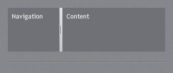

`GridSplitter` is a light grey bar with a dotted grip. `Separator` is a two-tone line (dark over light)
that reads as an engraved rule on the texture.

## ToolTip

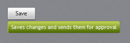

Tool tips use the accent button gradient with a light overlay, a highlighted top edge and white small
text, as in the original theme. They follow the accent.
