# Sample apps

Two small applications in [`samples/`](https://github.com/Montago/JetPackTheme/tree/master/samples) show
how the controls fit together in a real screen layout. They contain no back end: each page is a
`UserControl` in `Views/` with fixed sample data from `SampleData.cs`, so the XAML can be read on its
own.

```bash
dotnet run --project samples/JetPack.Wpf.Samples.Admin
dotnet run --project samples/JetPack.Wpf.Samples.Portal
```

Both use the same structure:

| File | Contents |
| --- | --- |
| `App.xaml` | Merges `JetPack.xaml` and defines a few page styles (`Page.Title`, `Page.Toolbar`, `Form.Label`, ...). |
| `MainWindow.xaml` | The shell: `JetPackWindow` with window commands, the navigation and a `StatusBar`. |
| `Views/*.xaml` | One `UserControl` per page. |
| `SampleData.cs` | Records and static lists the pages bind to. |

Pages move to another page with `NavigationCommands.GoToPage` and the page name as
`CommandParameter`; the window handles the command. A tile on the dashboard is just
`<jp:Tile Command="NavigationCommands.GoToPage" CommandParameter="Timesheets" ... />`.

## Administration app (HamburgerMenu)

`JetPack.Wpf.Samples.Admin` is a back-office app for a staffing company with the navigation in a
`HamburgerMenu` on the left. Each `HamburgerMenuItem` holds its page in `Tag`, and the menu's content
area shows the selected one:

```xml
<jp:HamburgerMenu PaneWidth="190" SelectedIndex="0"
                  Content="{Binding SelectedItem.Tag, RelativeSource={RelativeSource Self}}">
    <jp:HamburgerMenuItem Content="Dashboard">
        <jp:HamburgerMenuItem.Icon>
            <Path Style="{StaticResource Navigation.Icon}" Data="{StaticResource Icon.Dashboard}" />
        </jp:HamburgerMenuItem.Icon>
        <jp:HamburgerMenuItem.Tag>
            <v:DashboardView />
        </jp:HamburgerMenuItem.Tag>
    </jp:HamburgerMenuItem>
    ...
</jp:HamburgerMenu>
```

**Dashboard**: `InfoBar` with an action button, `Tile`s that open other pages, and two `GroupBox`es
with project budgets (`ProgressBar`) and recent activity.

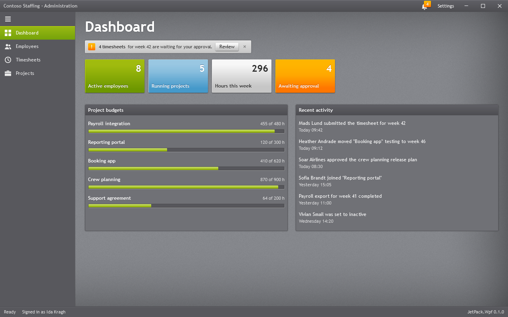

**Employees**: a filter bar (`TextBox` with watermark and clear button, `ComboBox`, `ToggleSwitch`)
over a `DataGrid`; the details form beside it binds to the selected row (`Label`, `TextBox`,
`ComboBox`, `DatePicker`, `NumericUpDown`, `ToggleSwitch`). The filter is a plain `ICollectionView`
filter in the code-behind.

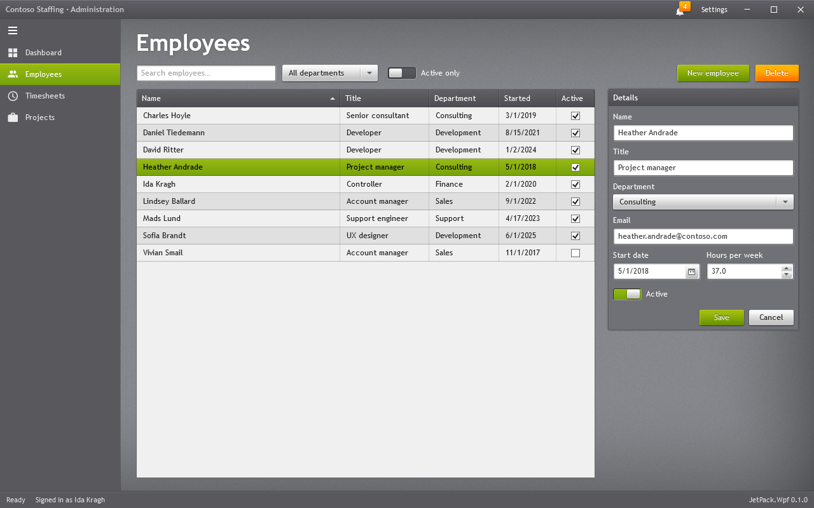

**Delete** asks with a `JetPackDialog` that has an orange confirm button:

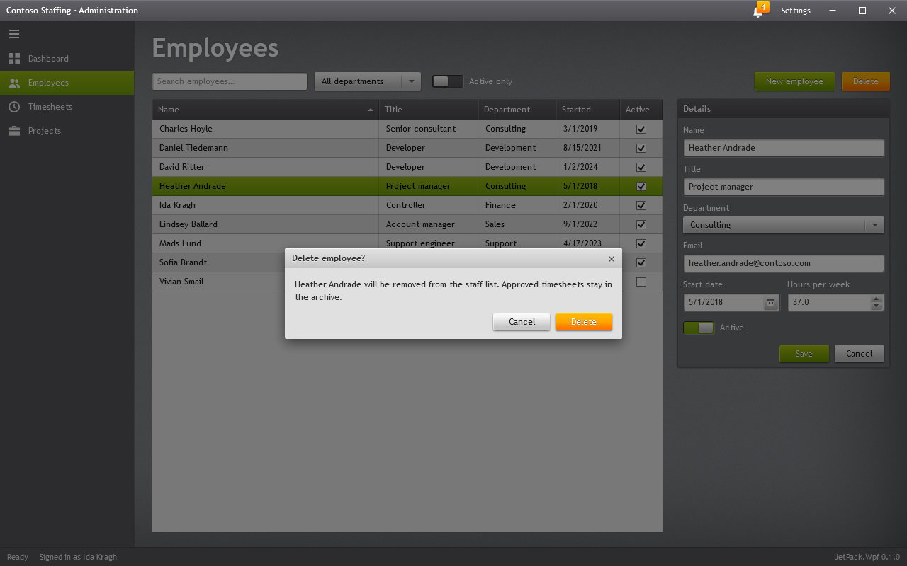

**Timesheets**: week and status `ComboBox`es, a `SplitButton` and a `DropDownButton` with menus, a
read-only `DataGrid` with a status column built from a `DataTemplate`, and a summary line.

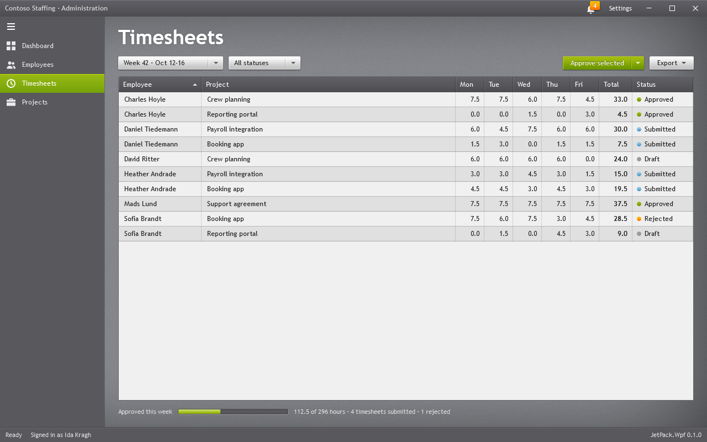

**Projects**: a `TreeView` of customers and projects. The right side is a `ContentControl` bound to
the tree's `SelectedItem`; implicit `DataTemplate`s show a customer (`ListView`) or a project
(`GroupBox`, `ProgressBar`, `Rating`, `Expander`).

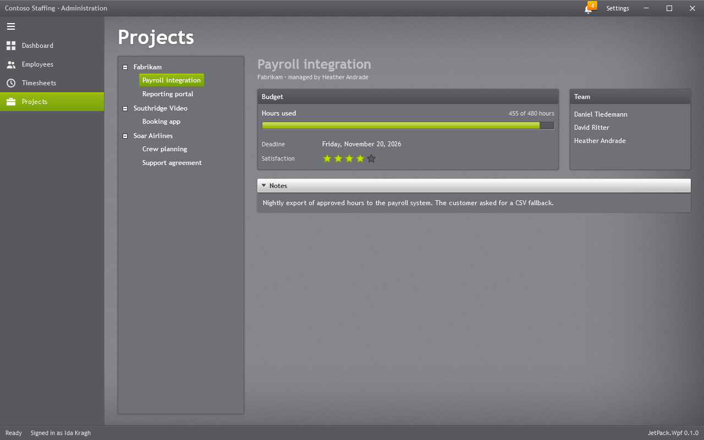

The title bar has a `Badged` notification button and a **Settings** button that opens a `Flyout` with
the accent, the navigation pane width (bound to `HamburgerMenu.IsPaneOpen`) and focus visuals.

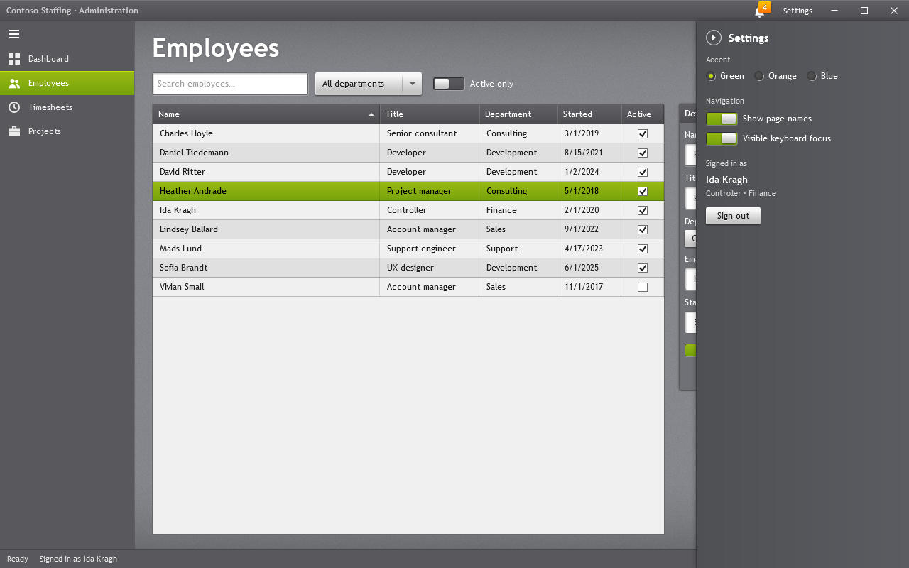

## Sales portal (navigation bar)

`JetPack.Wpf.Samples.Portal` follows the Silverlight navigation application template: the light
navigation bar (`JetPack.Styles.TabControl.Navigation`) runs edge to edge under the title bar, with
the brand in its `Tag`, and every tab holds one page.

```xml
<TabControl x:Name="Pages" Style="{StaticResource JetPack.Styles.TabControl.Navigation}">
    <TabControl.Tag>
        <TextBlock FontSize="20" FontWeight="Bold" Text="Northwind" Margin="0,0,16,0" />
    </TabControl.Tag>
    <TabItem Header="Home"><v:HomeView /></TabItem>
    <TabItem Header="Products"><v:ProductsView /></TabItem>
    ...
</TabControl>
```

**Home**: a greeting, an `InfoBar`, `Tile`s and two `GroupBox`es with a `ListView` and read-only
`Rating`s.

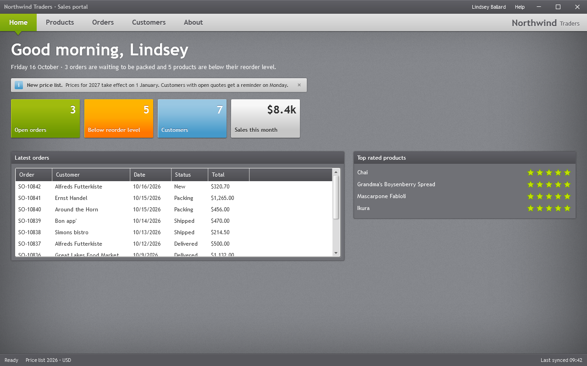

**Products**: search and category filter over a `ListBox` with an item template; the details show a
low-stock `InfoBar`, `NumericUpDown`s, `Rating`, `CheckBox`, an `Expander` and a `SplitButton`.

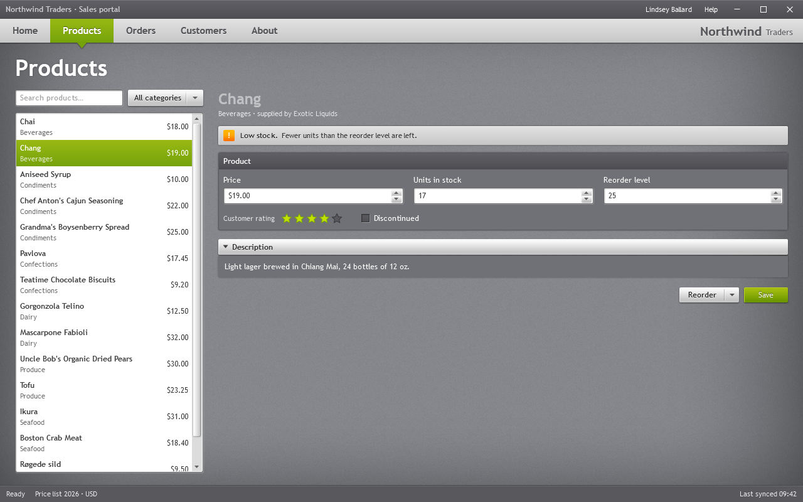

**Orders**: a filter bar with `DatePicker`s, `ComboBox` and `AutoSuggestBox`, a `DataGrid` of orders and
an `Expander` with the lines of the selected order in a `ListView`.

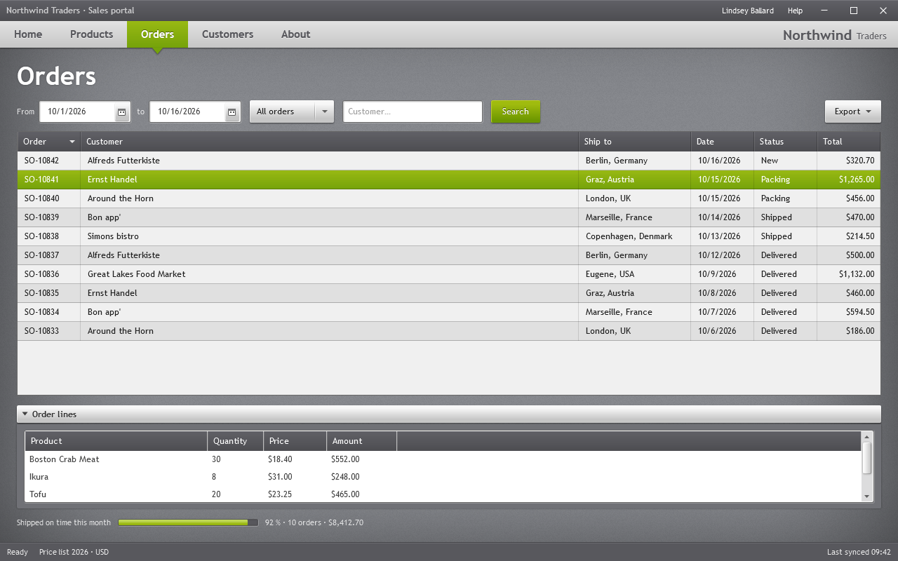

**Customers**: the "Companies" screen of the original template: an `Accordion` with a `TreeView`, and
a panel `TabControl` with dark text boxes for the selected customer.

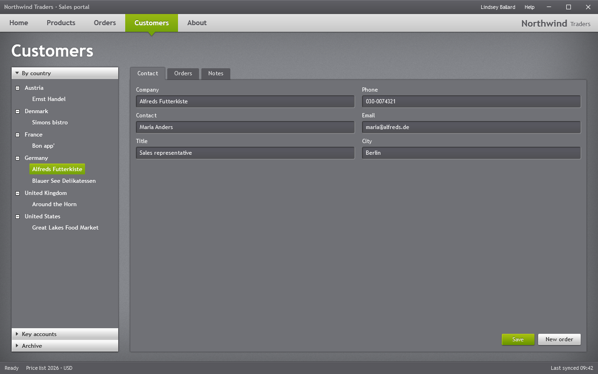

**About**: heading styles, body text, a `Separator` and a `Hyperlink`.

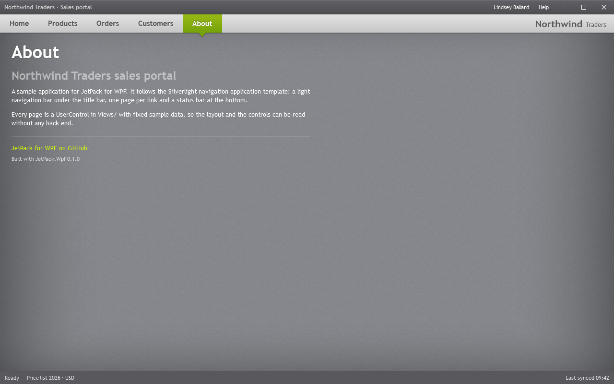

## Screenshots

Both apps accept `--snapshot <folder>`: they render every page to PNG and exit. The pictures on this
page were made that way.
