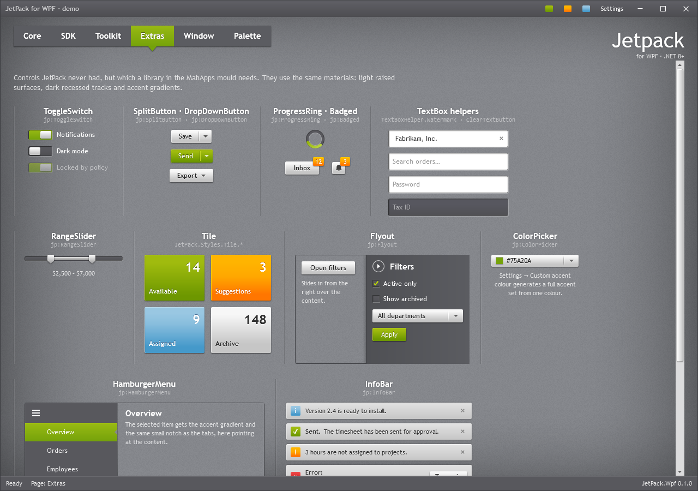

# Selection

## CheckBox and RadioButton

A dark 12px box (or circle) with a 1px dark border, an inner shadow and a faint outer highlight. The
check mark and the radio dot use the accent highlight colour (bright lime for green). Hover adds an
accent ring inside the box. `IsThreeState` shows a short bar (check box) or a ring (radio button) for
the indeterminate state.

```xml
<CheckBox Content="Keep Active" IsChecked="True" />
<CheckBox Content="Partly selected" IsThreeState="True" IsChecked="{x:Null}" />
<RadioButton Content="Weekly" GroupName="Interval" IsChecked="True" />
```

The label is white for use on the texture or dark panels. On light surfaces (menus, dialogs, tool
bars) use the dark-text variants:

```xml
<CheckBox Style="{StaticResource JetPack.Styles.CheckBox.OnLight}" Content="Show grid lines" />
<RadioButton Style="{StaticResource JetPack.Styles.RadioButton.OnLight}" Content="Landscape" />
```

Check boxes and radio buttons inside a `ToolBar` use the dark text automatically.

## ToggleSwitch

`jp:ToggleSwitch` is a `ToggleButton` drawn as a dark recessed track with a light sliding knob; the
track fills with the accent selection gradient when on. `Content` is the label to the right.

```xml
<jp:ToggleSwitch Content="Notifications" IsChecked="{Binding NotificationsOn}" />
```

Use `IsChecked`, `Checked` and `Unchecked` as on any toggle button.

## Slider

The track is a dark recessed bar; the part below the value is a light grey bar, and the thumb is the
pointed light thumb of the original theme. Horizontal and vertical are both supported, with tick
marks on either side.

```xml
<Slider Maximum="10" Value="4" />
<Slider Maximum="10" TickPlacement="BottomRight" TickFrequency="1" IsSnapToTickEnabled="True" />
<Slider Orientation="Vertical" Height="96" Maximum="10" Value="3" />
```

`IsMoveToPointEnabled` is on: clicking the track moves the thumb there.

## RangeSlider

`jp:RangeSlider` selects a range with two thumbs. Drag a thumb, or focus it and use the arrow keys.

```xml
<jp:RangeSlider Minimum="0" Maximum="10000" LowerValue="{Binding MinPrice}" UpperValue="{Binding MaxPrice}" SmallChange="100" />
```

| Property | Type | Default | Description |
| --- | --- | --- | --- |
| `Minimum`, `Maximum` | `double` | 0, 100 | |
| `LowerValue`, `UpperValue` | `double` | 25, 75 | Two-way bindable; the lower value never passes the upper. |
| `SmallChange` | `double` | 1 | Arrow-key step. |

## Rating

`jp:Rating` shows a row of stars: filled stars use the accent highlight, empty ones the dark track
colour. Hovering previews a value; clicking the current value again clears it.

```xml
<jp:Rating Value="{Binding Score}" Maximum="5" />
```

| Property | Type | Default |
| --- | --- | --- |
| `Value` | `int` | 0 |
| `Maximum` | `int` | 5 |
| `IsReadOnly` | `bool` | `false` |

Arrow keys change the value when the control has focus.


