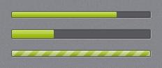
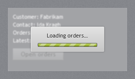
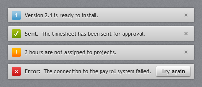

# Progress and status

## ProgressBar



A dark recessed track with the accent gradient as the fill and a glassy top half. When indeterminate,
light diagonal stripes move across the fill.

```xml
<ProgressBar Value="75" />
<ProgressBar IsIndeterminate="True" />
<ProgressBar Orientation="Vertical" Height="120" Value="40" />
```

Default height is 10 (width 10 when vertical); set `Height` for a thicker bar. `Maximum` defaults to
100.

## ProgressRing


`jp:ProgressRing` is an accent arc spinning over a dark recessed ring, 34×34 by default (it scales with
`Width`/`Height`).

```xml
<jp:ProgressRing IsActive="{Binding IsLoading}" />
```

| Property | Type | Default | Description |
| --- | --- | --- | --- |
| `IsActive` | `bool` | `true` | When false the ring is hidden but keeps its space. |

## BusyIndicator



`jp:BusyIndicator` wraps content. While `IsBusy` is true it blurs and dims the content, disables it so
it takes no input, and shows a small light card with `BusyContent` and an indeterminate progress bar.

```xml
<jp:BusyIndicator IsBusy="{Binding IsLoading}" BusyContent="Loading orders…">
    <Grid>...</Grid>
</jp:BusyIndicator>
```

| Property | Type | Default | Description |
| --- | --- | --- | --- |
| `IsBusy` | `bool` | `false` | |
| `BusyContent` | `object` | `Please wait…` | Text or any element shown on the card. |
| `BlurRadius` | `double` | 3 | Blur applied to the content while busy; 0 turns it off. |

The blur is only applied while busy, so the content keeps ClearType text the rest of the time.

## InfoBar



`jp:InfoBar` is an inline message strip: a light bar with a coloured severity icon, an optional bold
title, the message, optional action content and a close button.

```xml
<jp:InfoBar Severity="Success" Title="Sent." Message="The timesheet has been sent for approval." />
<jp:InfoBar Severity="Error" Title="Error:" Message="The connection to the payroll system failed." IsClosable="False">
    <Button Content="Try again" Click="OnRetry" />
</jp:InfoBar>
```

| Property | Type | Default | Description |
| --- | --- | --- | --- |
| `Severity` | `InfoBarSeverity` | `Info` | `Info` (blue *i*), `Success` (green ✓), `Warning` (orange !), `Error` (red ×). |
| `Title` | `string?` | `null` | Bold text before the message; hidden when null. |
| `Message` | `string?` | `null` | |
| `IsOpen` | `bool` | `true` | Two-way bindable; the bar collapses when false. |
| `IsClosable` | `bool` | `true` | Shows the × button. |
| `Content` | `object` | | Action area at the right, e.g. a button. |

Event: `Closed`, raised when the user clicks ×.
