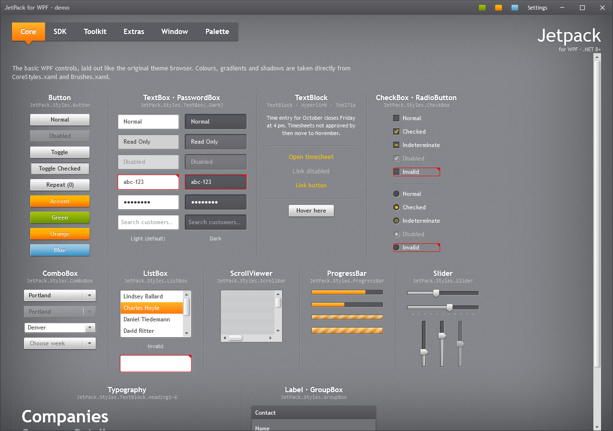

# Theme and accent



## Accents

JetPack ships the three accents of the original theme: green (default), orange and blue. The accent
colours selections, checks, progress bars, tooltips, the selected tab and the accent buttons.

```csharp
using JetPack.Wpf.Theming;

ThemeManager.ChangeAccent(JetPackAccent.Orange);
string current = ThemeManager.CurrentAccent;   // "Orange"
ThemeManager.AccentChanged += (_, _) => { /* refresh anything you cache */ };
```

### Generated accents

`ChangeAccent(Color)` builds a full accent from one colour. `AccentGenerator` derives the gradients,
highlight and shadow colours with the same lightness and saturation offsets the green accent uses, so
a generated accent has the same depth:

```csharp
ThemeManager.ChangeAccent(Color.FromRgb(0x8E, 0x44, 0xAD), "Purple");
```

To get the dictionary without applying it (for example to merge it into one window only), call
`AccentGenerator.Create(color, name)`.

Very light colours (yellow, pale blue) give white text on a light background on accent buttons; pick
a mid-tone base colour.

### How switching works

`JetPack.xaml` merges `Accents/Green.xaml`. `ThemeManager` adds the chosen accent dictionary at the
end of `Application.Resources.MergedDictionaries`, where it overrides the default. That is why theme
brushes must be referenced with `DynamicResource` in your XAML.

## Focus visuals

The original Silverlight theme had invisible keyboard focus. JetPack shows a 1px ring in the accent
highlight around focused buttons and an accent border on focused inputs. To match the original:

```csharp
ThemeManager.ShowFocusVisuals = false;
```

The ring on buttons, check boxes and similar controls is WPF's `FocusVisualStyle`, so it only appears
when focus moves by keyboard. Text inputs show the accent border whenever they have focus.

## Control font size

Controls use 12px. The original used 11px:

```csharp
ThemeManager.ControlFontSize = 11;
```

Headings are not affected (see [Typography](typography.md)).

## Overriding colours

Every colour is a resource key (full list in [Resource keys](resource-keys.md)). Redefine a key after
merging `JetPack.xaml` to change it app-wide:

```xml
<ResourceDictionary.MergedDictionaries>
    <ResourceDictionary Source="pack://application:,,,/JetPack.Wpf;component/Styles/JetPack.xaml" />
</ResourceDictionary.MergedDictionaries>
<SolidColorBrush x:Key="JetPack.Brushes.Error" Color="#FFC00000" />
<SolidColorBrush x:Key="JetPack.Brushes.Panel.Background" Color="#FF65666B" />
```

Keys that change with the accent (`JetPack.Brushes.Accent.*`, `JetPack.Brushes.Focus*`) are replaced
by `ThemeManager.ChangeAccent`, so override those in a custom accent instead.

Overrides also work for a single area: put the key in the `Resources` of a panel and only its children
use the new value.

## Window background

The window background is a tiled 200×200 texture (`JetPack.Brushes.Window.Background`) with a
vignette on top, drawn in code by the `Vignette` element (see [Vignette](window.md#vignette)). Turn
the vignette off per window with `ShowVignette="False"`, or replace the texture brush with your own
`ImageBrush` using the same key.
