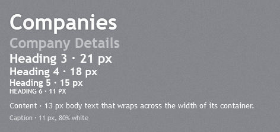
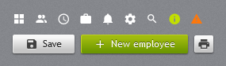
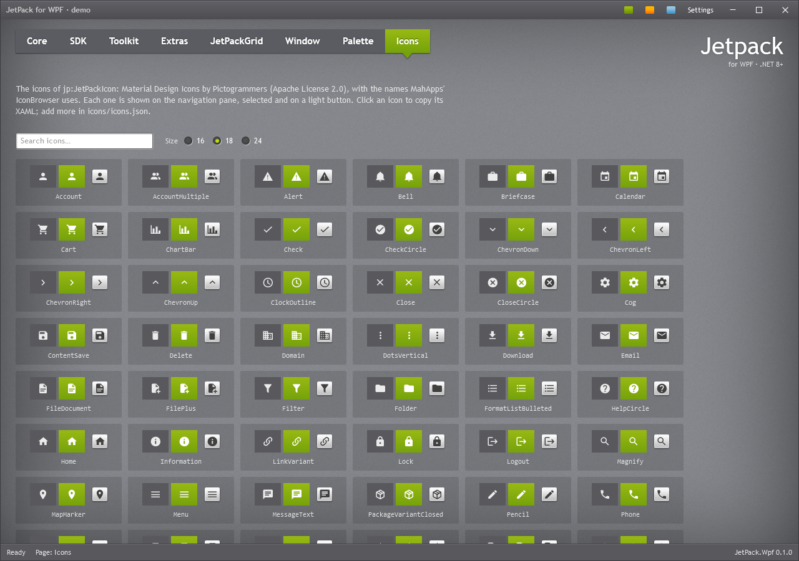

# Typography

## Fonts

The theme uses Trebuchet MS, which ships with Windows, with Segoe UI as the fallback.

| Key | Value | Used for |
| --- | --- | --- |
| `JetPack.Fonts.Family` | Trebuchet MS, Segoe UI | all controls |
| `JetPack.Fonts.Family.Heading` | Trebuchet MS, Segoe UI | heading styles |
| `JetPack.Fonts.Family.Mono` | Consolas, Cascadia Mono, Courier New | code, keys |
| `JetPack.Font.Size.Control` | 12 | controls (`ThemeManager.ControlFontSize`) |
| `JetPack.Font.Size.Small` | 11 | tooltips, status bar, captions |
| `JetPack.Font.Size.Default` | 12.5 | window default |
| `JetPack.Font.Size.Content` | 13 | body text |
| `JetPack.Font.Size.Navigation` | 15 | navigation and strip tab headers |

To use another typeface, redefine the two font family keys after merging `JetPack.xaml`.

## Text styles



Use these keyed `TextBlock` styles for text on the textured background:

| Style | Size | Notes |
| --- | --- | --- |
| `JetPack.Styles.TextBlock.Heading1` | 36, bold | soft glow, as the page titles in the original |
| `JetPack.Styles.TextBlock.Heading2` | 24, bold | 50% white, for section titles ("Company Details") |
| `JetPack.Styles.TextBlock.Heading3` | 21, bold | |
| `JetPack.Styles.TextBlock.Heading4` | 18, bold | |
| `JetPack.Styles.TextBlock.Heading5` | 15, bold | column and group titles |
| `JetPack.Styles.TextBlock.Heading6` | 11, bold | |
| `JetPack.Styles.TextBlock.Content` | 13 | white body text, wraps |
| `JetPack.Styles.TextBlock.Caption` | 11 | 80% white, wraps |

```xml
<TextBlock Style="{StaticResource JetPack.Styles.TextBlock.Heading1}" Text="Companies" />
<TextBlock Style="{StaticResource JetPack.Styles.TextBlock.Heading2}" Text="Company Details" />
```

`Label` is styled implicitly (white, control font size) and supports access keys (`Content="_Name"`
with `Target`).

## Icons



`jp:JetPackIcon` draws one of the JetPack icons in its `Foreground`, which it inherits like text: white
on the texture and in the navigation, dark when you set `JetPack.Brushes.Control.Glyph.Dark` on a
light button.

```xml
<jp:JetPackIcon Kind="ViewGrid" />
<Button Style="{StaticResource JetPack.Styles.Button.Square}" ToolTip="Print">
    <jp:JetPackIcon Kind="Printer" Foreground="{DynamicResource JetPack.Brushes.Control.Glyph.Dark}" />
</Button>
```

| Property | Type | Default | Description |
| --- | --- | --- | --- |
| `Kind` | `JetPackIconKind` | `None` | Which icon. |
| `Data` | `Geometry` (read-only) | | The icon's path in a 24×24 box, for a `Path` of your own; `JetPackIcon.GeometryOf(kind)` gives the same. |

Width and height are 16 by default (18 inside a `HamburgerMenuItem`); the 24×24 grid of the icon is scaled into them, so every icon
keeps its own padding and the set lines up.

The *Icons* tab in the demo shows the whole set on the navigation pane, selected and on a light
button, at 16, 18 or 24; clicking an icon copies its XAML.



The icons are [Material Design Icons](https://pictogrammers.com/library/mdi/) (Apache License 2.0),
and `Kind` uses the same names as MahApps' `PackIconMaterial` (`view-grid` → `ViewGrid`), so the
MahApps IconBrowser shows what is available. The library ships the set listed in
[`icons/icons.json`](https://github.com/Montago/JetPackTheme/blob/master/icons/icons.json); to add an
icon, put its MDI name in that file and run `python tools/generate_icons.py --fetch`. The same set
is generated for the web theme (`<jp-icon kind="ViewGrid" />`, see [JetPack for the web](web.md)).

## Text rendering

`JetPackWindow` uses `TextOptions.TextFormattingMode="Display"`, which keeps small text sharp. Large
text looks jagged in that mode, so the heading styles and the tab headers switch to `Ideal`. Do the
same for your own large text:

```xml
<TextBlock FontSize="38" Text="Jetpack" TextOptions.TextFormattingMode="Ideal" />
```

Effects such as the heading glow turn ClearType off for that element. The theme uses them only on
large text and on the embossed text of light surfaces.
