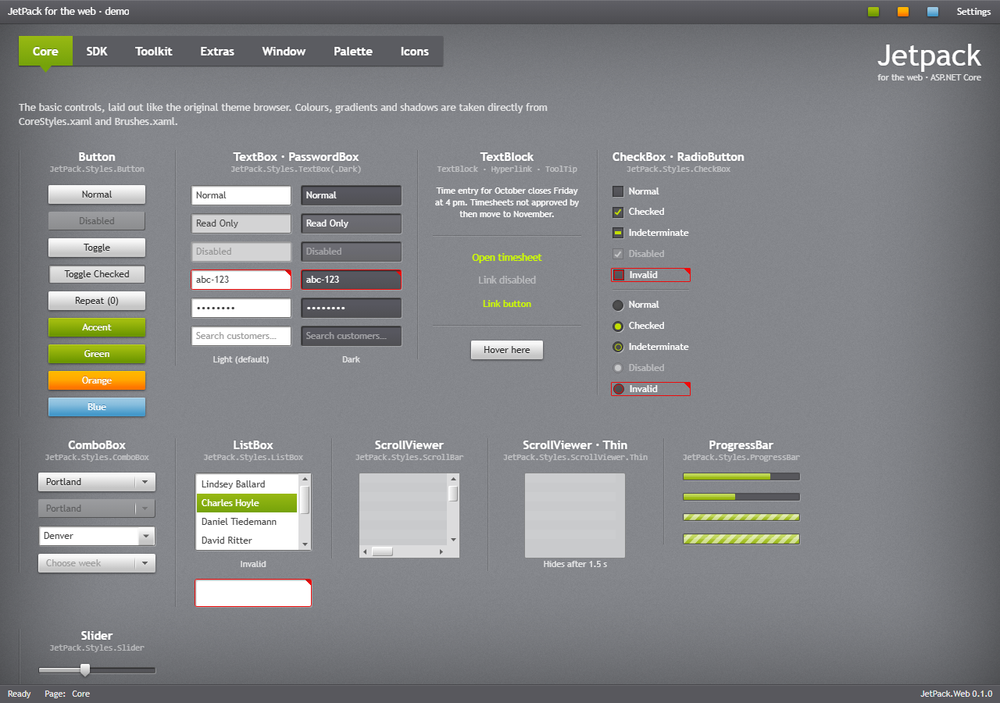

# JetPack for the web

JetPack for the web is the JetPack look in HTML and CSS, for admin portals and other business
sites. It is a Razor class library, published as the
[JetPack.Web](https://www.nuget.org/packages/JetPack.Web) package, with a tag helper for every
control of the WPF demo, named after the control (`<jp-combo-box>`, `<jp-tab-control>`,
`<jp-date-picker>` …). The CSS and JavaScript do not depend on .NET: any site can link them and
write the markup itself.

## Start here

- [Getting started](web/getting-started.md): install, tag helpers, layout, the window frame, Tailwind.
- [Theme and accent](web/theming.md): accents, generated accents, focus visuals, font size, overriding colours.
- [Typography](web/typography.md): fonts, heading styles, icons.

## Controls

| Page | Controls |
| --- | --- |
| [Window and dialogs](web/window.md) | the window frame (`body.jp-window`), title bar modes, window commands, `jp-flyout`, dialogs, `JetPack.showDialog` |
| [Buttons](web/buttons.md) | `jp-button` and its variants, `jp-toggle-button`, `jp-repeat-button`, `jp-hyperlink`, `jp-split-button`, `jp-drop-down-button`, `jp-tile`, `jp-badged` |
| [Text and input](web/inputs.md) | `jp-text-box`, `jp-password-box`, `jp-label`, validation, `jp-combo-box`, `jp-numeric-up-down`, `jp-auto-suggest-box`, `jp-search-combo-box`, `jp-date-picker`, `jp-time-picker`, `jp-color-picker` |
| [Selection](web/selection.md) | `jp-check-box`, `jp-radio-button`, `jp-toggle-switch`, `jp-slider`, `jp-range-slider`, `jp-rating` |
| [Lists and data](web/lists.md) | `jp-list-box`, `jp-list-view`, `jp-tree-view`, `jp-data-grid`, `jp-calendar`, `jp-scroll-viewer` |
| [Navigation and layout](web/navigation.md) | `jp-tab-control` (three looks), `jp-hamburger-menu`, `jp-expander`, `jp-accordion`, `jp-group-box`, `jp-menu`, `jp-context-menu`, `jp-tool-bar`, `jp-status-bar`, `jp-grid-splitter`, `jp-separator`, tool tips |
| [Progress and status](web/status.md) | `jp-progress-bar`, `jp-progress-ring`, `jp-busy-indicator`, `jp-info-bar` |

## Reference

- [Reference](web/reference.md): every tag helper with its attributes, the CSS classes, the data
  attributes, the `window.JetPack` API and the `jp-change` event of each control.
- [Demo and samples](web/samples.md): the web demo, its gallery page and the MVC sample site.

## What is in the package

| Part | File | Contents |
| --- | --- | --- |
| Components | `wwwroot/css/jetpack.css` | The controls as CSS classes in cascade layers, in one file |
| Tokens | `wwwroot/css/jetpack.tokens.css` | The colours, gradients, fonts and shadows of JetPack.Wpf as CSS custom properties (already part of `jetpack.css`) |
| Tailwind | `wwwroot/css/jetpack.tailwind.css` | The tokens as Tailwind v4 theme variables (`text-jp-soft`, `bg-jp-panel` …) |
| Behaviour | `wwwroot/js/jetpack.js` | Drop-downs, calendar, sliders, menus, tabs, flyouts, dialogs, tool tips, validation call-outs, accents and the vignette; no dependencies |
| Tag helpers | `TagHelpers/*.cs` | `<jp-*>` elements with the WPF property names |
| Icons | `wwwroot/img/icons.svg` | The JetPackIcon set as an SVG sprite |

The web theme follows the WPF library: class names follow the WPF controls and style keys
(`ComboBox` → `.jp-combo-box`, `JetPack.Styles.Button.Accent` → `.jp-button--accent`), tag helper
attributes are the WPF property names in kebab case (`IsEnabled` → `is-enabled`), and the colours
are generated from the same XAML dictionaries, so a desktop app and its web portal look the same.

## Limitations

- JetPackGrid has no web version; use a grid library for large, filterable tables.
- Scroll bars get the JetPack look only in Chromium browsers (Edge, Chrome); Firefox gets colours only.
- Dates are shown as en-US (M/d/yyyy).
- `jetpack.tailwind.css` has not been tried with the Tailwind CLI yet; the demo and the sample use
  the browser build.
