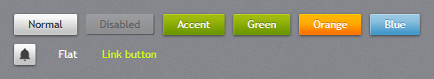
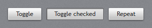
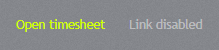
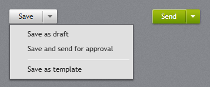
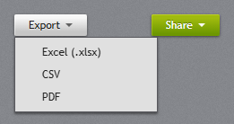
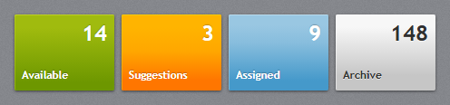
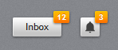

# Buttons

## Button



`jp-button` is the JetPack button: a light gradient slab with a drop shadow, a white top-left
highlight and embossed dark text. Hover lightens it, pressing darkens it, and disabled buttons turn
flat grey.

```cshtml
<jp-button>Save</jp-button>
<jp-button is-enabled="false">Save</jp-button>
<jp-button button-style="Accent" type="submit">Update</jp-button>
<jp-button button-style="Orange" content="Delete" />
<jp-button href="/employees/new" button-style="Accent">New employee</jp-button>
```

```html
<button type="button" class="jp-button">Save</button>
<button type="button" class="jp-button" disabled="disabled">Save</button>
<button type="submit" class="jp-button jp-button--accent">Update</button>
<button type="button" class="jp-button jp-button--orange">Delete</button>
<a href="/employees/new" class="jp-button jp-button--accent">New employee</a>
```

| Attribute | Default | Description |
| --- | --- | --- |
| `button-style` | `Default` | the variant, below |
| `content` | | the text; without it the element's content is used (icons, markup) |
| `type` | `button` | `button`, `submit` or `reset` |
| `href` | | makes it a link that looks like a button (a disabled one stays a `<button>`) |

### Variants

| `button-style` | Class | Look |
| --- | --- | --- |
| `Default` | `.jp-button` | light grey, dark text |
| `Accent` | `.jp-button--accent` | the current accent; follows `ThemeManager.changeAccent` |
| `Green` | `.jp-button--green` | the original GreenButton, always green |
| `Orange` | `.jp-button--orange` | the original OrangeButton, always orange (good for destructive actions) |
| `Blue` | `.jp-button--blue` | the original BlueButton, always blue |
| `Square` | `.jp-button--square` | 24 px wide icon button |
| `Flat` | `.jp-button--flat` | no surface until the mouse is over it; for tool bars and title bars |
| `Link` | `.jp-button--link` | looks like a hyperlink in the accent link colour |

### Custom colours

The coloured variants read five custom properties, so a new colour is a class that sets them,
used together with `jp-button--accent`. Put the rule outside the JetPack layers (any ordinary
stylesheet), so it wins:

```css
.jp-button--purple {
  --jp-b-normal: linear-gradient(#9C5BB8, #7D3C98);
  --jp-b-over: linear-gradient(#A96CC3, #8A47A6);
  --jp-b-pressed: linear-gradient(#5E2D73, #6B3483);
  --jp-b-highlight: #B07CC6;
  --jp-b-shadow: 0 -1px 0 rgb(40 10 50 / 0.5);
}
```

```html
<button type="button" class="jp-button jp-button--accent jp-button--purple">Publish</button>
```

## ToggleButton and RepeatButton



`jp-toggle-button` uses the same chrome; when checked (`aria-pressed="true"`) it looks pressed into
the surface. `jetpack.js` flips it on click and raises `jp-change` with `true` or `false`.
`jp-repeat-button` looks like a button and clicks once when pressed, then every 33 ms after 0.4 s
while it is held. Both take the attributes of `jp-button`.

```cshtml
<jp-toggle-button is-checked="true">Bold</jp-toggle-button>
<jp-repeat-button id="Next">Next</jp-repeat-button>
```

```html
<button type="button" class="jp-button" aria-pressed="true" data-jp-toggle="">Bold</button>
<button type="button" class="jp-button" data-jp-repeat="" id="Next">Next</button>
```

| Attribute | Default | Description |
| --- | --- | --- |
| `is-checked` | `false` | `jp-toggle-button` only: starts pressed |

## Hyperlink



`jp-hyperlink` is a link in the accent link colour (bright lime for green) that underlines on hover.
Disabled links turn 45% white and lose their address.

```cshtml
<jp-hyperlink href="/timesheets/43">Open timesheet</jp-hyperlink>
<jp-hyperlink is-enabled="false">Link disabled</jp-hyperlink>
```

```html
<a class="jp-hyperlink" href="/timesheets/43">Open timesheet</a>
<a class="jp-hyperlink" aria-disabled="true">Link disabled</a>
```

| Attribute | Default | Description |
| --- | --- | --- |
| `href` | `#` | the address |

## SplitButton



`jp-split-button` is a button with a separate arrow part. The main part is an ordinary button;
the arrow opens the menu (a popover) below it. The children are [menu items](navigation.md#menu-contextmenu-and-toolbar).

```cshtml
<jp-split-button id="Save" content="Save">
    <jp-menu-item header="Save as draft" />
    <jp-menu-item header="Save and send for approval" />
</jp-split-button>
```

```html
<div class="jp-split-button" id="Save">
    <button type="button" class="jp-button">Save</button>
    <button type="button" class="jp-button" popovertarget="Save-menu" aria-haspopup="menu" aria-label="More"><i class="jp-caret"></i></button>
    <div class="jp-context-menu" popover id="Save-menu" role="menu">
        <button type="button" class="jp-menu-item" role="menuitem"><span class="jp-menu-item__header">Save as draft</span></button>
        …
    </div>
</div>
```

| Attribute | Default | Description |
| --- | --- | --- |
| `content` | | the text of the main part |
| `button-style` | `Default` | `Accent` gives `JetPack.Styles.SplitButton.Accent` (any button variant works) |
| `id` | generated | the id of the control; the menu gets `<id>-menu` |

Listen for `click` on the first button for the main action, and for clicks on the menu items:

```js
document.querySelector('#Save > .jp-button').addEventListener('click', save);
```

## DropDownButton



`jp-drop-down-button` opens its menu when clicked. It takes the same attributes as `jp-split-button`.

```cshtml
<jp-drop-down-button content="Export" button-style="Accent">
    <jp-menu-item header="Excel (.xlsx)" href="/export?format=xlsx" />
    <jp-menu-item header="PDF" href="/export?format=pdf" />
</jp-drop-down-button>
```

```html
<span class="jp-drop-down-button">
    <button type="button" class="jp-button jp-button--accent" popovertarget="…-menu" aria-haspopup="menu">Export <i class="jp-caret"></i></button>
    <div class="jp-context-menu" popover id="…-menu" role="menu">…</div>
</span>
```

To line the menu up with the button's right edge, set `data-jp-align="right"` on the `.jp-context-menu`.

## Tile



`jp-tile` is a large button with a count in the top-right corner and a title bottom-left. It fills
the width it is given (a grid column, or a width class); the WPF tile is 110×84.

```cshtml
<jp-tile title="Available" count="14" tile-style="Green" href="/consultants?status=available" />
<jp-tile title="Archive" count="148" />
```

```html
<a class="jp-tile jp-tile--green" href="/consultants?status=available"><span class="jp-tile__title">Available</span><b class="jp-tile__count">14</b></a>
<button class="jp-tile" type="button"><span class="jp-tile__title">Archive</span><b class="jp-tile__count">148</b></button>
```

| Attribute | Default | Description |
| --- | --- | --- |
| `title` | | the bottom-left label |
| `count` | | the large top-right value |
| `tile-style` | `Default` | `Default` (light), `Accent`, `Green`, `Orange`, `Blue` |
| `href` | | makes it a link; without it a `<button>` |

Content inside the tag helper goes in the row between the count and the title.

## Badged



`jp-badged` puts a small orange count badge on the top-right corner of any element:

```cshtml
<jp-badged badge="12"><jp-button>Inbox</jp-button></jp-badged>
```

```html
<span class="jp-badged"><button type="button" class="jp-button">Inbox</button><span class="jp-badged__badge">12</span></span>
```

| Attribute | Description |
| --- | --- |
| `badge` | the badge text; without it no badge is shown |

To change the number from script, set the text of `.jp-badged__badge`.
