# Text and input

## TextBox

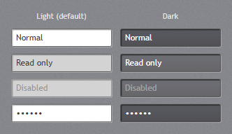

`jp-text-box` writes an `<input class="jp-text-box">`: white with a dark inset border, an accent
border when it has the focus, grey when read-only or disabled. `text-box-style="Dark"` is the dark
field for the dark panels.

```cshtml
<jp-text-box asp-for="Name" />
<jp-text-box name="Search" type="search" text="Contoso" />
<jp-text-box text="Read only" is-read-only="true" />
<jp-text-box text-box-style="Dark" text="Normal" />
```

```html
<input class="jp-text-box" type="text" id="Name" name="Name" value="Heather Andrade" />
<input class="jp-text-box" type="search" name="Search" value="Contoso" />
<input class="jp-text-box" readonly="readonly" type="text" value="Read only" />
<input class="jp-text-box jp-text-box--dark" type="text" value="Normal" />
```

| Attribute | Default | Description |
| --- | --- | --- |
| `asp-for` | | binds a model property: name, id, value and validation attributes |
| `text` | | the value, without `asp-for` |
| `name`, `id` | | without `asp-for` |
| `type` | `text` | the input type: `text`, `email`, `search`, `tel`, `url` … |
| `text-box-style` | `Default` | `Default`, `Dark`, `MultiLine`, `MultiLineDark` |
| `watermark` | | `TextBoxHelper.Watermark`: grey text while the box is empty (`placeholder`) |
| `clear-text-button` | `false` | `TextBoxHelper.ClearTextButton`: an × that empties the box |
| `is-read-only` | `false` | read-only |

### Multi-line

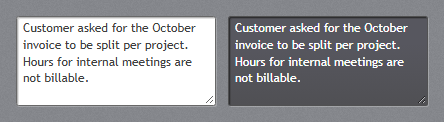

`text-box-style="MultiLine"` (or `MultiLineDark`) writes a `<textarea class="jp-text-box">`, which
wraps and scrolls. Give it a height:

```cshtml
<jp-text-box asp-for="Notes" text-box-style="MultiLine" class="h-24" />
```

### Watermark and clear button

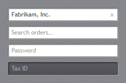

`watermark` is the HTML `placeholder`. `clear-text-button="true"` wraps the box in a
`.jp-text-box-host` with an × button; clicking it empties the box, raises `input` and `change`, and
puts the focus back.

```cshtml
<jp-text-box watermark="Search orders…" clear-text-button="true" />
```

```html
<div class="jp-text-box-host">
    <input class="jp-text-box" placeholder="Search orders…" type="text" />
    <button type="button" class="jp-text-box-host__clear" data-jp-clear aria-label="Clear" tabindex="-1">×</button>
</div>
```

## PasswordBox

`jp-password-box` is a text box with `type="password"`; it takes the attributes of `jp-text-box`,
with `password` for the value.

```cshtml
<jp-password-box asp-for="Password" watermark="Password" />
```

## Label

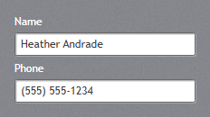

`jp-label` is the form label: white, in the control font size, with 3px below it. `target` is the id
of its field (`Label.Target`), so a click on the label focuses the field.

```cshtml
<jp-label content="Name" target="Name" />
<jp-text-box asp-for="Name" />
```

```html
<label class="jp-label" for="Name">Name</label>
<input class="jp-text-box" type="text" id="Name" name="Name" value="" />
```

| Attribute | Description |
| --- | --- |
| `content` | the text; without it the element's content is used |
| `target` | the `id` of the field (the `for` attribute) |

ASP.NET Core's own `<label asp-for="Name" class="jp-label">` works as well.

## Validation

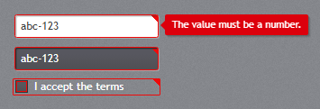

An invalid field gets the red frame and the red corner of the WPF validation template. A field is
invalid when it has `aria-invalid="true"`, or ASP.NET Core's `input-validation-error` class, which
`asp-for` adds after a failed post. The message can show in two ways:

- `data-jp-error="…"` (what `validation-error` writes): the message shows in a red call-out at the
  field's right while it has the focus or the mouse, as in WPF.
- A `.jp-validation-message` element under the field: a red call-out with an arrow pointing up. Put
  the class on ASP.NET Core's `asp-validation-for` element; it takes no space while the field is valid.

```cshtml
<jp-text-box text="abc-123" validation-error="The value must be a number." />
<jp-check-box content="I accept the terms" validation-error="You must accept the terms." />

<jp-label content="Name" target="Name" />
<jp-text-box asp-for="Name" />
<span class="jp-validation-message" asp-validation-for="Name"></span>
```

```html
<input aria-invalid="true" class="jp-text-box" data-jp-error="The value must be a number." type="text" value="abc-123" />
<label class="jp-check-box" aria-invalid="true" data-jp-error="You must accept the terms."><input type="checkbox" value="true" />I accept the terms</label>
```

`validation-error` works on every control tag helper. From script, set or remove the two attributes.

## ComboBox

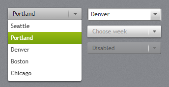

`jp-combo-box` writes a `<select class="jp-combo-box">`. `jetpack.js` opens the JetPack drop-down list
in place of the browser's own (Space, Enter or Alt+Down opens it; the arrow keys, Enter and Esc work in it); without script it is
still a working select. With `is-editable="true"` it is a text box with the items as suggestions.

```cshtml
<jp-combo-box selected-index="1">
    <jp-combo-box-item content="Seattle" />
    <jp-combo-box-item content="Portland" />
    <jp-combo-box-item content="Denver" is-enabled="false" />
</jp-combo-box>
<jp-combo-box asp-for="DepartmentId" asp-items="Model.Departments" watermark="Choose a department" />
<jp-combo-box is-editable="true" text="Denver" name="City">
    <jp-combo-box-item content="Seattle" />
    <jp-combo-box-item content="Denver" />
</jp-combo-box>
```

```html
<select class="jp-combo-box"><option>Seattle</option><option selected>Portland</option><option disabled>Denver</option></select>

<div class="jp-combo-box jp-combo-box--editable">
    <input class="jp-text-box" list="jp-combo-1" value="Denver" name="City">
    <button type="button" class="jp-text-box-button jp-text-box-button--drop-down" tabindex="-1" aria-label="Open"></button>
    <datalist id="jp-combo-1"><option value="Seattle"></option><option value="Denver"></option></datalist>
</div>
```

| Attribute | Default | Description |
| --- | --- | --- |
| `asp-for`, `asp-items` | | bind the selected value and the items, as ASP.NET Core's select tag helper |
| `selected-index` | -1 | the selected item, without `asp-for` |
| `watermark` | | grey text while nothing is chosen (a hidden empty first option) |
| `is-editable` | `false` | a text box with the items as suggestions |
| `text` | | the text of an editable combo box |
| `name`, `id` | | without `asp-for` |

`jp-combo-box-item` takes `content`, `value` (the posted value; the content when left out) and
`is-enabled`. Choosing an item raises `input`, `change` and `jp-change` (the value).

## NumericUpDown

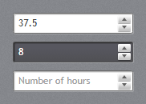

`jp-numeric-up-down` is an `<input type="number">` with the JetPack spin buttons. The buttons step by
`interval` and repeat while held; the arrow keys step as in any number field.

```cshtml
<jp-numeric-up-down asp-for="HoursPerWeek" minimum="0" maximum="60" interval="0.5" string-format="N1" />
<jp-numeric-up-down value="8" minimum="0" dark="true" />
<jp-numeric-up-down name="Hours" watermark="Number of hours" minimum="0" />
```

```html
<div class="jp-numeric-up-down">
    <input class="jp-text-box" max="60" min="0" step="0.5" type="number" id="HoursPerWeek" name="HoursPerWeek" value="37.5" />
    <span class="jp-numeric-up-down__spin">
        <button type="button" data-jp-step="1" tabindex="-1" aria-label="Increase"></button>
        <button type="button" data-jp-step="-1" tabindex="-1" aria-label="Decrease"></button>
    </span>
</div>
```

| Attribute | Default | Description |
| --- | --- | --- |
| `asp-for` | | binds a number property |
| `value`, `name` | | without `asp-for` |
| `minimum`, `maximum` | | the range (`min`, `max`) |
| `interval` | 1 | the step of the buttons (`step`) |
| `string-format` | | a .NET format for the first value, such as `N1` (written with a period, as `type="number"` needs) |
| `watermark` | | grey text while the box is empty |
| `dark` | `false` | `JetPack.Styles.NumericUpDown.Dark` |

## AutoSuggestBox

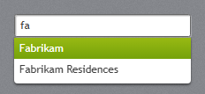

`jp-auto-suggest-box` is a search box that lists the items containing what you type. Picking one
puts it in the box and raises `jp-change` with the text. The items go to the page as JSON.

```cshtml
<jp-auto-suggest-box items="Model.CompanyNames" watermark="Search companies…" name="Company" />
```

```html
<div class="jp-auto-suggest-box">
    <input class="jp-text-box" type="search" autocomplete="off" value="" placeholder="Search companies…" name="Company">
    <script type="application/json">["Fabrikam","Fabrikam Residences","Contoso"]</script>
</div>
```

| Attribute | Description |
| --- | --- |
| `items` | the suggestions, any `IEnumerable<string>` |
| `text` | the text in the box |
| `watermark`, `name` | as on `jp-text-box` |

For suggestions from the server, listen for `input` on the box and replace the JSON (or fill the
list yourself).

## SearchComboBox

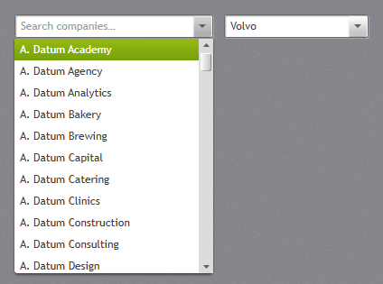

`jp-search-combo-box` is a combo box you type into to filter a long list (it shows the first 300
matches). The items can be objects: `display-member-path` names the property to show and
`selected-value-path` the one to post.

```cshtml
<jp-search-combo-box items="Model.Companies" display-member-path="Name" selected-value-path="Id"
                     selected-value="Model.CompanyId" name="CompanyId" watermark="Search companies…" />
<jp-search-combo-box items="Model.CarBrands" selected-item="@("Volvo")" />
```

```html
<div class="jp-search-combo-box" data-jp-display-member="Name" data-jp-value-member="Id" data-jp-selected-value="1042">
    <input class="jp-text-box" autocomplete="off" role="combobox" placeholder="Search companies…">
    <button type="button" class="jp-text-box-button jp-text-box-button--drop-down" tabindex="-1" aria-label="Open"></button>
    <input type="hidden" name="CompanyId">
    <script type="application/json">[{"Id":1042,"Name":"A. Datum Academy"}, …]</script>
</div>
```

| Attribute | Default | Description |
| --- | --- | --- |
| `items` | | the list, any `IEnumerable` (serialised as JSON) |
| `display-member-path` | | the property to show; without it the items themselves |
| `selected-value-path` | | the property to post and to match `selected-value` |
| `selected-value` | | the value of the selected item |
| `selected-item` | | the selected item itself, for lists of strings |
| `filter-mode` | `Contains` | `Contains` or `StartsWith` |
| `watermark`, `name`, `id` | | `name` adds a hidden input with the selected value |

Choosing an item raises `jp-change` with `{ selectedItem, selectedValue }`.

## DatePicker

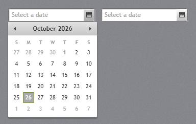

`jp-date-picker` is a text box with a calendar button that opens a [Calendar](lists.md#calendar) below
it. A typed date (M/d/yyyy, as in the WPF demo) is read when the box loses the focus; Alt+Down opens
the calendar.

```cshtml
<jp-date-picker selected-date="@DateTime.Today" name="StartDate" />
<jp-date-picker watermark="Start date" />
```

```html
<div class="jp-date-picker" data-selected-date="2026-10-26">
    <input class="jp-text-box" value="10/26/2026" placeholder="Select a date">
    <button type="button" class="jp-text-box-button jp-text-box-button--calendar" tabindex="-1" aria-label="Show calendar"></button>
    <input type="hidden" name="StartDate" value="2026-10-26">
</div>
```

| Attribute | Default | Description |
| --- | --- | --- |
| `selected-date` | | the date |
| `watermark` | `Select a date` | grey text while the box is empty |
| `name` | | adds a hidden input that posts the date as `yyyy-MM-dd` (binds to `DateTime` and `DateOnly`) |

Choosing a date raises `jp-change` with a `Date` (or `null` when the box is emptied).
`JetPack.formatDate(date)` and `JetPack.parseDate(text)` convert in the picker's format.

## TimePicker

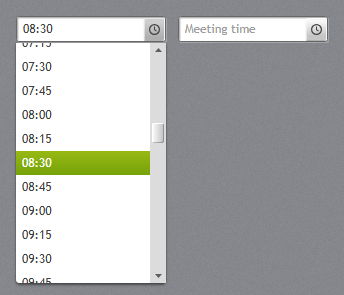

`jp-time-picker` is a text box with a clock button that lists the times of the day, every
`minute-step` minutes. You can also type a time.

```cshtml
<jp-time-picker selected-time="@(new TimeSpan(8, 30, 0))" name="Start" />
<jp-time-picker minute-step="30" watermark="Meeting time" />
```

```html
<div class="jp-time-picker" data-jp-minute-step="15">
    <input class="jp-text-box" value="08:30" name="Start">
    <button type="button" class="jp-text-box-button jp-text-box-button--clock" tabindex="-1" aria-label="Choose a time"></button>
</div>
```

| Attribute | Default | Description |
| --- | --- | --- |
| `selected-time` | | the time (`TimeSpan`) |
| `minute-step` | 15 | minutes between the times in the list |
| `watermark`, `name` | | the input posts the time as `HH:mm` (binds to `TimeSpan` and `TimeOnly`) |

Choosing a time raises `jp-change` with the text, such as `"08:30"`.

## ColorPicker

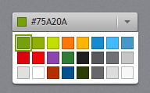

`jp-color-picker` is a combo-box-like button with a swatch and the hex value; it opens the theme
palette. Choosing a colour raises `change` and `jp-change` with the colour, and the button's
`value` is the colour.

```cshtml
<jp-color-picker id="ChartColor" selected-color="#148CD1" />
```

```html
<button type="button" class="jp-color-picker" id="ChartColor" data-selected-color="#148CD1" aria-haspopup="dialog">
    <span class="jp-color-picker__swatch"></span><span class="jp-color-picker__text"></span>
</button>
```

| Attribute | Default | Description |
| --- | --- | --- |
| `selected-color` | `#75A20A` | the colour, as `#RRGGBB` |
| `id` | | |

`data-jp-palette="#75A20A #FE770A #148CD1"` on the button replaces the 24 colours of the palette.
To let users pick their own accent:

```js
document.getElementById('ChartColor').addEventListener('jp-change', e => JetPack.ThemeManager.changeAccent(e.detail));
```
