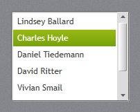
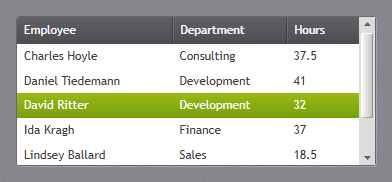
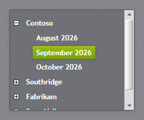
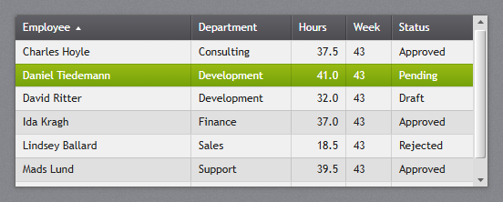
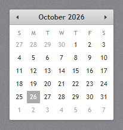
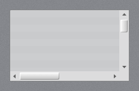
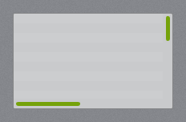

# Lists and data

The lists select one item with the mouse and with the arrow keys, Home and End. The selected item
has `aria-selected="true"`, gets the accent selection, and the list raises `jp-change` with the
selected element (the item, or the `<tr>` of a grid). With `name`, a hidden input posts the selected
item's `value` (or its text).

## ListBox



`jp-list-box` is the white list with the JetPack scroll bar. Give it a height to make it scroll.

```cshtml
<jp-list-box selected-index="1" name="Employee" class="h-32">
    <jp-list-box-item content="Lindsey Ballard" value="17" />
    <jp-list-box-item content="Charles Hoyle" value="23" />
    <jp-list-box-item value="31"><b>Daniel</b> Tiedemann</jp-list-box-item>
</jp-list-box>
```

```html
<div class="jp-list-box h-32" role="listbox" tabindex="0" data-jp-name="Employee">
    <div class="jp-list-box-item" role="option" aria-selected="false" data-value="17">Lindsey Ballard</div>
    <div class="jp-list-box-item" role="option" aria-selected="true" data-value="23">Charles Hoyle</div>
    <div class="jp-list-box-item" role="option" aria-selected="false" data-value="31"><b>Daniel</b> Tiedemann</div>
    <input type="hidden" name="Employee" value="23">
</div>
```

| Attribute | Default | Description |
| --- | --- | --- |
| `selected-index` | -1 | the selected item |
| `name` | | posts the selected value |
| `dark` | `false` | the dark list for flyouts and dark panels |

`jp-list-box-item` takes `content` (or the element's content), `value` and `is-enabled`.

## ListView with GridView



`jp-list-view` is a `ListView` with a `GridView`: a white list with column headers, filled from
`items` as `ItemsSource`. Each `jp-grid-view-column` shows one property.

```cshtml
<jp-list-view items="Model.Timesheets" selected-index="2" height="150">
    <jp-grid-view-column header="Employee" display-member-binding="Employee" width="150" />
    <jp-grid-view-column header="Department" display-member-binding="Department" width="110" />
    <jp-grid-view-column header="Hours" display-member-binding="Hours" width="70" />
</jp-list-view>
```

```html
<div class="jp-list-view" style="height:150px;" tabindex="0">
    <table data-jp-selection="single">
        <thead><tr><th style="width:150px">Employee</th><th style="width:110px">Department</th><th style="width:70px">Hours</th></tr></thead>
        <tbody>
            <tr aria-selected="false"><td>Charles Hoyle</td><td>Consulting</td><td>37.5</td></tr>
            …
        </tbody>
    </table>
</div>
```

It takes the attributes of `jp-data-grid` below; the column takes `display-member-binding` in place
of `binding`.

## TreeView



`jp-tree-view` is the dark tree with bold items. An item with children gets the [+]/[−] box, which
is a `<details>`, so it folds without script; a click on the text selects the item without folding it.

```cshtml
<jp-tree-view name="Month" class="h-44">
    <jp-tree-view-item header="Contoso" is-expanded="true">
        <jp-tree-view-item header="August 2026" value="2026-08" />
        <jp-tree-view-item header="September 2026" value="2026-09" is-selected="true" />
    </jp-tree-view-item>
    <jp-tree-view-item header="Fabrikam">
        <jp-tree-view-item header="May 2026" value="2026-05" />
    </jp-tree-view-item>
</jp-tree-view>
```

```html
<ul class="jp-tree-view h-44" role="tree" data-jp-name="Month">
    <li><details open>
        <summary><span class="jp-tree-view__item" role="treeitem" aria-selected="false">Contoso</span></summary>
        <ul role="group">
            <li><span class="jp-tree-view__item" role="treeitem" aria-selected="false" data-value="2026-08">August 2026</span></li>
            <li><span class="jp-tree-view__item" role="treeitem" aria-selected="true" data-value="2026-09">September 2026</span></li>
        </ul>
    </details></li>
    …
</ul>
```

| Attribute | Description |
| --- | --- |
| `name` | `jp-tree-view`: posts the selected item's value |
| `header` | `jp-tree-view-item`: the text |
| `is-expanded` | `jp-tree-view-item`: open when the page loads |
| `is-selected` | `jp-tree-view-item`: the selected item |
| `value` | `jp-tree-view-item`: the posted value |

## DataGrid



`jp-data-grid` is a read-only grid with the dark JetPack header, alternating rows and the accent
selection, filled from `items`. With a height the rows scroll under a sticky header.

```cshtml
<jp-data-grid items="Model.Timesheets" selected-index="1" height="190">
    <jp-data-grid-text-column header="Employee" binding="Employee" sort-direction="Ascending" />
    <jp-data-grid-text-column header="Department" binding="Department" width="110" />
    <jp-data-grid-text-column header="Hours" binding="Hours" string-format="N1" width="60" horizontal-alignment="Right" />
    <jp-data-grid-text-column header="Week" binding="Week" width="50" />
</jp-data-grid>
```

```html
<div class="jp-data-grid-host" style="height:190px;">
    <table class="jp-data-grid" data-jp-selection="single">
        <thead><tr>
            <th aria-sort="ascending">Employee</th>
            <th style="width:110px">Department</th>
            <th style="width:60px">Hours</th>
            <th style="width:50px">Week</th>
        </tr></thead>
        <tbody>
            <tr aria-selected="false"><td>Charles Hoyle</td><td>Consulting</td><td class="jp-data-grid__number">37.5</td><td>43</td></tr>
            …
        </tbody>
    </table>
</div>
```

| Attribute | Default | Description |
| --- | --- | --- |
| `items` | | the rows, any `IEnumerable` (`ItemsSource`) |
| `selected-index` | -1 | the selected row |
| `height` | | height in pixels; the rows scroll under the header |
| `selection-mode` | `Single` | `Single` or `None` |

| Column attribute | Description |
| --- | --- |
| `header` | the header text |
| `binding` | the property of each item to show |
| `width` | a pixel width; `*` or nothing for the rest |
| `string-format` | a .NET format, such as `N1` or `d`, in the request's culture |
| `horizontal-alignment` | `Right` for numbers |
| `sort-direction` | `Ascending` or `Descending`: the sort arrow in the header |

The grid does not sort or edit; sort on the server and show the direction with `sort-direction`.
For rows that open a page, write the table yourself (or in a loop) and give each `<tr>` a
`data-href`: a click opens the address, Ctrl+click opens it in a new tab, and links or buttons in the
row still work on their own.

```cshtml
<div class="jp-data-grid-host">
    <table class="jp-data-grid">
        <thead><tr><th>Name</th><th>Title</th></tr></thead>
        <tbody>
        @foreach (var e in Model.Employees)
        {
            <tr data-href="@Url.Action("Edit", new { e.Id })"><td>@e.Name</td><td>@e.Title</td></tr>
        }
        </tbody>
    </table>
</div>
```

## Calendar



`jp-calendar` is the month view with the year and decade views behind the header: click the title
to go up a level, and the arrows to move a month (or a year, a decade). Today is marked grey and the
selected date green. The arrow keys move between the days.

```cshtml
<jp-calendar selected-date="@DateTime.Today" />
```

```html
<div class="jp-calendar" data-selected-date="2026-10-26"></div>
```

| Attribute | Description |
| --- | --- |
| `selected-date` | the selected date |
| `display-date` | the month shown first (default: the selected month, or this month) |

`jetpack.js` writes the header and the days. Choosing a day raises `jp-change` with a `Date`, and
`data-selected-date` holds it as `yyyy-MM-dd`.

## ScrollViewer and ScrollBar



Every scroll bar on the page has the JetPack look in Chromium browsers (Edge, Chrome): the light
track, the glossy thumb and the arrow buttons. Firefox gets the colours only. `jp-scroll-viewer` is a
scrolling box with WPF's scroll bar settings:

```cshtml
<jp-scroll-viewer horizontal-scroll-bar-visibility="Auto" class="h-40">…</jp-scroll-viewer>
```

```html
<div class="jp-scroll-viewer h-40" style="overflow-x:auto;overflow-y:auto;" tabindex="-1">…</div>
```

| Attribute | Default | Description |
| --- | --- | --- |
| `horizontal-scroll-bar-visibility` | `Disabled` | `Auto`, `Visible`, `Hidden` or `Disabled` |
| `vertical-scroll-bar-visibility` | `Auto` | the same |
| `thin` | `false` | `JetPack.Styles.ScrollViewer.Thin`, below |



`thin="true"` gives the thin accent bar of `JetPack.Styles.ScrollViewer.Thin`: it shows while the box
scrolls or the mouse is near its edge, and hides 1.5 s later.
