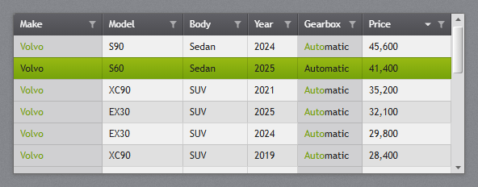
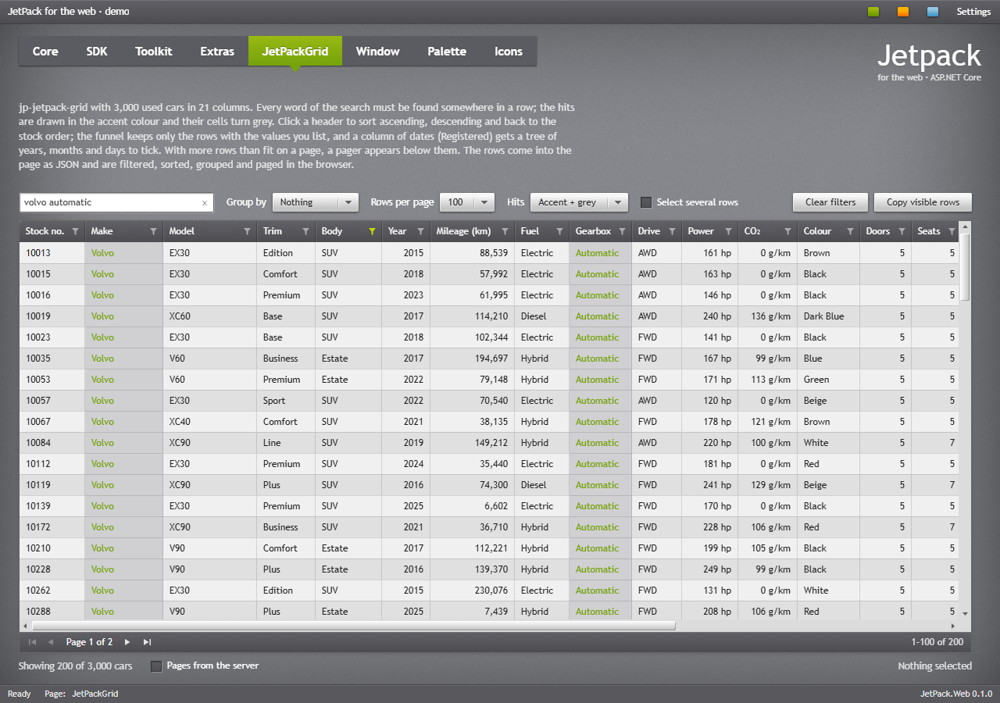
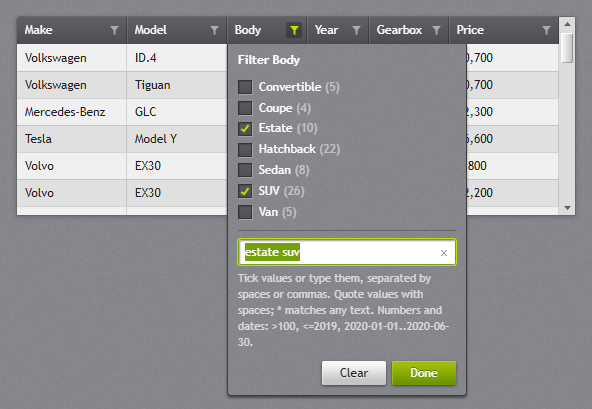
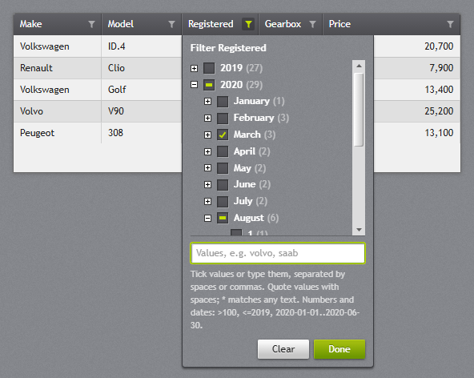
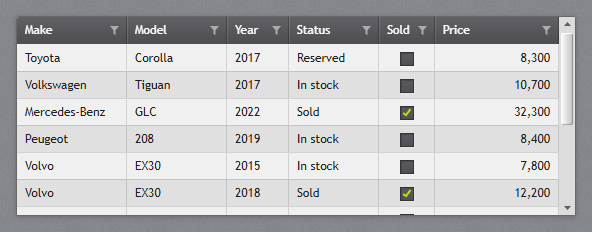
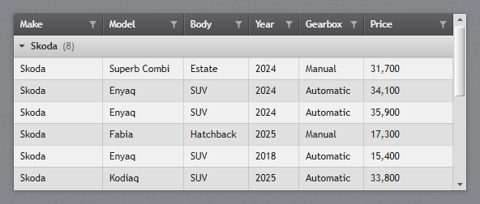
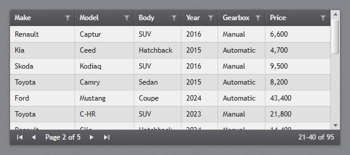

# Lists and data

The lists select one item with the mouse and with the arrow keys, Home and End. The selected item
has `aria-selected="true"`, gets the accent selection, and the list raises `jp-change` with the
selected element (the item, or the `<tr>` of a grid). With `name`, a hidden input posts the selected
item's `value` (or its text).

## ListBox


`jp-list-box` is the white list with the JetPack scroll bar. Give it a height to make it scroll.

```cshtml
<jp-list-box selected-index="1" name="Employee" class="h-32">
    <jp-list-box-item content="Lindsey Ballard" value="17" />
    <jp-list-box-item content="Charles Hoyle" value="23" />
    <jp-list-box-item value="31"><b>Daniel</b> Tiedemann</jp-list-box-item>
</jp-list-box>
```

```html
<div class="jp-list-box h-32" role="listbox" tabindex="0" data-jp-name="Employee">
    <div class="jp-list-box-item" role="option" aria-selected="false" data-value="17">Lindsey Ballard</div>
    <div class="jp-list-box-item" role="option" aria-selected="true" data-value="23">Charles Hoyle</div>
    <div class="jp-list-box-item" role="option" aria-selected="false" data-value="31"><b>Daniel</b> Tiedemann</div>
    <input type="hidden" name="Employee" value="23">
</div>
```

| Attribute | Default | Description |
| --- | --- | --- |
| `selected-index` | -1 | the selected item |
| `name` | | posts the selected value |
| `dark` | `false` | the dark list for flyouts and dark panels |

`jp-list-box-item` takes `content` (or the element's content), `value` and `is-enabled`.

## ListView with GridView


`jp-list-view` is a `ListView` with a `GridView`: a white list with column headers, filled from
`items` as `ItemsSource`. Each `jp-grid-view-column` shows one property.

```cshtml
<jp-list-view items="Model.Timesheets" selected-index="2" height="150">
    <jp-grid-view-column header="Employee" display-member-binding="Employee" width="150" />
    <jp-grid-view-column header="Department" display-member-binding="Department" width="110" />
    <jp-grid-view-column header="Hours" display-member-binding="Hours" width="70" />
</jp-list-view>
```

```html
<div class="jp-list-view" style="height:150px;" tabindex="0">
    <table data-jp-selection="single">
        <thead><tr><th style="width:150px">Employee</th><th style="width:110px">Department</th><th style="width:70px">Hours</th></tr></thead>
        <tbody>
            <tr aria-selected="false"><td>Charles Hoyle</td><td>Consulting</td><td>37.5</td></tr>
            …
        </tbody>
    </table>
</div>
```

It takes the attributes of `jp-data-grid` below; the column takes `display-member-binding` in place
of `binding`.

## TreeView


`jp-tree-view` is the dark tree with bold items. An item with children gets the [+]/[−] box, which
is a `<details>`, so it folds without script; a click on the text selects the item without folding it.

```cshtml
<jp-tree-view name="Month" class="h-44">
    <jp-tree-view-item header="Contoso" is-expanded="true">
        <jp-tree-view-item header="August 2026" value="2026-08" />
        <jp-tree-view-item header="September 2026" value="2026-09" is-selected="true" />
    </jp-tree-view-item>
    <jp-tree-view-item header="Fabrikam">
        <jp-tree-view-item header="May 2026" value="2026-05" />
    </jp-tree-view-item>
</jp-tree-view>
```

```html
<ul class="jp-tree-view h-44" role="tree" data-jp-name="Month">
    <li><details open>
        <summary><span class="jp-tree-view__item" role="treeitem" aria-selected="false">Contoso</span></summary>
        <ul role="group">
            <li><span class="jp-tree-view__item" role="treeitem" aria-selected="false" data-value="2026-08">August 2026</span></li>
            <li><span class="jp-tree-view__item" role="treeitem" aria-selected="true" data-value="2026-09">September 2026</span></li>
        </ul>
    </details></li>
    …
</ul>
```

| Attribute | Description |
| --- | --- |
| `name` | `jp-tree-view`: posts the selected item's value |
| `header` | `jp-tree-view-item`: the text |
| `is-expanded` | `jp-tree-view-item`: open when the page loads |
| `is-selected` | `jp-tree-view-item`: the selected item |
| `value` | `jp-tree-view-item`: the posted value |

## DataGrid


`jp-data-grid` is a read-only grid with the dark JetPack header, alternating rows and the accent
selection, filled from `items`. With a height the rows scroll under a sticky header. As in WPF, a
click on a column header sorts the rows and the columns can be resized; see
[Sorting and resizing](#sorting-and-resizing).

```cshtml
<jp-data-grid items="Model.Timesheets" selected-index="1" height="190">
    <jp-data-grid-text-column header="Employee" binding="Employee" sort-direction="Ascending" />
    <jp-data-grid-text-column header="Department" binding="Department" width="110" />
    <jp-data-grid-text-column header="Hours" binding="Hours" string-format="N1" width="60" horizontal-alignment="Right" />
    <jp-data-grid-text-column header="Week" binding="Week" width="50" />
</jp-data-grid>
```

```html
<div class="jp-data-grid-host" style="height:190px;">
    <table class="jp-data-grid" data-jp-selection="single">
        <thead><tr>
            <th aria-sort="ascending">Employee</th>
            <th style="width:110px">Department</th>
            <th style="width:60px">Hours</th>
            <th style="width:50px">Week</th>
        </tr></thead>
        <tbody>
            <tr aria-selected="false"><td>Charles Hoyle</td><td>Consulting</td><td class="jp-data-grid__number" data-sort-value="37.5">37.5</td><td data-sort-value="43">43</td></tr>
            …
        </tbody>
    </table>
</div>
```

| Attribute | Default | Description |
| --- | --- | --- |
| `items` | | the rows, any `IEnumerable` (`ItemsSource`) |
| `selected-index` | -1 | the selected row |
| `height` | | height in pixels; the rows scroll under the header |
| `selection-mode` | `Single` | `Single` or `None` |
| `can-user-sort-columns` | `true` | `false`: a header click does not sort (`data-jp-sort="false"`) |
| `can-user-resize-columns` | `true` | `false`: the columns keep their widths (`data-jp-resize="false"`) |

| Column attribute | Description |
| --- | --- |
| `header` | the header text |
| `binding` | the property of each item to show |
| `width` | a pixel width; `*` or nothing for the rest |
| `string-format` | a .NET format, such as `N1` or `d`, in the request's culture |
| `horizontal-alignment` | `Right` for numbers |
| `sort-direction` | `Ascending` or `Descending`: the sort arrow in the header; the rows are already in that order |
| `sort-member-path` | the property to sort by, when it is not `binding` |
| `can-user-sort` | `false`: this header does not sort |
| `can-user-resize` | `false`: this column keeps its width |

### Sorting and resizing

`jetpack.js` gives every `table.jp-data-grid` the column behaviour of a WPF `DataGrid`, also tables
you write yourself:

- A click on a header sorts the rows ascending, the next click descending; the arrow shows the
  order (`aria-sort`). Shift+click sorts by one more column. Enter and Space sort the focused
  header. The selected row stays selected, and the `tfoot` stays where it is.
- Text sorts in the browser's language with numbers in it in number order (`Item 9` before
  `Item 10`), and plain numbers as numbers. A cell with `data-sort-value` sorts by that value
  instead: `jp-data-grid` writes it for numbers, dates (ISO 8601) and enums, so formatted values
  sort right in every culture. Give it to formatted cells in tables you write yourself.
- Drag the right edge of a header to resize its column; a double-click there fits the column to
  its content. The first drag fixes every column at its width; after that only the dragged column
  changes (down to 20px) and the columns to its right move along. An empty header after the last
  column fills the room that is left, and when the columns need more room than there is, the grid
  scrolls sideways. Cut-off text ends in an ellipsis.
- `data-jp-sort="false"` and `data-jp-resize="false"` on the table, or on one `<th>`, turn either off.
  A header that holds a link is left to the link, for grids that sort on the server.

Before it sorts, the table raises `jp-sorting` (cancelable) with `{ column, header, direction }` in
`event.detail`; call `preventDefault()` to sort somewhere else, such as on the server. After it,
`jp-sorted` gives the sort columns as a list of the same objects.

```js
grid.addEventListener('jp-sorting', e => {
    e.preventDefault();
    location.search = `?sort=${e.detail.column}&dir=${e.detail.direction}`;
});
```

The grid does not edit. For rows that open a page, write the table yourself (or in a loop) and
give each `<tr>` a `data-href`: a click opens the address, Ctrl+click opens it in a new tab, and
links or buttons in the row still work on their own.

```cshtml
<div class="jp-data-grid-host">
    <table class="jp-data-grid">
        <thead><tr><th>Name</th><th>Title</th></tr></thead>
        <tbody>
        @foreach (var e in Model.Employees)
        {
            <tr data-href="@Url.Action("Edit", new { e.Id })"><td>@e.Name</td><td>@e.Title</td></tr>
        }
        </tbody>
    </table>
</div>
```

## JetPackGrid



`jp-jetpack-grid` is the web version of [`jp:JetPackGrid`](../lists.md#jetpackgrid), for lists that
people need to narrow down. It has the same rules as the WPF grid:

- **Search:** every word must be found in a row, in any searchable column, ignoring case. The hits
  are drawn in the accent colour and their cells turn grey. Quotes keep a phrase together.
- **Value filter per column:** the funnel in a header opens a box for values the column must equal,
  or ranges for numbers and dates. A column of dates gets a tree of years, months and days to tick.
- **Three-state sorting:** a header click sorts ascending, then descending, then back to the source
  order. Shift+click sorts by more columns.
- **Grouping** by a column, with a header row per group that folds up.
- **Paging** with the pager below the rows.
- Single or extended selection with the mouse and the keys, frozen columns on the left, and columns
  that resize by their header's right edge.

The tag helper writes the header and the rows into the page as JSON: each cell as it is shown
(formatted on the server, in the request's culture), plus the value for numbers, dates and check
boxes, which sorting and ranges use. `jetpack.js` draws every row of the page shown. That suits up to
a few thousand rows; for more, page the grid or let the server do the work in
[server mode](#server-mode).

```cshtml
<jp-text-box id="Search" watermark="Search, e.g. volvo estate automatic" clear-text-button="true" />

<jp-jetpack-grid id="Cars" items="Model.Cars" page-size="100" search-box="Search" frozen-column-count="2" class="h-[600px]">
    <jp-jetpack-grid-column header="Make" binding="Make" width="100" />
    <jp-jetpack-grid-column header="Body" binding="Body" width="85" filter-text="estate suv" />
    <jp-jetpack-grid-column header="Mileage (km)" binding="Mileage" string-format="N0" width="108" text-alignment="Right" is-searchable="false" />
    <jp-jetpack-grid-column header="Registered" binding="Registered" string-format="d" width="96" text-alignment="Right" />
    <jp-jetpack-grid-check-box-column header="Sold" binding="IsSold" width="56" />
</jp-jetpack-grid>
```

```html
<div class="jp-jetpack-grid h-[600px]" id="Cars" data-jp-culture="en-US" data-jp-search-box="Search" data-jp-page-size="100" data-jp-frozen-column-count="2">
    <div class="jp-jetpack-grid__viewport" tabindex="0">
        <table class="jp-jetpack-grid__table" role="grid">
            <thead><tr>
                <th data-binding="Make" data-type="text" data-width="100">Make</th>
                <th data-binding="Body" data-type="text" data-width="85" data-filter-text="estate suv">Body</th>
                <th data-binding="Mileage" data-type="number" data-width="108" data-string-format="N0" data-align="right" data-searchable="false">Mileage (km)</th>
                …
            </tr></thead>
            <tbody></tbody>
        </table>
    </div>
    <script type="application/json" class="jp-jetpack-grid__items">[["Volvo","SUV",["88,539",88539],["9/20/2015","2015-09-20"],false], …]</script>
</div>
```

The grid takes the height its parent gives it (in a flex column, give it `flex: 1`), or `height`.
Its columns scroll sideways inside it, so a wide grid never widens the page. The web demo's
*JetPackGrid* tab shows 3,000 cars in 21 columns, searched for `volvo automatic` with the *Body*
column filtered to `estate suv`:



### Search hits

The words of the search are drawn in the accent colour, and a cell with a hit gets a grey
background up to the grid lines. In a selected row the grey is left out and the hits take the row's
text colour. The two colours are CSS variables on the grid, which `highlight-foreground` and
`highlight-cell-background` set (`none` turns a part off):

```css
#Cars {
    --jp-jetpack-grid-highlight-foreground: firebrick;   /* default: var(--jp-accent-solid) */
    --jp-jetpack-grid-highlight-cell-background: transparent;   /* default: var(--jp-data-grid-search-hit) */
}
```

As in WPF, the row the mouse is over takes the accent at 25 %, and a selected row the accent
gradient behind the cells' dark text.

### Header filter



When the box opens, the grid reads the column's values from every row. With at most
`filter-list-limit` different values (20 by default) they are listed with their row counts to
tick; a column with more values only gets the text box. Ticking writes the value into the text,
typing a value ticks it, and typed values that are not in the list stay in the text.

The values and ranges are those of the WPF grid ([Header filter](../lists.md#header-filter)):
values separated by spaces, commas or semicolons; quotes keep a value with spaces together; `*`
matches any text (`vol*`, `*tron`); `>50000`, `<=2019`, `2016..2018` and `2020-03..` compare the value
itself, not the text the cell shows. A date can be a year, a month (`2020-03`), a day (`2020-03-15`)
or the page culture's own form (`3/15/2020` in en-US), and stands for all of it.

The rows are filtered while you type, after `search-delay`. Enter, Escape or *Done* closes the box,
and *Clear* empties it. A funnel turns accent-coloured while its column has a filter.

#### Dates



A column of `DateTime`, `DateTimeOffset` or `DateOnly` values gets a tree instead of the tick list:
years with their months and days, each with its row count, under decades when the years span ten or
more, and *(blank)* for rows without a date. Ticking a year or a month ticks every day in it; a
partly ticked node opens when the box opens again. The ticked days go into the column's
`filter-dates`, and a row must also pass the typed values.

### Check box column



`jp-jetpack-grid-check-box-column` shows a `bool` as the JetPack check box. The filter lists the
values as `true-text` and `false-text` ("Yes" and "No"), so `filter-text="yes"` keeps the ticked
rows. The search leaves the column out unless `is-searchable="true"`.

### Groups



`group-member-path` groups the rows by the column with that binding. Each group gets a header row with
the value and its row count, which folds the group up when clicked. The groups come in the order of
their first row, the rows keep the sort within each group and alternate their background, and folded
groups stay folded until `group-member-path` changes.

### Paging



With `page-size`, the pager appears when more rows than that pass the search and the filters. Sorting
and grouping apply to all rows; the pages are cut from the sorted rows, and a group can continue on
the next page. A new search, filter or sort goes back to the first page, and a row selected on one
page is deselected when another is shown.

### Server mode

With `items-source-url`, the rows stay on the server. For each page, and for the values of a filter
box, the grid posts a `JetPackGridRequest` (page, page size, search, filters, sort, grouping, and its
columns' bindings and formats) and draws the `JetPackGridResponse` that comes back. The tag helper
then writes no rows into the page. `JetPackGridServer.Query` answers from rows in memory with the
same rules as the browser:

```cshtml
<jp-jetpack-grid items-source-url="@Url.Content("~/api/cars")" page-size="100" search-box="Search">
    <jp-jetpack-grid-column header="Make" binding="Make" width="100" />
    …
</jp-jetpack-grid>
```

```csharp
app.MapPost("/api/cars", (JetPackGridRequest request) => JetPackGridServer.Query(cars, request));
```

- The browser names the columns it wants, so `Query` reads only bindings you allow: the ones you
  list (`Query(cars, request, "Make", "Model", "Price")`), or else the public properties of the item
  type itself, not nested paths. Hand it view models, not entities with fields the page must not
  see. Formats that would build huge strings are ignored.
- For a database, write the endpoint yourself from the request (its `Columns`, `Sorts`, `SearchText`
  and each column's `FilterText` and `FilterDates`) and send back the same response: the page's
  `Rows` (one cell per column, in the form above), `TotalCount`, `FilteredCount`, `PageIndex`, and
  `Groups` while grouped. For a filter box, `ValuesFor` names the column, and the response holds its
  `Values` (or `Dates` for a column of dates) instead of rows.
- `grid.itemsSource` can also be a function `(request) => response` (or a promise of one), for a
  transport of your own. MVC's antiforgery token on the page is sent as the `RequestVerificationToken`
  header.
- The grid is `aria-busy` while a page is on its way (its rows dim after a moment), a newer request
  wins over one still on its way, and a failed request raises `jp-load-failed` and keeps the rows shown.

### Attributes

| Attribute | Default | Description |
| --- | --- | --- |
| `items` | | the rows, any `IEnumerable` (`ItemsSource`) |
| `items-source-url` | | server mode: the address the grid posts its requests to |
| `search-text` | | the search when the page loads |
| `search-box` | | the id of a text box whose text is the search (`SearchText` bound to it) |
| `search-delay` | 300 | milliseconds after the last change to the search or a filter before the rows are filtered |
| `filter-list-limit` | 20 | a filter box lists the values to tick when the column has at most this many; 0 never |
| `group-member-path` | | the binding of the column to group by |
| `page-size` | 0 | rows per page; 0 shows every row |
| `page-index` | 0 | the page shown, from 0 |
| `selected-index` | -1 | the selected row, among the rows shown |
| `selection-mode` | `Single` | `Single`, `Extended` (Ctrl, Shift, Ctrl+A) or `None` |
| `frozen-column-count` | 0 | columns on the left that stay when the others scroll sideways |
| `height` | | height in pixels |
| `can-user-sort-columns`, `can-user-resize-columns` | `true` | `false` turns header sorting or resizing off |
| `highlight-foreground`, `highlight-cell-background` | | CSS colours of the search hits; `none` for none |

| Column attribute | Description |
| --- | --- |
| `header`, `binding` | the header text and the property shown (a dotted path reads nested properties) |
| `width` | a pixel width; `*` for the rest of the row |
| `string-format` | a .NET format such as `N0` or `d`, or a composite one such as `{0} hp` |
| `text-alignment` | `Right` for numbers, or `Center` |
| `sort-direction` | `Ascending` or `Descending`: the order the rows start in |
| `can-user-sort`, `can-user-resize` | `false` for this column |
| `is-searchable` | `false` leaves the column out of the search (`false` by default on the check box column) |
| `is-filterable` | `false` hides the funnel |
| `filter-text` | the values of the header filter |
| `filter-dates` | the days a column of dates must be one of (`IEnumerable<DateTime?>`; null for rows without a date) |
| `true-text`, `false-text` | the check box column's texts of its values ("Yes", "No") |

### Script

`JetPack.jetpackGrid(elementOrId)` gives the grid's API:

| Member | Description |
| --- | --- |
| `searchText` | get or set the search; follows the `search-box` both ways |
| `groupMemberPath`, `pageSize`, `pageIndex`, `selectionMode` | get or set, as the attributes |
| `sorts` | get or set the sort as `[{ binding, direction }]`, first column first (`SortDescriptions`) |
| `pageCount`, `isPaging`, `isGrouped`, `isFiltered` | read only |
| `filteredItemCount`, `totalItemCount` | rows left after the search and filters; rows in all |
| `items` | get or set the rows. Setting takes plain objects keyed by the columns' bindings, which the grid formats in the page's culture, and leaves server mode. Reading gives such objects (`{ Make: "Volvo", Price: 41400, Registered: "2025-03-14" }`) |
| `itemsSource` | get or set server mode: a URL, a function, or `null` for the rows in the page |
| `selectedItem`, `selectedItems`, `selectedIndex` (set) | the selection |
| `getFilterText(column)`, `setFilterText(column, text)`, `setFilterDates(column, days)` | a column's filter; a column is its binding, header or index |
| `clearFilters(column?)` | clears one column's filter, or the search and every filter |
| `applyFilters()` | filters at once instead of after `search-delay`, back to the first page |
| `refresh()` | reads the rows again, keeping the page |
| `getVisibleItems()` | the rows left after the search and filters, in the order shown; with paging every page's (in server mode only the page shown) |
| `expandAllGroups()`, `collapseAllGroups()` | unfold or fold every group |

| Event | `event.detail` |
| --- | --- |
| `jp-filtered` | `{ count, totalCount }` after the rows were filtered |
| `jp-page-changed` | `{ pageIndex, pageCount }` when another page is shown |
| `jp-selected-item-changed` | `{ oldValue, newValue }` (row objects, or `null`) |
| `jp-sorting` | before a header click sorts; cancelable; `{ column, binding, direction }` |
| `jp-sorted` | after it sorted; a list of `{ column, binding, direction }` |
| `jp-load-failed` | server mode: `{ error }` when a request failed |

```js
const cars = JetPack.jetpackGrid('Cars');
document.getElementById('Cars').addEventListener('jp-filtered', e => {
    status.textContent = `Showing ${e.detail.count} of ${e.detail.totalCount} cars`;
});
groupBy.addEventListener('change', () => { cars.groupMemberPath = groupBy.value; });
```

## Calendar


`jp-calendar` is the month view with the year and decade views behind the header: click the title
to go up a level, and the arrows to move a month (or a year, a decade). Today is marked grey and the
selected date green. The arrow keys move between the days.

```cshtml
<jp-calendar selected-date="@DateTime.Today" />
```

```html
<div class="jp-calendar" data-selected-date="2026-10-26"></div>
```

| Attribute | Description |
| --- | --- |
| `selected-date` | the selected date |
| `display-date` | the month shown first (default: the selected month, or this month) |

`jetpack.js` writes the header and the days. Choosing a day raises `jp-change` with a `Date`, and
`data-selected-date` holds it as `yyyy-MM-dd`.

## ScrollViewer and ScrollBar


Every scroll bar on the page has the JetPack look in Chromium browsers (Edge, Chrome): the light
track, the glossy thumb and the arrow buttons. Firefox gets the colours only. `jp-scroll-viewer` is a
scrolling box with WPF's scroll bar settings:

```cshtml
<jp-scroll-viewer horizontal-scroll-bar-visibility="Auto" class="h-40">…</jp-scroll-viewer>
```

```html
<div class="jp-scroll-viewer h-40" style="overflow-x:auto;overflow-y:auto;" tabindex="-1">…</div>
```

| Attribute | Default | Description |
| --- | --- | --- |
| `horizontal-scroll-bar-visibility` | `Disabled` | `Auto`, `Visible`, `Hidden` or `Disabled` |
| `vertical-scroll-bar-visibility` | `Auto` | the same |
| `thin` | `false` | `JetPack.Styles.ScrollViewer.Thin`, below |


`thin="true"` gives the thin accent bar of `JetPack.Styles.ScrollViewer.Thin`: it shows while the box
scrolls or the mouse is near its edge, and hides 1.5 s later.
