# Navigation and layout

## TabControl

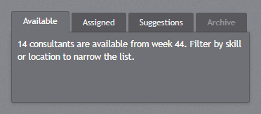

`jp-tab-control` has three looks, as in WPF. The default is the panel with tabs on top: the selected
tab joins the panel below it, the others are dark. The content fills the control's height when you
give it one.

```cshtml
<jp-tab-control class="h-40">
    <jp-tab-item header="Available">14 consultants are available from week 44.</jp-tab-item>
    <jp-tab-item header="Assigned">…</jp-tab-item>
    <jp-tab-item header="Archive" is-enabled="false" />
</jp-tab-control>
```

```html
<div id="jp-tabs-1" class="jp-tab-control h-40" data-selection-animation="slide" data-content-transition="none">
    <div class="jp-tab-control__header">
        <div class="jp-tab-control__strip" role="tablist">
            <button type="button" class="jp-tab-item" role="tab" id="jp-tabs-1-tab-0" aria-controls="jp-tabs-1-panel-0" aria-selected="true" tabindex="0">Available</button>
            <button type="button" class="jp-tab-item" role="tab" id="jp-tabs-1-tab-1" aria-controls="jp-tabs-1-panel-1" aria-selected="false" tabindex="-1">Assigned</button>
            <button type="button" class="jp-tab-item" role="tab" … disabled>Archive</button>
            <span class="jp-tab-control__notch" aria-hidden="true"></span>
        </div>
    </div>
    <div class="jp-tab-control__content" role="tabpanel" id="jp-tabs-1-panel-0" aria-labelledby="jp-tabs-1-tab-0">14 consultants are available from week 44.</div>
    <div class="jp-tab-control__content" role="tabpanel" id="jp-tabs-1-panel-1" aria-labelledby="jp-tabs-1-tab-1" hidden>…</div>
    …
</div>
```

| Attribute | Default | Description |
| --- | --- | --- |
| `tab-control-style` | `Default` | `Default` (panel), `Strip` or `Navigation`, below |
| `selected-index` | 0 | the selected tab (or `is-selected` on a `jp-tab-item`) |
| `selection-animation` | `Slide` | `TabControlHelper.SelectionAnimation`: how the notch moves to the selected tab: `Slide`, `Drop` or `None` |
| `content-transition` | `None` | `TabControlHelper.ContentTransition`: `None` or `Fade` |
| `use-hash` | `false` | keeps the selected tab in the address (`#name`), so a link or a reload opens that tab |
| `id` | generated | the id of the control; the tabs and panels get ids from it |

| `jp-tab-item` attribute | Description |
| --- | --- |
| `header` | the tab text |
| `name` | a stable key for the tab: its ids, and the `#name` of `use-hash` |
| `is-selected` | the selected tab |
| `is-enabled` | `false` shows the tab dimmed |
| `class` | goes on the tab's content panel |

Click a tab, or use the arrow keys, Home and End in the strip. Selecting a tab raises `jp-change`
with `{ index, header, name }`. From script:

```js
const tabs = document.getElementById('Pages');
tabs.jetpack.select('sdk');       // by name, header or index
tabs.jetpack.selectedIndex;       // 1
```

### Navigation bar

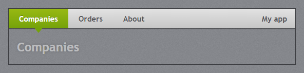

`tab-control-style="Navigation"` is the full-width light bar of the original theme's navigation
template: large tab headers, the selected one in the accent with the notch under it, and the content
below with no frame. `jp-tab-control-tag` is the TabControl's `Tag`, shown at the right end of the bar
(the app name, a logo).

```cshtml
<jp-tab-control tab-control-style="Navigation">
    <jp-tab-control-tag><b>My app</b></jp-tab-control-tag>
    <jp-tab-item header="Companies" name="companies">…</jp-tab-item>
    <jp-tab-item header="Orders" name="orders">…</jp-tab-item>
</jp-tab-control>
```

```html
<div id="…" class="jp-tab-control jp-tab-control--navigation" …>
    <div class="jp-tab-control__header">
        <div class="jp-tab-control__strip" role="tablist">… <span class="jp-tab-control__notch" aria-hidden="true"></span></div>
        <div class="jp-tab-control__tag"><b>My app</b></div>
    </div>
    …
</div>
```

### Strip

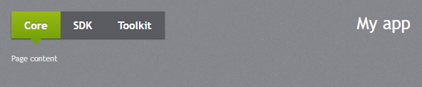

`tab-control-style="Strip"` is the dark strip of the demo, with the `Tag` at the right. It is the
page switcher of the web demo. Both bar looks leave the content unframed.

## HamburgerMenu

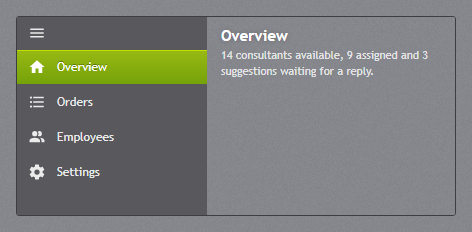

`jp-hamburger-menu` is the dark navigation pane with an icon and a label for each page; the button at
the top folds it to the icons. It works in two ways.

**As the window's navigation.** Put it in `.jp-window__body`, before the content, and give the items
an `href`. Each page marks its own item with `is-selected` (or `aria-current="page"`). Folding the pane
is remembered in the browser for all pages, and narrow windows (640 px or less) start folded.

```cshtml
<div class="jp-window__body">
    <jp-hamburger-menu>
        <jp-hamburger-menu-item content="Dashboard" icon="ViewGrid" href="/" is-selected="@(page == "Dashboard")" />
        <jp-hamburger-menu-item content="Employees" icon="AccountMultiple" href="/employees" is-selected="@(page == "Employees")" />
    </jp-hamburger-menu>
    <main class="jp-window__content">@RenderBody()</main>
</div>
```

```html
<nav class="jp-hamburger-menu" aria-label="Pages">
    <button type="button" class="jp-hamburger-menu__toggle" data-jp-toggle-pane aria-expanded="true" aria-label="Show page names"><svg class="jp-icon" …></svg></button>
    <a class="jp-hamburger-menu__item" href="/" title="Dashboard" aria-current="page"><svg class="jp-icon" …></svg><span class="jp-hamburger-menu__label">Dashboard</span></a>
    …
</nav>
```

**As a control with its own pages.** When the items have content and no `href`, the tag helper writes
the pane and a content area beside it, and clicking an item shows its content, as the control does in
a WPF window. Give it a size.

```cshtml
<jp-hamburger-menu selected-index="0" class="h-52">
    <jp-hamburger-menu-item content="Overview" icon="Home"><h5>Overview</h5>…</jp-hamburger-menu-item>
    <jp-hamburger-menu-item content="Settings" icon="Cog">…</jp-hamburger-menu-item>
</jp-hamburger-menu>
```

| Attribute | Default | Description |
| --- | --- | --- |
| `selected-index` | -1 | the selected item (or `is-selected` on an item) |
| `is-pane-open` | `true` | `false` starts folded to the icons |
| `pane-width` | 190 | the width of the open pane in pixels |

| `jp-hamburger-menu-item` attribute | Description |
| --- | --- |
| `content` | the label |
| `icon` | a `JetPackIconKind` |
| `href` | makes the item a link |
| `is-selected` | the selected item |

A check box or toggle switch with `data-jp-pane-switch` folds and opens the window's pane as well
(the demo's Settings flyout has one). To fold a pane that is not directly in `.jp-window__body`, mark
it `data-jp-window-pane`.

## Expander

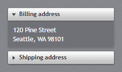

`jp-expander` is a `<details>`: the light header with the arrow, and the content in a dark panel
below it. It folds without script.

```cshtml
<jp-expander header="Billing address" is-expanded="true">120 Pine Street<br>Seattle, WA 98101</jp-expander>
```

```html
<details class="jp-expander" open="open">
    <summary>Billing address</summary>
    <div class="jp-expander__content">120 Pine Street<br>Seattle, WA 98101</div>
</details>
```

| Attribute | Default | Description |
| --- | --- | --- |
| `header` | | the header text |
| `is-expanded` | `false` | open |

Use the `toggle` event of `<details>` to react to it.

## Accordion

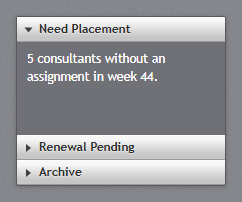

`jp-accordion` puts expanders in one frame, with one open at a time (the expanders share a
`<details name>`). Given a height, the open expander fills it and the closed headers sit at the bottom.

```cshtml
<jp-accordion class="h-44">
    <jp-expander header="Need Placement" is-expanded="true">5 consultants without an assignment.</jp-expander>
    <jp-expander header="Renewal Pending">2 contracts expire on 31 December.</jp-expander>
</jp-accordion>
```

```html
<div class="jp-accordion h-44">
    <details class="jp-expander" open="open" name="jp-accordion-1"><summary>Need Placement</summary><div class="jp-expander__content">…</div></details>
    <details class="jp-expander" name="jp-accordion-1"><summary>Renewal Pending</summary><div class="jp-expander__content">…</div></details>
</div>
```

## GroupBox

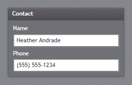

`jp-group-box` is a dark panel with a header strip.

```cshtml
<jp-group-box header="Contact">
    <jp-label content="Name" target="Name" />
    <jp-text-box id="Name" text="Heather Andrade" />
</jp-group-box>
```

```html
<section class="jp-group-box">
    <h2 class="jp-group-box__header">Contact</h2>
    <div class="jp-group-box__content">…</div>
</section>
```

| Attribute | Description |
| --- | --- |
| `header` | the header text |

## Menu, ContextMenu and ToolBar

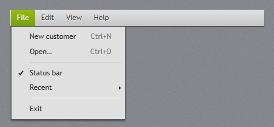

`jp-menu` is the light menu bar. Its `jp-menu-item` children are the top-level headers, and their
children are the menu that opens below them, a popover. Once a menu is open, the mouse opens the
other headers' menus at once; the arrow keys move in a menu, Right opens a submenu and Left closes
it, and Esc closes the menu.

```cshtml
<jp-menu>
    <jp-menu-item header="_File">
        <jp-menu-item header="_New customer" input-gesture-text="Ctrl+N" icon="FilePlus" />
        <jp-separator />
        <jp-menu-item header="Status bar" is-checkable="true" is-checked="true" />
        <jp-menu-item header="Recent">
            <jp-menu-item header="Contoso Corporation" href="/customers/17" />
        </jp-menu-item>
    </jp-menu-item>
    <jp-menu-item header="_Help" />
</jp-menu>
```

```html
<nav class="jp-menu" role="menubar">
    <button type="button" class="jp-menu-item" role="menuitem" popovertarget="jp-submenu-1" aria-haspopup="menu">File</button>
    <div class="jp-context-menu" popover id="jp-submenu-1" role="menu">
        <button type="button" class="jp-menu-item" role="menuitem"><svg class="jp-icon" aria-hidden="true">…</svg><span class="jp-menu-item__header">New customer</span><span class="jp-menu-item__gesture">Ctrl+N</span></button>
        <hr class="jp-menu-separator" />
        <button type="button" class="jp-menu-item" role="menuitemcheckbox" aria-checked="true"><span class="jp-menu-item__header">Status bar</span></button>
        <button type="button" class="jp-menu-item" role="menuitem" aria-haspopup="menu" data-jp-submenu="jp-submenu-2"><span class="jp-menu-item__header">Recent</span></button>
        <div class="jp-context-menu" popover id="jp-submenu-2" role="menu">…</div>
    </div>
    <button type="button" class="jp-menu-item" role="menuitem">Help</button>
</nav>
```

| `jp-menu-item` attribute | Default | Description |
| --- | --- | --- |
| `header` | | the text (an `_` access key marker is dropped) |
| `input-gesture-text` | | the shortcut shown at the right; it only shows the text, it does not bind the key |
| `icon` | | a `JetPackIconKind` in the icon column |
| `is-checkable` | `false` | a check item: a click flips `aria-checked` |
| `is-checked` | `false` | shows the check mark |
| `href` | | makes the item a link |

A click on an item closes the menu; listen for `click` on the items (or use `href`).

### ContextMenu

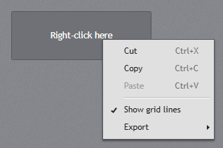

`jp-context-menu` is a menu that opens at the mouse on a right-click. Give it an `id`, and put
`data-jp-context-menu="id"` on the elements it belongs to:

```cshtml
<div data-jp-context-menu="GridMenu">Right-click here</div>
<jp-context-menu id="GridMenu">
    <jp-menu-item header="Copy" input-gesture-text="Ctrl+C" />
    <jp-menu-item header="Paste" input-gesture-text="Ctrl+V" is-enabled="false" />
    <jp-separator />
    <jp-menu-item header="Export"><jp-menu-item header="PDF" /></jp-menu-item>
</jp-context-menu>
```

```html
<div class="jp-context-menu" id="GridMenu" popover role="menu">…</div>
```

The same `.jp-context-menu` is the menu of [SplitButton and DropDownButton](buttons.md#splitbutton).

### ToolBar

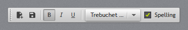

`jp-tool-bar` is the light bar with the grip. In it, buttons are flat until the mouse is over them,
pressed toggle buttons look pressed in, and a `jp-separator` is the vertical separator.
`jp-tool-bar-tray` holds one or more tool bars.

```cshtml
<jp-tool-bar-tray>
    <jp-tool-bar>
        <jp-button tool-tip="Save"><jp-icon kind="ContentSave" /></jp-button>
        <jp-separator />
        <jp-toggle-button is-checked="true"><b>B</b></jp-toggle-button>
        <jp-combo-box selected-index="0" class="!w-28"><jp-combo-box-item content="Trebuchet MS" /></jp-combo-box>
        <jp-check-box content="Spelling" is-checked="true" on-light="true" />
    </jp-tool-bar>
</jp-tool-bar-tray>
```

```html
<div class="jp-tool-bar-tray">
    <div class="jp-tool-bar" role="toolbar"><span class="jp-tool-bar__thumb" aria-hidden="true"></span>
        <button type="button" class="jp-button" data-jp-tool-tip="Save">…</button>
        <span class="jp-tool-bar__separator" role="separator"></span>
        …
    </div>
</div>
```

## StatusBar

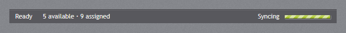

`jp-status-bar` is the dark bar at the bottom of the window, with small text. Items with
`horizontal-alignment="Right"` move to the right end.

```cshtml
<jp-status-bar>
    <jp-status-bar-item>Ready</jp-status-bar-item>
    <jp-status-bar-item content="5 available · 9 assigned" />
    <jp-status-bar-item horizontal-alignment="Right">Syncing <jp-progress-bar is-indeterminate="true" class="!w-20 !h-2" /></jp-status-bar-item>
</jp-status-bar>
```

```html
<footer class="jp-status-bar">
    <span>Ready</span>
    <span>5 available · 9 assigned</span>
    <span class="jp-status-bar__item--right">Syncing <progress class="!w-20 !h-2 jp-progress-bar" max="100"></progress></span>
</footer>
```

| `jp-status-bar-item` attribute | Description |
| --- | --- |
| `content` | the text; without it the element's content is used |
| `horizontal-alignment` | `Right` moves the item (and the ones after it) to the right |

## GridSplitter and Separator

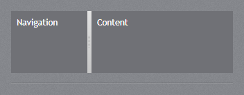

`jp-grid-splitter` goes between two panes of a flex row: dragging it (or the Left and Right keys,
10 px a step) resizes the pane before it, within both panes' `min-width`. `jp-separator` is the etched
horizontal line; in a menu it is the menu separator, and in a tool bar the vertical one.

```cshtml
<div class="flex h-40">
    <div class="flex-1 min-w-24">Navigation</div>
    <jp-grid-splitter />
    <div class="flex-[2] min-w-24">Content</div>
</div>
<jp-separator />
```

```html
<div class="jp-grid-splitter" role="separator" aria-orientation="vertical"></div>
<hr class="jp-separator" />
```

## ToolTip

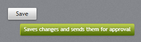

`tool-tip` on any control tag helper, or `jp-tool-tip` on any element, shows the green JetPack call-out
under the pointer after half a second:

```cshtml
<jp-button tool-tip="Saves changes and sends them for approval">Save</jp-button>
<span jp-tool-tip="Hours this week">37.5</span>
```

```html
<button type="button" class="jp-button" data-jp-tool-tip="Saves changes and sends them for approval">Save</button>
<span data-jp-tool-tip="Hours this week">37.5</span>
```

Both write `data-jp-tool-tip`, which you can also set from script. Use it in place of `title`, which
shows the browser's own tool tip.
