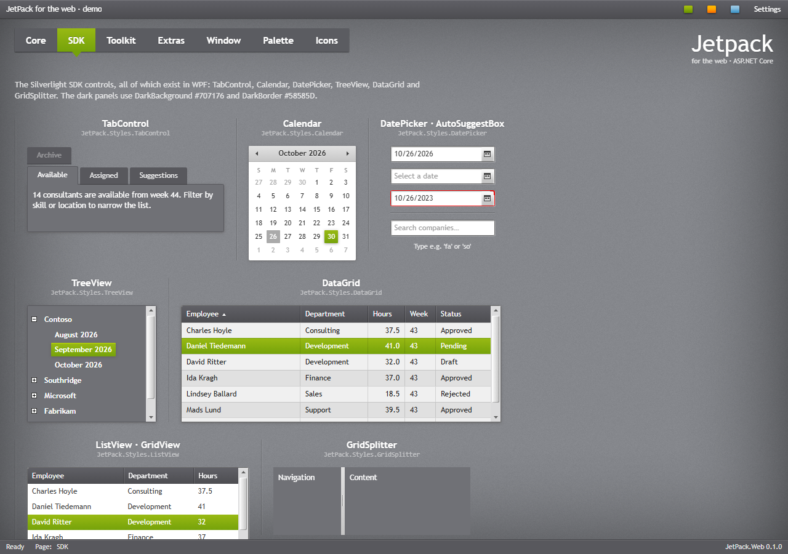
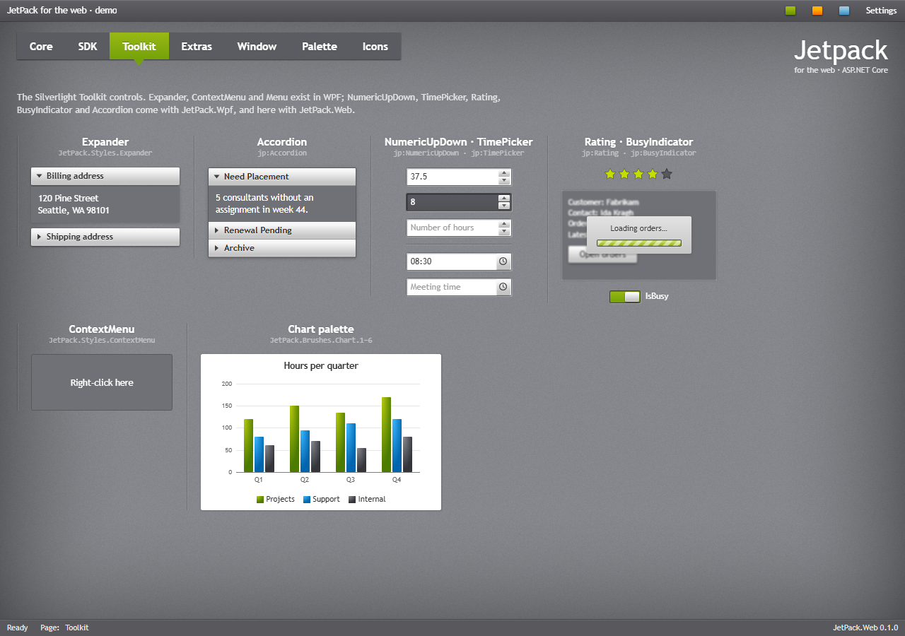
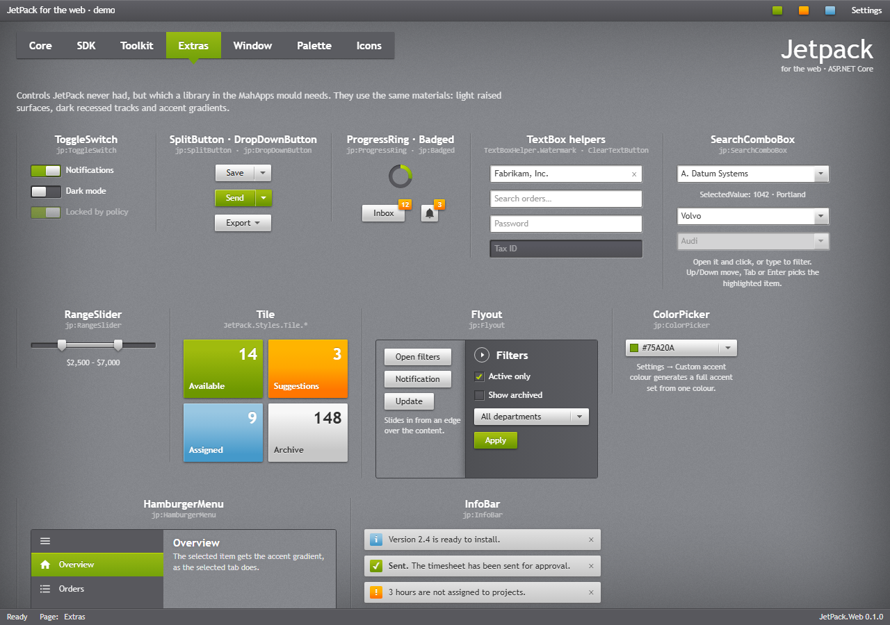
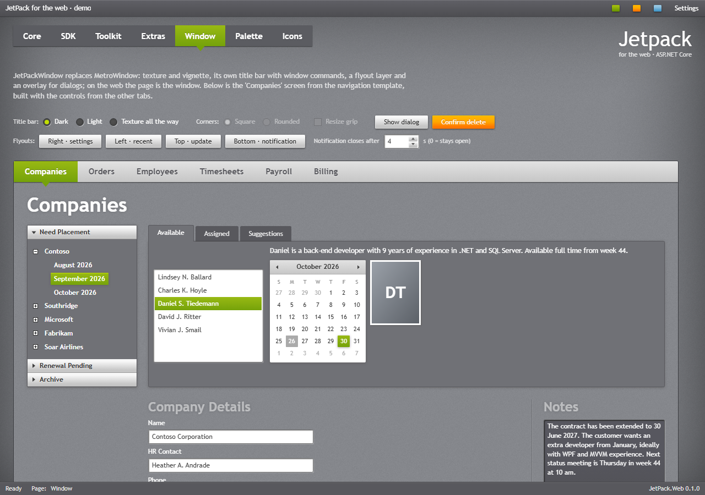
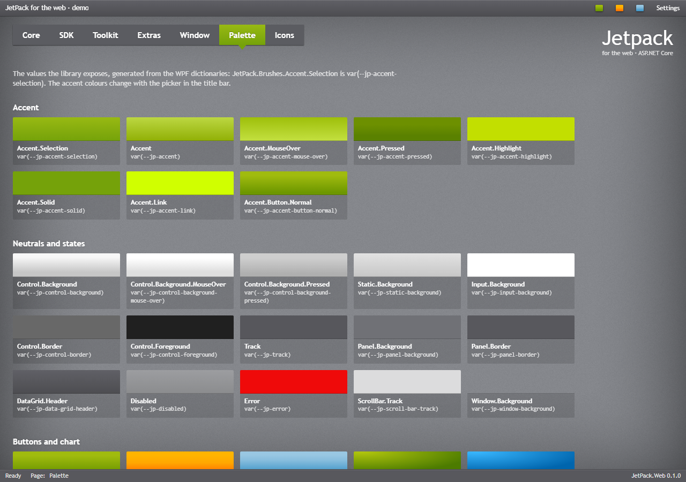
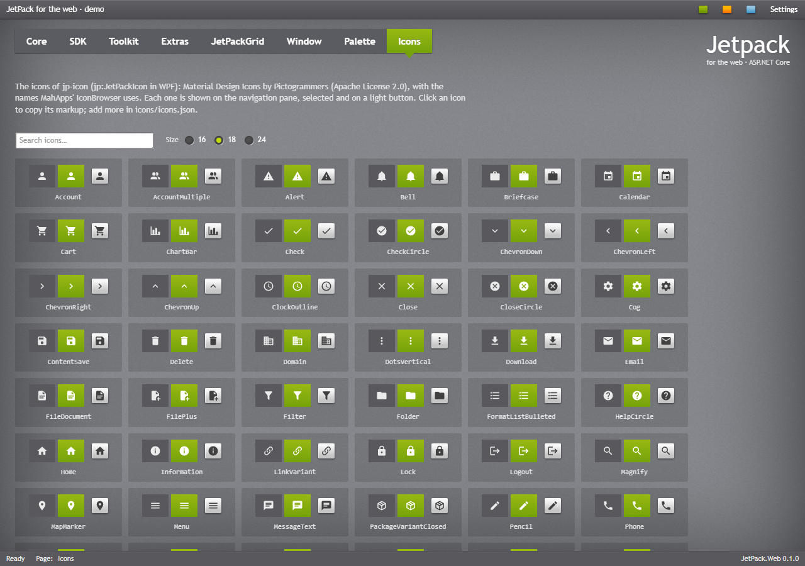
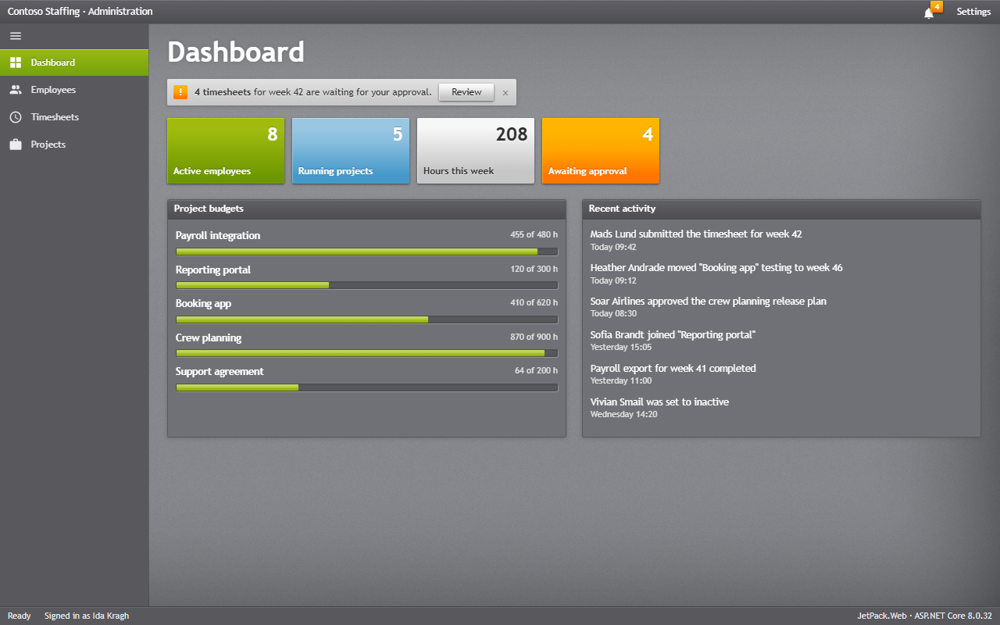
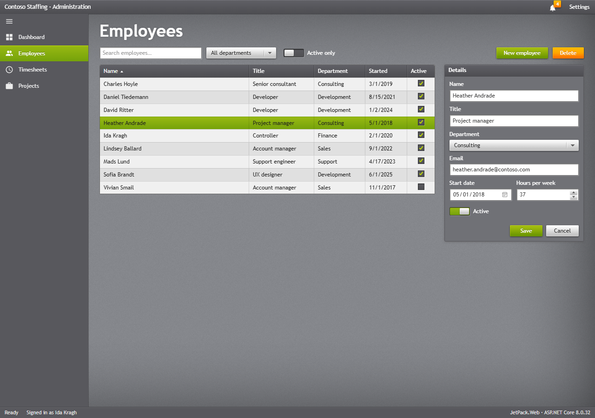
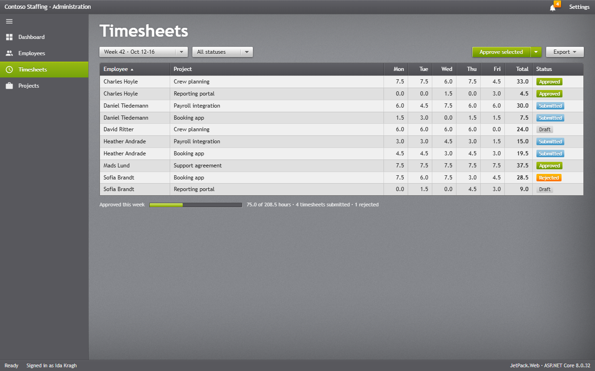
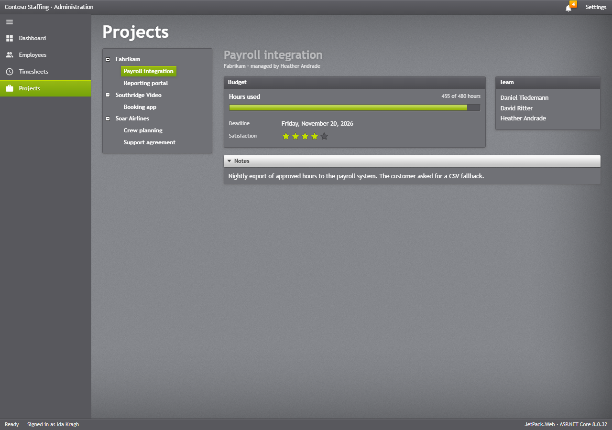

# Demo and samples

## The web demo

`src/JetPack.Web.Demo` is the WPF demo (`src/JetPack.Wpf.Demo`) as a web page: the same tabs, the
same controls in the same places, the same data (it links the WPF demo's `DemoData.cs`), and the
Settings, Recent, Update and Saved flyouts of the window. Each tab is a partial view named after the
WPF UserControl (`Views/Demo/Pages/CorePage.cshtml` ↔ `Views/CorePage.xaml`), and
`wwwroot/js/demo.js` is the code-behind. The JetPackGrid tab is left out; grids of that kind are
better served by a dedicated grid library.

```bash
dotnet run --project src/JetPack.Web.Demo
```














What the browser cannot do the same way: the Window tab's corner style and resize grip, and Mica in
Settings, belong to the desktop window; they are shown disabled. Dates are shown as en-US (M/d/yyyy).

### The gallery page

`/Demo/Gallery` (`Views/Demo/Gallery.cshtml`) shows one sample of each control, with the same names
as the WPF demo's `GalleryPage.xaml`; the pictures on the control pages come from it.
`/Demo/Gallery?shot=<name>` shows one sample on a magenta page, opens what is marked
`data-demo-open` (a drop-down, a menu, a tool tip or a validation call-out), and puts the texture
behind it and its popups. `tools/web_snapshots.py` takes that page with headless Edge and cuts the
picture out by colour, giving `docs/screenshots/web/controls/<name>.png`.

## MVC sample site

`samples/JetPack.Web.Samples.Mvc` is the [WPF administration app](../samples.md) as an ASP.NET Core MVC
site, with the same pages and the same `SampleData.cs`. It shows a site layout with the window frame,
a [HamburgerMenu](navigation.md#hamburgermenu) of links, a badged bell in the title bar and a
Settings flyout. Filters are plain GET forms, and the employee form posts back with server-side
validation and `.jp-validation-message` call-outs; nothing is stored.

```bash
dotnet run --project samples/JetPack.Web.Samples.Mvc
```

| File | Contents |
| --- | --- |
| `Views/Shared/_Layout.cshtml` | the window: title bar, navigation pane, status bar, Settings flyout |
| `Views/<Page>/Index.cshtml` | one view per page |
| `Controllers/PageControllers.cs` | one controller per page; the employees controller takes the form post |
| `Models/PageModels.cs` | the page models |









## Pictures

All the pictures of the web pages come from `python tools/web_snapshots.py`: it builds the demo and
the sample to a scratch folder, runs them, and takes 1280 × 900 pictures of the demo's tabs and the
sample's pages, and one picture per gallery sample, with headless Edge. Endless animations stand
still in the pictures (`?snapshot` on the demo), and a picture is only replaced when its pixels change.
`python tools/update_docs.py` runs it together with the WPF pictures.
