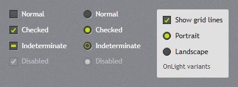
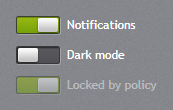
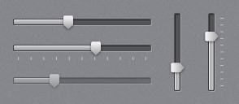
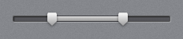

# Selection

## CheckBox and RadioButton



`jp-check-box` and `jp-radio-button` write a `<label>` around a native input, so they post, validate
and take the keyboard as any check box. Checked boxes show the original theme's check mark in the
accent; the third state shows a dash. `on-light="true"` is the variant with dark text for light
surfaces (tool bars, menus).

```cshtml
<jp-check-box asp-for="IsActive" content="Active" />
<jp-check-box content="Indeterminate" is-checked="null" />
<jp-radio-button group-name="Period" value="week" content="Week" is-checked="true" />
<jp-radio-button group-name="Period" value="month" content="Month" />
<jp-check-box content="Show grid lines" is-checked="true" on-light="true" />
```

```html
<label class="jp-check-box"><input type="checkbox" id="IsActive" name="IsActive" value="true" checked="checked" />Active</label>
<label class="jp-check-box"><input data-jp-indeterminate="" type="checkbox" value="true" />Indeterminate</label>
<label class="jp-radio-button"><input type="radio" name="Period" value="week" checked="checked" />Week</label>
<label class="jp-check-box jp-check-box--on-light"><input type="checkbox" value="true" checked="checked" />Show grid lines</label>
```

| Attribute | Default | Description |
| --- | --- | --- |
| `asp-for` | | `jp-check-box`: binds a `bool` (with ASP.NET Core's hidden `false` input) |
| `content` | | the text; without it the element's content is used |
| `is-checked` | `false` | `true`, `false` or `null` (the indeterminate dash) |
| `name`, `value`, `id` | | without `asp-for`; `value` defaults to `true` (check box) or the content (radio button) |
| `group-name` | | `jp-radio-button`: the radio buttons with the same group exclude each other (the `name`) |
| `on-light` | `false` | `JetPack.Styles.CheckBox.OnLight`: dark text for light surfaces |

Use the inputs' own `change` event.

## ToggleSwitch



`jp-toggle-switch` is an on/off switch for a `bool`, posted like a check box. The knob slides, and
the track turns the accent colour when it is on.

```cshtml
<jp-toggle-switch asp-for="Notifications">Notifications</jp-toggle-switch>
<jp-toggle-switch name="DarkMode" content="Dark mode" />
<jp-toggle-switch is-checked="true" is-enabled="false">Locked by policy</jp-toggle-switch>
```

```html
<label class="jp-toggle-switch"><input role="switch" type="checkbox" id="Notifications" name="Notifications" value="true" />Notifications</label>
```

| Attribute | Default | Description |
| --- | --- | --- |
| `asp-for` | | binds a `bool` |
| `content` | | the text; without it the element's content is used |
| `is-checked` | `false` | on |
| `name`, `id` | | without `asp-for` (posts `true` when on) |

## Slider



`jp-slider` has the JetPack track, the accent fill and the glossy thumb. Drag the thumb, click the
track, or use the keys: arrows (`small-change`), Page Up/Down (`large-change`), Home and End.
`orientation="Vertical"` stands it up; give it a height.

```cshtml
<jp-slider value="4" maximum="10" label="Volume" />
<jp-slider value="6" maximum="10" tick-placement="BottomRight" tick-frequency="1" is-snap-to-tick-enabled="true" name="Level" />
<jp-slider orientation="Vertical" value="3" maximum="10" style="height: 96px" />
```

```html
<div class="jp-slider" role="slider" aria-valuemin="0" aria-valuemax="10" aria-valuenow="6" aria-orientation="horizontal"
     data-jp-ticks="1" data-jp-snap="true">
    <div class="jp-slider__track"></div><div class="jp-slider__fill"></div>
    <div class="jp-slider__ticks"></div><div class="jp-slider__thumb"></div>
    <input type="hidden" name="Level">
</div>
```

| Attribute | Default | Description |
| --- | --- | --- |
| `value` | 0 | the value |
| `minimum`, `maximum` | 0, 10 | the range |
| `small-change`, `large-change` | range ÷ 100, ÷ 10 | the steps of the arrow keys and Page Up/Down |
| `orientation` | `Horizontal` | `Horizontal` or `Vertical` |
| `tick-placement` | `None` | `BottomRight` draws ticks under (or right of) the track |
| `tick-frequency` | 1 | the distance between ticks |
| `is-snap-to-tick-enabled` | `false` | the value moves from tick to tick |
| `name` | | adds a hidden input with the value |
| `label` | | text for screen readers (`aria-label`) |

While the value changes the slider raises `input` and `jp-change` with the number; `change` follows
when the drag or key press ends.

## RangeSlider



`jp-range-slider` has two thumbs, for a lower and an upper value. Tab moves from the lower thumb to
the upper one. It takes the attributes of `jp-slider`, with `lower-value` and `upper-value` in place
of `value`:

```cshtml
<jp-range-slider minimum="0" maximum="10000" lower-value="2500" upper-value="7000" small-change="100" name="Price" label="Price" />
```

```html
<div class="jp-range-slider" role="slider" aria-valuemin="0" aria-valuemax="10000" aria-valuenow="7000" data-jp-lower-value="2500" data-jp-small-change="100" …>
    …
    <input type="hidden" name="Price.LowerValue"><input type="hidden" name="Price.UpperValue">
</div>
```

`name` posts two values, `<name>.LowerValue` and `<name>.UpperValue`, which bind to a class with those
two properties. `jp-change` gives `{ lowerValue, upperValue }`.

## Rating


`jp-rating` is a row of stars. Clicking a star sets the value, the stars follow the mouse, and the
arrow keys change it by one. `is-read-only="true"` only shows the value.

```cshtml
<jp-rating value="4" />
<jp-rating value="2" maximum="10" />
<jp-rating value="3" is-read-only="true" />
```

```html
<span class="jp-rating" style="--value: 4; --max: 5;" role="slider" aria-valuemin="0" aria-valuemax="5" aria-valuenow="4" aria-label="Rating" data-jp-input=""></span>
<span class="jp-rating" style="--value: 3; --max: 5;" role="img" aria-label="3 of 5"></span>
```

| Attribute | Default | Description |
| --- | --- | --- |
| `value` | 0 | the number of stars |
| `maximum` | 5 | the number of stars in the row |
| `is-read-only` | `false` | shows the value without input |

A change raises `jp-change` with the new value. The rating does not post; copy the value to a
hidden input in the `jp-change` handler if a form needs it.
