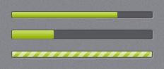
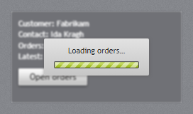
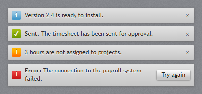

# Progress and status

## ProgressBar



`jp-progress-bar` is a `<progress class="jp-progress-bar">`: the dark track with the accent fill, or
the running accent stripes when it is indeterminate. It is as wide as its container and 10 px
high; set the size with your own classes, as the gallery's second bar does with `!h-[14px]`.

```cshtml
<jp-progress-bar value="75" />
<jp-progress-bar value="3" maximum="8" />
<jp-progress-bar is-indeterminate="true" />
```

```html
<progress class="jp-progress-bar" max="100" value="75"></progress>
<progress class="jp-progress-bar" max="8" value="3"></progress>
<progress class="jp-progress-bar" max="100"></progress>
```

| Attribute | Default | Description |
| --- | --- | --- |
| `value` | 0 | the progress |
| `maximum` | 100 | the value of a full bar |
| `is-indeterminate` | `false` | the running stripes (a `<progress>` without `value`) |

From script, set `value` on the element; remove the attribute (`removeAttribute('value')`) to make it
indeterminate.

## ProgressRing


`jp-progress-ring` is the spinning accent arc on a dark ring, 34 px by default. The ring keeps its
proportions at any size.

```cshtml
<jp-progress-ring />
<jp-progress-ring class="!size-6" />
<jp-progress-ring is-active="false" />
```

```html
<span class="jp-progress-ring" role="progressbar" aria-label="Working" data-active="true"></span>
```

| Attribute | Default | Description |
| --- | --- | --- |
| `is-active` | `true` | `false` hides the ring but keeps its space (`data-active="false"`) |

## BusyIndicator



`jp-busy-indicator` blurs and dims its content and shows a light card with a message and a running
progress bar over it. While it is busy, the content cannot be clicked.

```cshtml
<jp-busy-indicator id="Orders" is-busy="true" busy-content="Loading orders…">
    …the content…
</jp-busy-indicator>
```

```html
<div class="jp-busy-indicator" id="Orders" data-busy="true" aria-busy="true">
    <div class="jp-busy-indicator__content">…the content…</div>
    <div class="jp-busy-indicator__card" role="status">Loading orders…<progress class="jp-progress-bar"></progress></div>
</div>
```

| Attribute | Default | Description |
| --- | --- | --- |
| `is-busy` | `false` | busy when the page loads |
| `busy-content` | `Please wait…` | the message on the card |

There is no script behind it; switch it with the two attributes:

```js
const busy = document.getElementById('Orders');
busy.dataset.busy = 'true';  busy.ariaBusy = 'true';
const orders = await fetch('/api/orders').then(r => r.json());
busy.dataset.busy = 'false'; busy.ariaBusy = 'false';
```

## InfoBar



`jp-info-bar` is a light strip with a coloured severity icon, a bold title and a message. Content
inside the tag helper goes to the right as actions, and the × hides the bar.

```cshtml
<jp-info-bar severity="Success" title="Sent." message="The timesheet has been sent for approval." />
<jp-info-bar severity="Error" title="Error:" message="The connection to the payroll system failed." is-closable="false">
    <jp-button>Try again</jp-button>
</jp-info-bar>
```

```html
<div class="jp-info-bar jp-info-bar--success" role="status">
    <span class="jp-info-bar__icon" aria-hidden="true">✓</span>
    <span><span class="jp-info-bar__title">Sent.</span> The timesheet has been sent for approval.</span>
    <button type="button" class="jp-info-bar__close" data-jp-dismiss aria-label="Close">×</button>
</div>
<div class="jp-info-bar jp-info-bar--error" role="alert">
    <span class="jp-info-bar__icon" aria-hidden="true">!</span>
    <span><span class="jp-info-bar__title">Error:</span> The connection to the payroll system failed.</span>
    <span class="jp-info-bar__actions"><button type="button" class="jp-button">Try again</button></span>
</div>
```

| Attribute | Default | Description |
| --- | --- | --- |
| `severity` | `Info` | `Info`, `Success`, `Warning` or `Error` (`InfoBarSeverity`) |
| `title` | | bold text before the message |
| `message` | | the message |
| `is-closable` | `true` | shows the × |
| `is-open` | `true` | `false` writes the bar `hidden`, to show it from script later |

Closing hides the bar (`hidden`) and raises `jp-close` on it. `data-jp-dismiss` on any button in the
bar does the same. To show it again, remove `hidden`.
