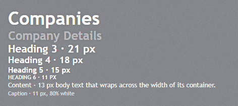
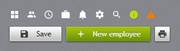

# Typography

## Fonts

The theme uses Trebuchet MS, which ships with Windows and macOS, with Segoe UI and the browser's sans-serif
as fallbacks. The sizes are those of the WPF library:

| Custom property | Value | Used for |
| --- | --- | --- |
| `--jp-font-family` | Trebuchet MS, Segoe UI, sans-serif | the page and all controls |
| `--jp-font-family-heading` | Trebuchet MS, Segoe UI, sans-serif | headings |
| `--jp-font-family-mono` | Consolas, Cascadia Mono, Courier New, monospace | code, keys |
| `--jp-font-size-control` | 12px | controls (`ThemeManager.controlFontSize`) |
| `--jp-font-size-small` | 11px | tool tips, status bar, captions |
| `--jp-font-size-default` | 12.5px | the page (`body`) |
| `--jp-font-size-content` | 13px | body text |
| `--jp-font-size-navigation` | 15px | navigation and strip tab headers |

To use another typeface, set the two family properties after `jetpack.css`:

```css
:root {
  --jp-font-family: "Segoe UI", sans-serif;
  --jp-font-family-heading: "Segoe UI", sans-serif;
}
```

## Text styles



`h1`–`h6` get the JetPack heading styles by themselves. `jp-text-block` writes the right element for
each `JetPack.Styles.TextBlock.*` style, and the classes give the look to any element:

| `text-block-style` | Element and class | Size | Notes |
| --- | --- | --- | --- |
| `Heading1` | `<h1 class="jp-text-block--heading1">` | 36px, bold | page titles; all headings have a soft glow |
| `Heading2` | `<h2 class="jp-text-block--heading2">` | 24px, bold | 50% white, for section titles ("Company Details") |
| `Heading3` | `<h3 class="jp-text-block--heading3">` | 21px, bold | |
| `Heading4` | `<h4 class="jp-text-block--heading4">` | 18px, bold | |
| `Heading5` | `<h5 class="jp-text-block--heading5">` | 15px, bold | column and group titles |
| `Heading6` | `<h6 class="jp-text-block--heading6">` | 11px, bold | |
| `Content` | `<p class="jp-text-block--content">` | 13px | white body text |
| `Caption` | `<p class="jp-text-block--caption">` | 11px | 80% white |

```cshtml
<jp-text-block text-block-style="Heading1" text="Companies" />
<jp-text-block text-block-style="Heading2">Company Details</jp-text-block>
<jp-text-block text-block-style="Caption" text="Updated 10/26/2026" />
```

```html
<h1 class="jp-text-block--heading1">Companies</h1>
<h2 class="jp-text-block--heading2">Company Details</h2>
<p class="jp-text-block--caption" style="margin:0;">Updated 10/26/2026</p>
```

| Attribute | Description |
| --- | --- |
| `text-block-style` | `Default` (a plain `<p>`), `Heading1`–`Heading6`, `Content`, `Caption` |
| `text` | the text; without it the element's content is used |

The class is useful when the heading level and the look differ, for example an `<h2>` that looks like
`Heading5`: `<h2 class="jp-text-block--heading5">`. Headings have no margin; space them with your own
classes. `jp-label` is the form label (see [Label](inputs.md#label)).

## Icons



The icons of `jp:JetPackIcon` in WPF, as an SVG sprite (`img/icons.svg`, one `<symbol>` per icon).
An icon takes the text colour (`currentColor`) and is 16×16 by default, 18×18 in `jp-hamburger-menu`.

```cshtml
<jp-icon kind="ViewGrid" />
<jp-icon kind="Bell" label="Notifications" />   @* label: for an icon that stands alone *@
<jp-button button-style="Square" tool-tip="Print">
    <jp-icon kind="Printer" style="color: var(--jp-control-glyph-dark)" />
</jp-button>
<jp-button button-style="Accent"><jp-icon kind="Plus" class="mr-1.5" />New employee</jp-button>
```

```html
<svg class="jp-icon" aria-hidden="true" focusable="false"><use href="/_content/JetPack.Web/img/icons.svg#view-grid"></use></svg>
<svg class="jp-icon" role="img" aria-label="Notifications" focusable="false"><use href="/_content/JetPack.Web/img/icons.svg#bell"></use></svg>
```

| Attribute | Description |
| --- | --- |
| `kind` | the icon, a `JetPackIconKind` (the same names as in WPF: `ViewGrid`, `AccountMultiple` …) |
| `label` | text for screen readers; without it the icon is hidden from them (`aria-hidden`) |

In the sprite the icons have their MDI names in kebab case (`ViewGrid` → `#view-grid`). Size an icon
with `width` and `height` (or Tailwind's `size-6`); colour it with `color`. On light buttons use
`var(--jp-control-glyph-dark)`, as in WPF.

The *Icons* tab of the web demo shows the whole set; clicking an icon copies its tag helper.


The icons are [Material Design Icons](https://pictogrammers.com/library/mdi/) (Apache License 2.0).
The set is the one listed in
[`icons/icons.json`](https://github.com/Montago/JetPackTheme/blob/master/icons/icons.json), shared
with the WPF library; to add an icon, put its MDI name in that file and run
`python tools/generate_icons.py --fetch`, which writes the sprite and the `JetPackIconKind` enum of
both libraries.
