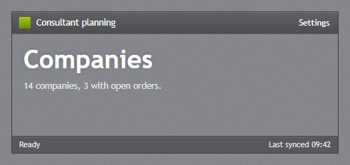
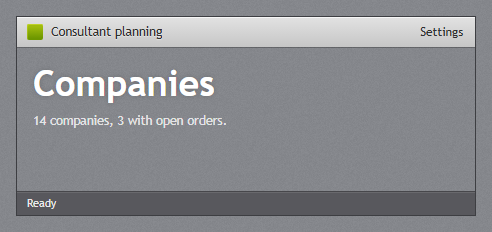
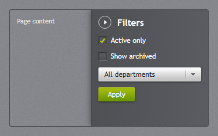
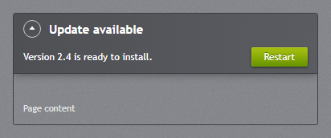
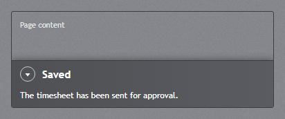
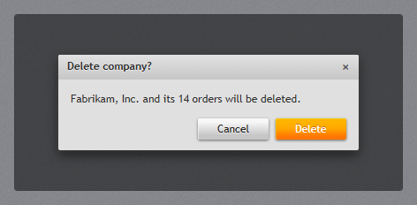

# Window and dialogs

## Window



On the web the page is the window: `body.jp-window` is `JetPackWindow`, with a title bar, a body for
the navigation pane and the content, and a status bar. [Getting started](getting-started.md#the-window-frame)
lists its parts. The frame has no tag helper; write it in the layout:

```html
<body class="jp-window">
    <canvas class="jp-vignette" aria-hidden="true"></canvas>
    <header class="jp-title-bar">
        <span class="jp-title-bar__icon"></span>
        <span class="jp-title-bar__title">Consultant planning</span>
        <div class="jp-window-commands">
            <button type="button" data-jp-open="settings">Settings</button>
        </div>
    </header>
    <div class="jp-window__body">
        <main class="jp-window__content">…</main>
    </div>
    <jp-status-bar>
        <jp-status-bar-item>Ready</jp-status-bar-item>
        <jp-status-bar-item horizontal-alignment="Right">Last synced 09:42</jp-status-bar-item>
    </jp-status-bar>
</body>
```

The window classes also work on any box, as in the picture: give it a height and the same rows.

### Title bar modes



`data-title-bar` on the window is `TitleBarMode`:

| `data-title-bar` | Look |
| --- | --- |
| *(none)* | the dark title bar (default) |
| `light` | the light, embossed bar of the original theme's headers |
| `texture` | no bar of its own: the texture and the vignette run up under the title, which gets a soft glow |

```html
<body class="jp-window" data-title-bar="light">
```

### Window commands

`.jp-window-commands` holds the buttons and links of the title bar (`RightWindowCommands`). They are
flat, in the title colour, and light up when the mouse is over them. The last group in the title bar
goes to the right; a group before the title is `LeftWindowCommands`. Anything fits in them, for
example a [badged](buttons.md#badged) bell:

```html
<div class="jp-window-commands">
    <a href="/timesheets"><span class="jp-badged"><jp-icon kind="Bell" /><span class="jp-badged__badge">4</span></span></a>
    <button type="button" data-jp-open="settings">Settings</button>
</div>
```

### Vignette

`<canvas class="jp-vignette">` draws the dark edges of the window. `jetpack.js` draws it as
`Controls/Vignette.cs` does in WPF, dithered so the gradient does not band, and draws it again when
the window changes size. Leave the canvas out, or hide it, for a window without one.

## Flyouts



`jp-flyout` is a panel that slides in from an edge of the window and lies over the content. Put it
in the window (`body.jp-window`), or in any box with the class `jp-flyout-host`. In the window, the
flyouts start below the title bar.

```cshtml
<jp-flyout id="settings" header="Settings" width="300">
    <jp-check-box content="Active only" is-checked="true" />
    <jp-button button-style="Accent" data-jp-close>Apply</jp-button>
</jp-flyout>

<button type="button" data-jp-open="settings">Settings</button>
```

```html
<aside class="jp-flyout" id="settings" data-position="right" aria-label="Settings" style="width:300px;">
    <header class="jp-flyout__header">
        <button type="button" class="jp-flyout__close" data-jp-close aria-label="Close" data-jp-tool-tip="Close"></button>
        <span>Settings</span>
    </header>
    …
</aside>
```

| Attribute | Default | Description |
| --- | --- | --- |
| `id` | | needed to open the flyout |
| `header` | | the title next to the round close button |
| `position` | `Right` | `Right`, `Left`, `Top` or `Bottom`: the edge it slides in from |
| `width` | 300 | width in pixels, for `Left` and `Right` |
| `is-open` | `false` | open when the page loads |
| `is-closable` | `true` | shows the close button |
| `is-auto-close-enabled` | `false` | closes by itself after `auto-close-interval` |
| `auto-close-interval` | 5000 | milliseconds; the timer starts again when the mouse leaves the flyout |
| `padding` | `12px 14px` | inner spacing, as CSS |





Opening and closing:

- `data-jp-open="id"` on any element opens the flyout, or closes it when it is already open (set
  `data-jp-toggle-open="false"` to only open).
- `data-jp-close` on an element inside closes it; so does Esc (the top flyout first).
- From script: `JetPack.openFlyout('settings')` and `JetPack.closeFlyout('settings')` (an id or the
  element). The flyout raises `jp-open` and `jp-close`.

## Dialogs



`JetPackDialog` and `ShowMessageAsync` are promises in `jetpack.js`. The dialog is a modal
`<dialog class="jp-dialog">` that dims the window below the title bar:

```js
await JetPack.showMessage('Timesheet sent', 'Your timesheet has been sent for approval.');

const result = await JetPack.showDialog({
    title: 'Delete company?',
    content: 'Fabrikam, Inc. and its 14 orders will be deleted.',
    affirmativeText: 'Delete',
    negativeText: 'Cancel',
    affirmativeStyle: 'orange',
});
if (result === 'affirmative') { … }
```

| Option | Default | Description |
| --- | --- | --- |
| `title` | | the header text |
| `content` | | the message (plain text) |
| `affirmativeText` | `OK` | the text of the main button |
| `negativeText` | | a second button; without it the dialog has one button |
| `affirmativeStyle` | `accent` | the main button's variant: `accent`, `green`, `orange` or `blue` |

The promise resolves to `'affirmative'` or `'negative'` (the second button, the × and Esc). The main
button has the focus when the dialog opens.

A dialog of your own, with a form for example, is the same markup in the page:

```html
<dialog class="jp-dialog" id="rename">
    <header class="jp-dialog__header"><span>Rename company</span><button type="button" data-jp-close aria-label="Close">×</button></header>
    <form class="jp-dialog__content" method="dialog">
        <jp-text-box name="Name" text="Fabrikam, Inc." />
        <div class="jp-dialog__buttons">
            <button class="jp-button" value="cancel">Cancel</button>
            <button class="jp-button jp-button--accent" value="ok">Rename</button>
        </div>
    </form>
</dialog>

<jp-button data-jp-open="rename">Rename…</jp-button>
```

`data-jp-open` opens a `<dialog>` with `showModal()`, and `data-jp-close` inside it closes it.

## Differences from WPF

- The browser draws the window's outer frame, so `JetPackWindow`'s corner style, resize grip, Mica
  backdrop and minimise/maximise/close buttons have no web version.
- Flyouts and dialogs need no flyout layer or overlay element: the flyout positions itself in its
  host, and the dialog uses the browser's top layer.
