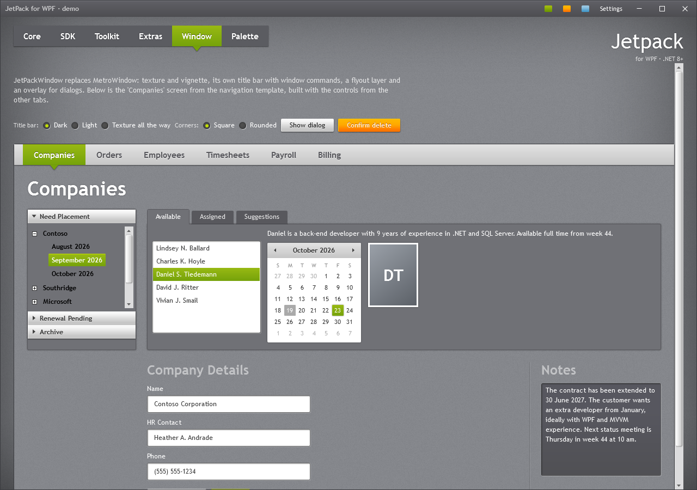
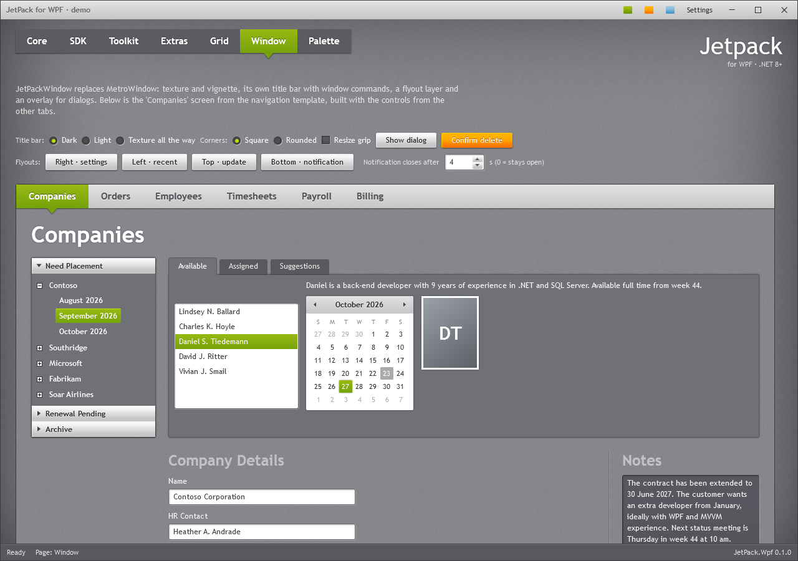
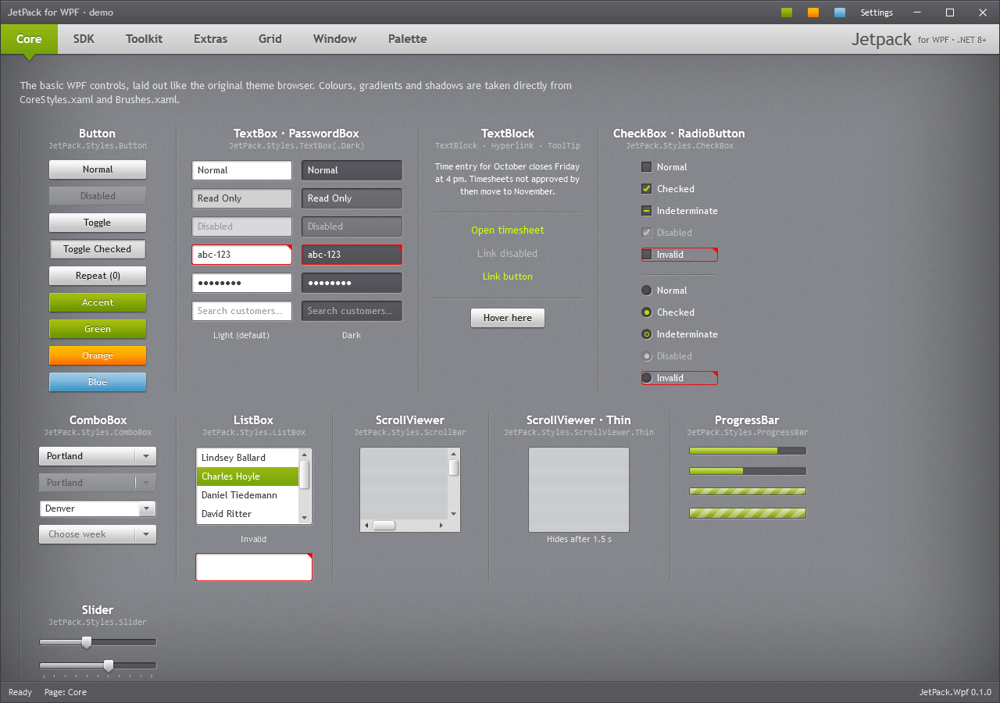
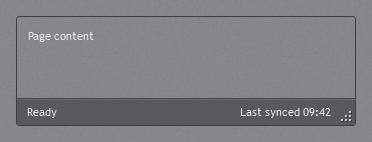
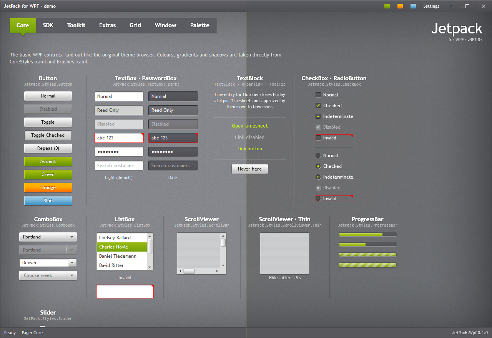
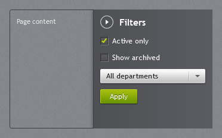
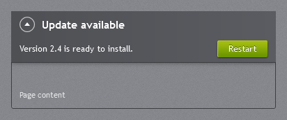
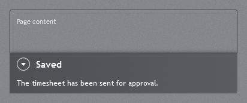
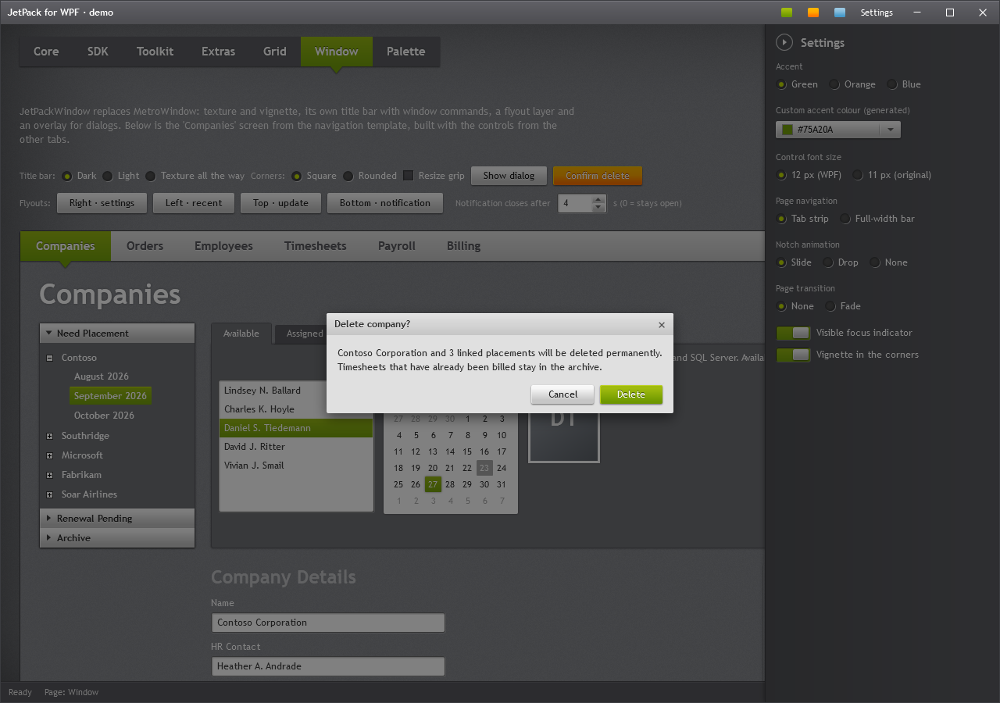
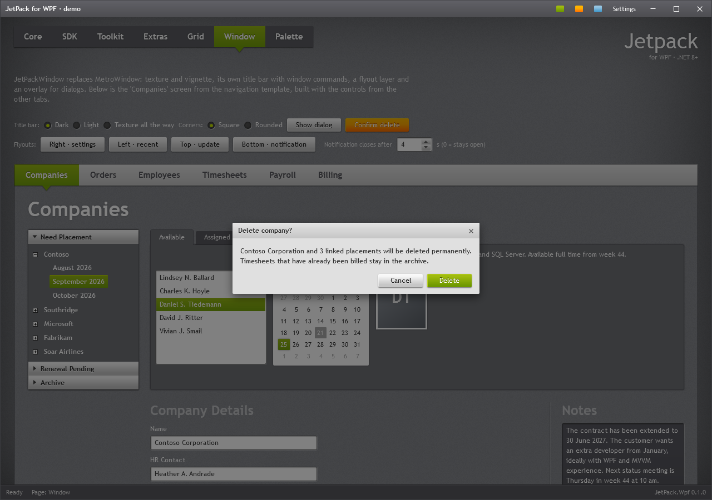

# Window and dialogs



## JetPackWindow

`JetPack.Wpf.Controls.JetPackWindow` derives from `Window` and draws its own frame with
`WindowChrome`: the tiled grey texture, the vignette, a 30px title bar with icon, title, window
commands and caption buttons, a layer for flyouts and an overlay for dialogs. Snapping, resizing and
the system menu keep working.

```xml
<jp:JetPackWindow x:Class="MyApp.MainWindow"
                  xmlns="http://schemas.microsoft.com/winfx/2006/xaml/presentation"
                  xmlns:x="http://schemas.microsoft.com/winfx/2006/xaml"
                  xmlns:jp="urn:jetpack-wpf"
                  Title="Consultant planning" TitleBarMode="Dark" CornerStyle="Rounded">
    <jp:JetPackWindow.RightWindowCommands>
        <StackPanel Orientation="Horizontal">
            <Button Content="Settings" Click="OnSettings" />
            <Button Content="Help" />
        </StackPanel>
    </jp:JetPackWindow.RightWindowCommands>
    ...
</jp:JetPackWindow>
```

### Properties

| Property | Type | Default | Description |
| --- | --- | --- | --- |
| `TitleBarMode` | `TitleBarMode` | `Dark` | `Dark`: grey gradient (the data grid header) with white text. `Light`: the light navigation-bar gradient with dark embossed text. `Texture`: no bar; the texture runs to the top. |
| `CornerStyle` | `WindowCornerStyle` | `Square` | `Rounded` asks the Windows 11 compositor for rounded corners and a frame in the JetPack border colour. Windows 10 keeps square corners. |
| `HasSystemRoundedCorners` | `bool` (read-only) | | True while Windows draws rounded corners; the template then leaves out its own 1px border. |
| `TitleBarHeight` | `double` | 30 | Height of the title bar and of the draggable caption area. |
| `ShowIcon` | `bool` | `true` | Shows `Icon` at the left of the title bar. |
| `ShowVignette` | `bool` | `true` | The darkened edges of the original theme. See [Vignette](#vignette). |
| `EnableMica` | `bool` | `false` | Lets the Windows 11 Mica backdrop show through the ground and the title bar. See [Mica backdrop](#mica-backdrop). |
| `GroundOpacity` | `double` | 0.5 | How much the ground, texture and title bar cover Mica: 0 shows Mica alone, 1 hides it. Only used while Mica is on. Around 0.75 is recommended to keep the JetPack look. |
| `IsMicaActive` | `bool` (read-only) | | True while Windows draws Mica behind the window. |
| `ShowMinButton` | `bool` | `true` | |
| `ShowMaxRestoreButton` | `bool` | `true` | Also hidden when `ResizeMode` is `NoResize` or `CanMinimize`. |
| `LeftWindowCommands` | `object` | `null` | Content after the icon. |
| `RightWindowCommands` | `object` | `null` | Content before the minimise button. |
| `Flyouts` | `object` | `null` | A layer above the window content for `Flyout` panels; usually a `Grid`. |

`Button` and `ToggleButton` inside the window-command areas automatically get the flat title-bar look
(`JetPack.Styles.Button.WindowCommand`) and inherit the title text colour, which follows
`TitleBarMode`.



### Layout tips

The content area is everything under the title bar. Two layouts that match the original navigation
template:

```xml
<DockPanel>
    <StatusBar DockPanel.Dock="Bottom">
        <StatusBarItem Content="Ready" />
        <StatusBarItem HorizontalAlignment="Right" Content="Last synced 09:42" />
    </StatusBar>
    <TabControl Style="{StaticResource JetPack.Styles.TabControl.Navigation}">
        <TabControl.Tag>
            <TextBlock Margin="0,0,16,0" FontSize="15" FontWeight="Bold" Text="My app" />
        </TabControl.Tag>
        <TabItem Header="Companies">...</TabItem>
    </TabControl>
</DockPanel>
```



For the dark tab strip of the original theme browser, use `JetPack.Styles.TabControl.Strip` inside a
margin instead. See [Navigation and layout](navigation.md#tabcontrol).

### Status bar

`JetPackWindow` has no status bar property: the footer is an ordinary `StatusBar` docked at the bottom
of the window content (first child of the `DockPanel`, so it takes the full width), and it gets the
JetPack look from the implicit style. To turn it off, leave it out; to change it, change its items.

```xml
<StatusBar DockPanel.Dock="Bottom">
    <StatusBarItem Content="{Binding StatusText}" />
    <StatusBarItem DockPanel.Dock="Right" Content="{Binding Version}" />
    <StatusBarItem DockPanel.Dock="Right" Content="Last synced 09:42" />
    <StatusBarItem>
        <ProgressBar Width="80" Height="8" IsIndeterminate="{Binding IsBusy}" />
    </StatusBarItem>
</StatusBar>
```

The items are laid out in a `DockPanel`: items dock left in order, and `DockPanel.Dock="Right"` puts
an item at the right end (the first one furthest right). With only one right-hand item,
`HorizontalAlignment="Right"` on the last item does the same. Set `Background`, `Foreground` or
`FontSize` on the `StatusBar` to change its colours or text size, or base your own style on
`JetPack.Styles.StatusBar` / `JetPack.Styles.StatusBarItem`. See also
[StatusBar](navigation.md#statusbar).

### Resizing and the grip



| `ResizeMode` | Resize by the edges | Caption buttons | Grip |
| --- | --- | --- | --- |
| `CanResize` (default) | yes | minimise, maximise | no |
| `CanResizeWithGrip` | no, only by the grip | minimise, maximise | yes |
| `CanMinimize` | no | minimise | no |
| `NoResize` | no | none | no |

Unlike a normal WPF `Window`, where the edges keep working, `CanResizeWithGrip` makes the grip the only
way to resize the window with the mouse; maximising and snapping still work. Use `CanResize` for
resizable edges. The grip is six embossed dots
(`JetPack.Styles.ResizeGrip`, also the implicit `ResizeGrip` style), drawn above the content and the
flyouts, and hidden while the window is maximised. It sits inside the rounded corner when
`CornerStyle="Rounded"`. A `StatusBar` in a window with the grip gets 16px more padding on the right,
so its last item stays clear of the dots.

### Maximised windows

When maximised, the window keeps its content inside the screen's work area (the resize border that
`WindowChrome` hangs over the edge is compensated) and drops its border.

### Vignette

The darkened edges come from a `Vignette` element between the ground and the content. It is drawn in
code: a shade of fixed width along every edge, darker in the corners, with fine noise mixed in so the
gradient shows no bands. Its width does not change with the window size, and it is drawn on whole
device pixels, so resizing does not stretch it.

| Property | Type | Default | Description |
| --- | --- | --- | --- |
| `Reach` | `double` | 180 | How far in from each edge the shade reaches. In a window smaller than two reaches the shades meet in the middle. |
| `Strength` | `double` | 0.3 | Opacity of the shade at the middle of an edge. |

To change it for every window, add an implicit style to the application resources:

```xml
<Style TargetType="jp:Vignette">
    <Setter Property="Reach" Value="240" />
    <Setter Property="Strength" Value="0.25" />
</Style>
```

### Mica backdrop

`EnableMica="True"` asks Windows for the dark Mica backdrop, a soft tint taken from the desktop
wallpaper, and lays the JetPack ground, texture and title bar over it at `GroundOpacity`. The demo has
a switch and a slider for both in its settings flyout.

```xml
<jp:JetPackWindow ... EnableMica="True" GroundOpacity="0.75">
```



*Left half without Mica, right half with Mica at the recommended `GroundOpacity="0.75"`. The tint
comes from the desktop wallpaper, so it differs from one PC to the next; a colourful wallpaper shows
more of it.*

A `GroundOpacity` of around 0.75 is recommended: the grey ground and texture stay in charge and
Mica adds a faint tint. Lower values let more of Mica through, but the window turns darker and moves
away from the original JetPack look. The default of 0.5 is lower so the effect is easy to see when
you first turn it on.

- Mica needs Windows 11 22H2 (build 22621) or later. Elsewhere `IsMicaActive` stays false and the
  window looks as usual.
- Windows shows Mica only while the window is active; an inactive window gets a plain dark fill.
- Mica is drawn by the compositor from a sampled wallpaper, not blurred live, so it costs next to
  nothing. The window does not use `AllowsTransparency`.
- WPF renders text in grey scale instead of ClearType on a see-through window. Text inside clipped or
  effect areas stays grey scale after Mica is turned off again, until the window is reopened.

## Flyouts



Put `Flyout` panels in the `Flyouts` layer. They cover the content area from one of its edges and
slide in when `IsOpen` becomes true:

```xml
<jp:JetPackWindow.Flyouts>
    <Grid>
        <jp:Flyout x:Name="SettingsFlyout" Header="Settings" Width="300">
            <StackPanel>
                <jp:ToggleSwitch Content="Notifications" IsChecked="True" />
            </StackPanel>
        </jp:Flyout>
    </Grid>
</jp:JetPackWindow.Flyouts>
```

```csharp
private void OnSettings(object sender, RoutedEventArgs e) => SettingsFlyout.IsOpen = !SettingsFlyout.IsOpen;
```

| Property | Type | Default | Description |
| --- | --- | --- | --- |
| `IsOpen` | `bool` | `false` | Two-way bindable. |
| `Position` | `FlyoutPosition` | `Right` | `Right`, `Left`, `Top` or `Bottom`; sets the alignment, the slide direction and which way the back button points. |
| `IsClosable` | `bool` | `true` | Shows the round back button next to the header. |
| `Header` | `object` | | Bold title next to the back button. |
| `IsAutoCloseEnabled` | `bool` | `false` | Closes the flyout `AutoCloseInterval` after it opens, as in MahApps. Unlike MahApps, the timer stops while the mouse is over the flyout and starts again when it leaves. |
| `AutoCloseInterval` | `long` | `5000` | Time in milliseconds before an auto-closing flyout closes. |

The panel's faint grey gradient (`Background`) is drawn by a `DitheredFill` element: a
`LinearGradientBrush` becomes a bitmap on whole device pixels with fine noise mixed in, because WPF
draws gradients without dithering and twelve colour steps over 300px would show as bands. Any other
brush you set as `Background` is drawn as it is. `DitheredFill` can be used on its own for other large,
low-contrast gradients:

```xml
<jp:DitheredFill>
    <jp:DitheredFill.Fill>
        <LinearGradientBrush StartPoint="0,0" EndPoint="1,0">
            <GradientStop Color="#FF4F5054" Offset="0" />
            <GradientStop Color="#FF5B5C61" Offset="1" />
        </LinearGradientBrush>
    </jp:DitheredFill.Fill>
</jp:DitheredFill>
```

It follows the brush's stops, start and end points, mapping mode, spread method and opacity, but
not its `Transform` or `RelativeTransform`. The bitmap is made again when the element is resized or
`Fill` is set, not when a brush already in use is changed.

### Top and bottom

`Top` and `Bottom` flyouts span the full width and take the height of their content (the default
`Width` of 300 only applies to `Right` and `Left`). A bottom flyout with `IsAutoCloseEnabled` works
as a short notification; a top flyout without it as a message that stays until it is dismissed, such
as an available update:



```xml
<jp:Flyout x:Name="UpdateFlyout" Position="Top" Header="Update available">
    <DockPanel>
        <Button DockPanel.Dock="Right" Content="Restart" Style="{StaticResource JetPack.Styles.Button.Accent}" />
        <TextBlock Text="Version 2.4 is ready to install." VerticalAlignment="Center" />
    </DockPanel>
</jp:Flyout>
```



```xml
<jp:Flyout x:Name="SavedFlyout" Position="Bottom" Header="Saved"
           IsAutoCloseEnabled="True" AutoCloseInterval="3000">
    <TextBlock Text="The timesheet has been sent for approval." />
</jp:Flyout>
```

Set `IsClosable="False"` on a message the user must not dismiss. The `Flyouts` layer clips its
content, so a top flyout slides out from under the title bar rather than over it.

A `Flyout` works in any `Grid`, not only in the window layer: the demo uses one inside a small panel
on the *Extras* page. The *Window* page has a row of buttons that open a flyout at each edge of the
demo window, with a field for how long the bottom notification stays open.



## Dialogs

Dialogs are shown inside the window, over a 50% black overlay, in the style of the Silverlight
`ChildWindow`: a light title strip, a grey body and the buttons bottom right.

### ShowMessageAsync

```csharp
var result = await window.ShowMessageAsync(
    "Delete company?",
    "Contoso Corporation and 3 linked placements will be deleted permanently.",
    affirmativeText: "Delete",
    negativeText: "Cancel");

if (result == MessageDialogResult.Affirmative) { ... }
```

`MessageDialogResult` is `Affirmative`, `Negative` or `Canceled` (Escape or the close button). Leave
`negativeText` out for a single OK button.

### JetPackDialog

For your own content or button styles, create a `JetPackDialog` and show it with `ShowDialogAsync`:

```csharp
var dialog = new JetPackDialog
{
    Title = "Delete company?",
    Content = "Contoso Corporation and 3 linked placements will be deleted permanently.",
    AffirmativeText = "Delete",
    NegativeText = "Cancel",
    AffirmativeButtonStyle = (Style)FindResource("JetPack.Styles.Button.Orange"),
};
var result = await window.ShowDialogAsync(dialog);
```

| Property | Type | Default | Description |
| --- | --- | --- | --- |
| `Title` | `string` | | Text in the title strip. |
| `Content` | `object` | | String content wraps; any element can be used. |
| `AffirmativeText` | `string` | `OK` | Main button (default button, Enter). |
| `NegativeText` | `string?` | `null` | Second button (cancel button); hidden when null. |
| `AffirmativeButtonStyle` | `Style` | `Button.Accent` | E.g. `JetPack.Styles.Button.Orange` for a destructive action. |

Call `dialog.Close(result)` from your own content to close it with a result. Focus returns to the
element that had it before the dialog opened.



## Plain Window

To keep the system title bar but use the JetPack background and fonts:

```xml
<Window Style="{StaticResource JetPack.Styles.Window}" ... />
```
